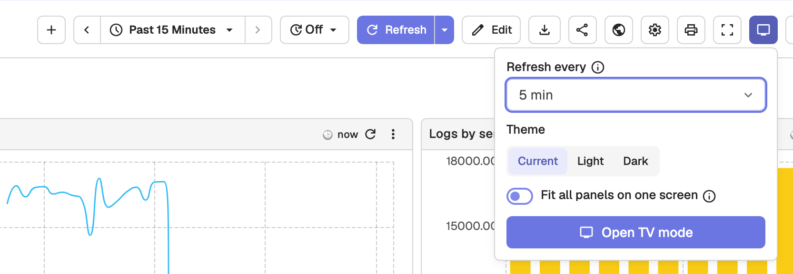
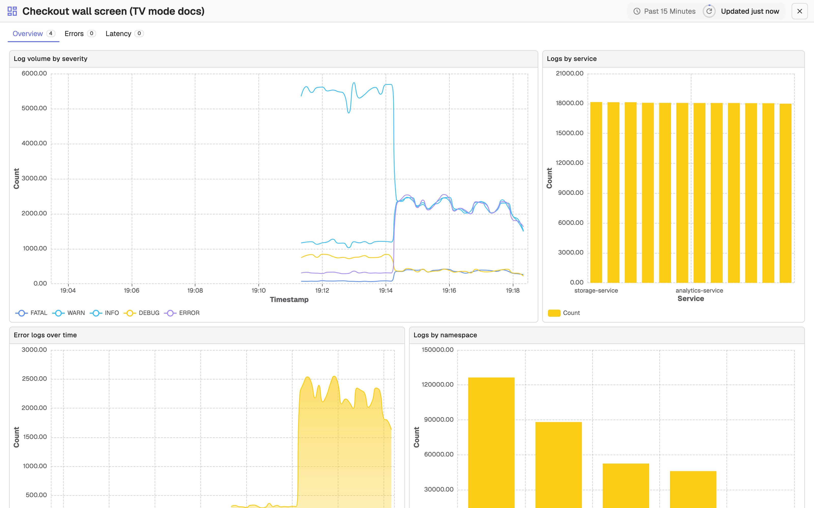

# Dashboard TV Mode

TV mode turns a dashboard into a wall-screen view. The app header, sidebar, and dashboard toolbar disappear, panels become view-only, and the dashboard refreshes itself on a schedule. To rotate several dashboards on one screen, use a TV playlist instead.

## Open a dashboard in TV mode

Open a dashboard and click the **TV mode** icon in the dashboard toolbar. A setup popover opens.

The popover offers:

- **Refresh every**: how often the TV reloads data (Off, 30 sec, 1 min, 5 min, 15 min, 30 min, 1 hr). It defaults to the dashboard's current refresh interval, or 5 minutes when auto-refresh is off. Intervals below the server's minimum auto-refresh interval are disabled.
- **Theme**: **Current**, **Light**, or **Dark**, applied to this screen only.
- **Fit all panels on one screen**: shrinks panels to the screen height so nothing scrolls. Off by default.

Click **Open TV mode**. The dashboard switches to TV mode in the same tab, with `kiosk=true` in the URL and keeps the current relative time range, tab, and variable values. A compact header replaces the app chrome.

The header shows:

- The dashboard name and time range.
- A countdown ring until the next refresh, which spins while panels load. Hover over it to see the time of the next refresh.
- An **Updated** label such as "Updated 2m ago". Hover over it to see the exact time.
- A status chip, only when something needs attention: failing panels, a hung query, stale data, the backend being unreachable, or auto-refresh being off.
- An exit button (**Exit TV mode**), which is always visible. Pressing **Esc** or the browser's **Back** button also leaves TV mode.

Tabs and variables sit in one compact row under the header and stay usable. A variable change applies immediately.

## TV mode URL parameters

To link straight into TV mode, for example from a TV's browser, add query parameters to a dashboard URL:

| Parameter | Values | Effect |
|-----------|--------|--------|
| `kiosk` | `true` or `1` | Turns on TV mode: hides the app chrome and makes panels view-only. |
| `refresh` | A duration such as `30s`, `5m`, or `1h` | How often the dashboard reloads. Values below the server's minimum auto-refresh interval are raised to it. |
| `theme` | `light` or `dark` | Forces a theme on this screen only. |
| `fit` | `true` or `1` | Scales the grid so all panels fit on one screen. |

For example, append `&kiosk=true&refresh=5m&theme=dark` to a dashboard URL.

## How TV mode keeps the screen current

While in TV mode, the dashboard recovers from problems on its own:

- A query that hangs is cancelled and the refresh is forced.
- If the backend is down, OpenObserve retries with backoff and recovers when the backend is back.
- Refresh pauses while the browser tab is hidden and resumes when it becomes visible.
- A panel that fails shows its error inside the panel.

When you leave TV mode after entering it from the toolbar, the dashboard returns to the refresh interval it had before.
