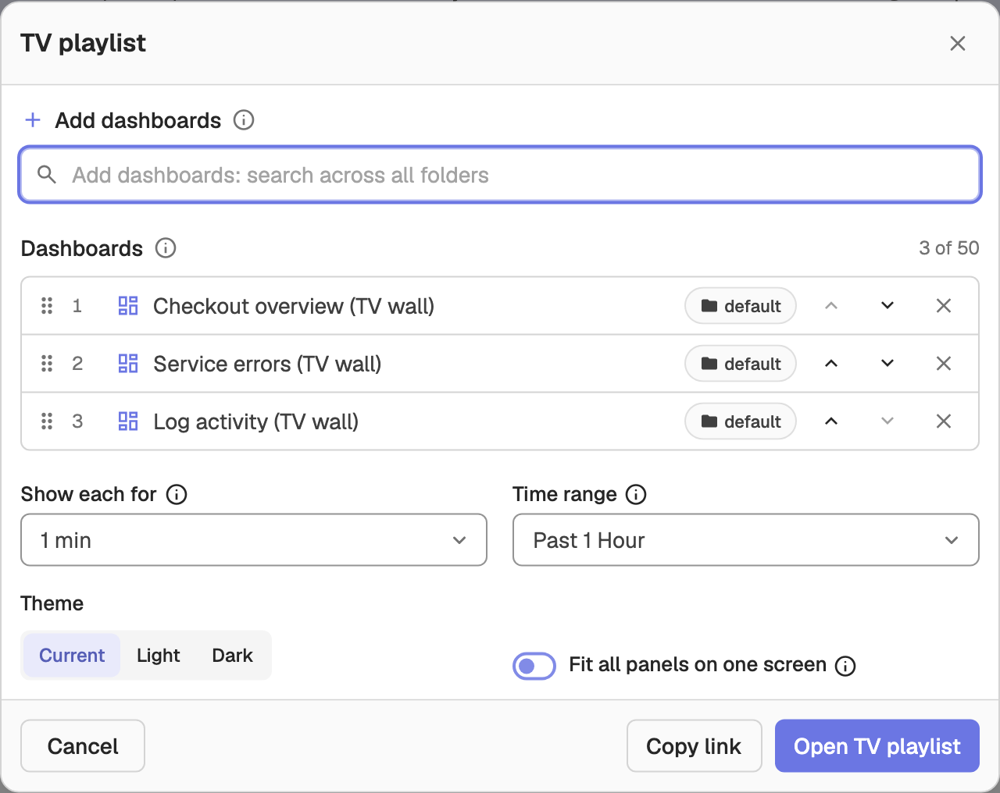
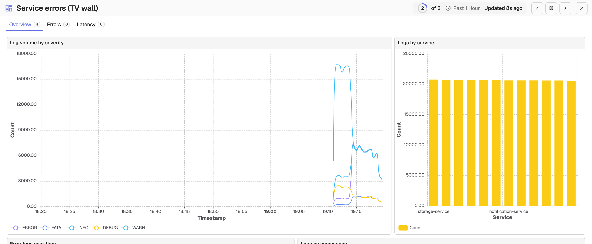

# TV Playlist

A TV playlist rotates a set of dashboards on a wall-mounted TV, showing each one for a set duration, with a compact header for pausing, stepping and exiting. Playlists are not saved objects: you build one from the dashboard list and open it in a new tab, or share it as a link.

## Create a TV playlist

1. Go to **Dashboards** from the left menu.
2. Use the checkboxes to select the dashboards to rotate. The playlist follows the order in which you tick them.
3. Click **TV playlist** in the bar that appears above the list.

The **TV playlist** dialog opens with the selected dashboards already in the playlist.

### Add and reorder dashboards

- Under **Add dashboards**, search across all folders and click **Add** next to a result. Each result shows its folder.
- The **Dashboards** list shows the playlist in order. Drag the grip icon, or use the **Move up** and **Move down** arrows, to change the order.
- Click the **Remove** (x) icon to drop a dashboard. A playlist can hold up to 50 dashboards.

### Rotation settings

| Setting | Options | Default |
|---------|---------|---------|
| **Show each for** | `10s` to `1h` | `1m` |
| **Time range** | **Each dashboard's own default**, or one range for all dashboards: `15m`, `1h`, `6h`, `24h` or `7d` | `1h` |
| **Theme** | **Current**, **Light** or **Dark** | **Current** |
| **Fit all panels on one screen** | Shrinks panels to the screen height so nothing scrolls | Off |

Click **Open TV playlist** to launch the player in a new tab, or **Copy link** to copy the playlist URL and open it in the TV's browser. The link carries the dashboards, their order, the interval, time range, theme and fit setting, so anyone with access to those dashboards can open it directly.

## Use the player

The player runs at a URL of the form `/web/dashboards/tv?org_identifier=<org>&playlist=<dashboard_id>:<folder_id>,…&interval=1m&slide=1`. The `slide` parameter tracks the dashboard on screen, so reloading the page, or a TV that reboots, resumes on the same dashboard. An `interval` outside 10 seconds to 1 hour is adjusted to the nearest allowed value.

The header shows the current dashboard name, a countdown ring with its position (for example `2 of 5`), the time range, and when the data was last updated. The controls are always visible:

- **Previous dashboard** / **Next dashboard** step between dashboards (or press the **Left** / **Right** arrow keys).
- **Pause rotation** / **Resume rotation** freezes and restarts the rotation (or press **Space**).
- **Exit** returns to the dashboard list (or press **Esc**).

Each dashboard opens on its first tab with its own variable defaults. Its tab bar and variables stay visible but read-only.

## Behavior

- The next dashboard loads in the background, so switching is instant.
- Data reloads as each dashboard comes up, and every 5 minutes while one stays on screen.
- If the backend becomes unreachable, the player holds the current dashboard, shows **Backend unreachable**, and resumes on its own when the backend answers again.
- Deleted dashboards, and dashboards you no longer have access to, are skipped. A panel that fails to load shows its error inside the panel only.
- If a proxy blocks the dashboards from loading inside the player, the player falls back to loading one full dashboard page per slide.
