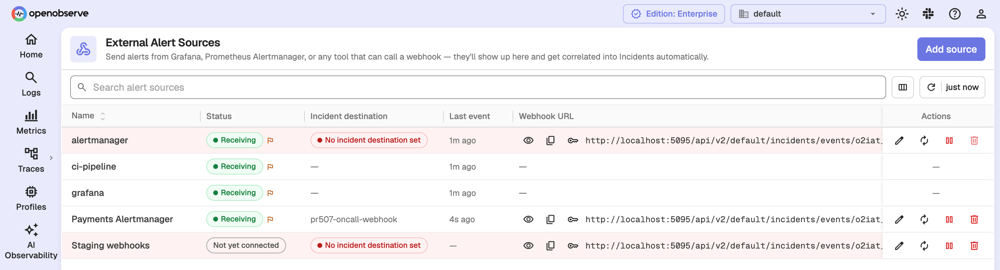
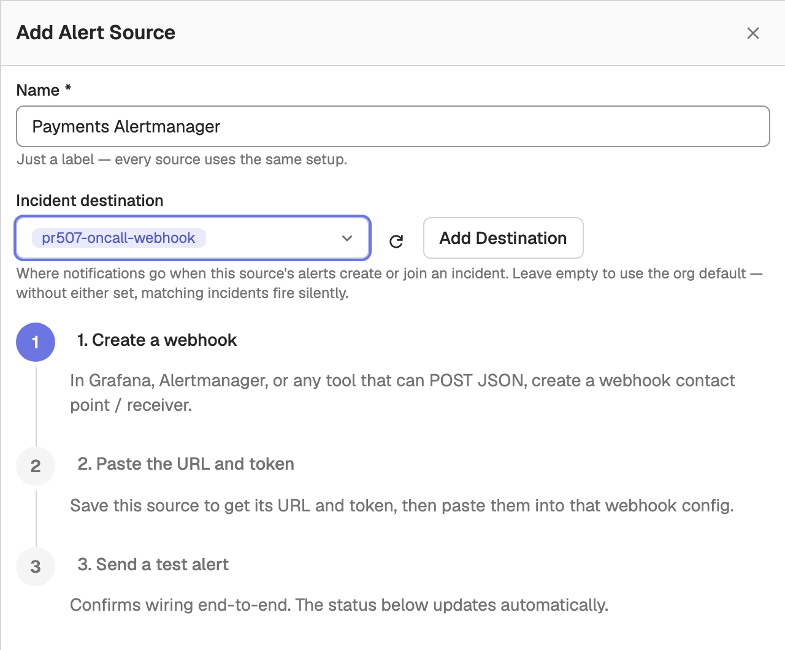
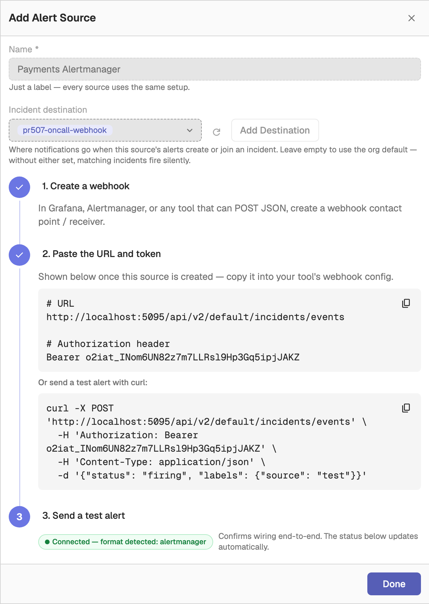
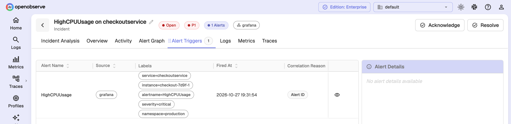
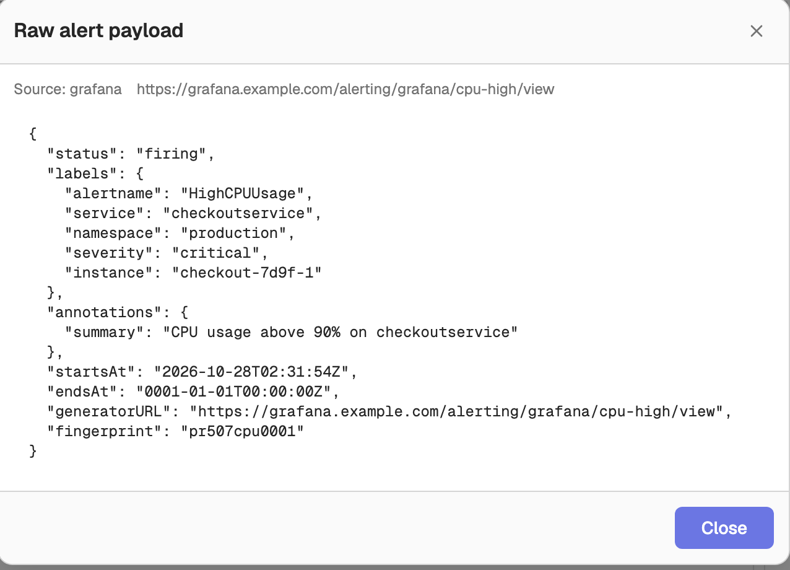

OpenObserve can receive alerts from external monitoring systems such as Grafana, Prometheus Alertmanager, or any tool that can POST a JSON webhook. It correlates them into incidents alongside the alerts OpenObserve evaluates itself.

:::info[Availability]
This feature is available in Enterprise and Cloud editions. On self-hosted Enterprise it requires incidents to be enabled with `O2_INCIDENTS_ENABLED=true` (default `false`).
:::

## Overview

When an external system sends an alert to an alert source's webhook URL, OpenObserve:

1. Authenticates the request with the alert source's `o2iat_` token.
2. Detects the payload format (Grafana, Alertmanager, or generic JSON).
3. Normalizes the payload: status, severity, labels, timestamp, and deduplication key.
4. Stores the alert and correlates it into an incident with the same correlation engine that groups OpenObserve alerts.
5. Resolves the incident automatically once every external alert in it has reported `resolved`.

Every organization has a **default** alert source that accepts any supported format. You can add more alert sources, for example to give each upstream system its own token or incident destination.

## Prerequisites

- OpenObserve Enterprise or Cloud.
- Incidents enabled (`O2_INCIDENTS_ENABLED=true` on self-hosted Enterprise).
- Permission on the `incidents` resource. Managing alert sources uses the same permission as managing incidents.

## Open External Alert Sources

In the left navigation, go to **Reliability** > **External Alert Sources**.



Each row shows the source **Name**, **Status**, **Incident destination**, **Last event**, and **Webhook URL**, with actions on the right.

## The default alert source

OpenObserve creates the default alert source for each organization the first time the page or the list API is opened. The default source:

- Has its own webhook URL and `o2iat_`-prefixed token.
- Detects the payload format automatically, so any supported sender can use it.
- Cannot be deleted. Disable it instead if you do not want to accept alerts through it.

When several upstream systems send through the default source's token, each sender appears as its own row. A sender is named after the `source` label of its alerts, or after the detected format (`grafana`, `alertmanager`, `generic`) when there is no such label. Only the first of these rows carries the URL and token actions, because they all share one token.

## Add an alert source

1. Click **Add source**.
2. Enter a **Name**. It is only a label; every source uses the same setup.
3. Optionally choose an **Incident destination**. This is where notifications go when this source's alerts create or join an incident. Leave it empty to use the organization default. If neither is set, matching incidents are created without a notification.
4. Click **Save**.

   

After saving, step 2 of the drawer shows the URL and the `Authorization` header to paste into the sending system, plus a `curl` command that sends a test alert. Step 3 shows **Waiting for first event…** until the first alert arrives, then **Connected — format detected:** with the detected format. Click **Done** to close the drawer.



Alert sources created from the UI detect the format automatically. To pin a source to one format, create it through the [API](#create-an-alert-source) with `source_type`.

## Webhook URL and authentication

Each alert source has a webhook URL that embeds its token:

```
https://<your-openobserve-host>/api/v2/<org_id>/incidents/events/<o2iat_token>
```

Senders that support custom headers can instead POST to `/api/v2/<org_id>/incidents/events` and pass the token as `Authorization: Bearer <o2iat_token>`. If both are present, the header wins.

A request returns `202 Accepted` with a summary:

```json
{"accepted": 1, "rejected": 0, "errors": []}
```

Limits per request: a body of at most 1 MiB, and at most 200 alerts. An unknown or mismatched token returns `404`.

## Configure the sending system

### Grafana

In Grafana, create a contact point of type **Webhook**, paste the alert source's webhook URL, and attach the contact point to a notification policy. Grafana's default payload is detected automatically; no template changes are needed.

### Alertmanager

Add the webhook URL as a receiver:

```yaml
receivers:
  - name: openobserve-incidents
    webhook_configs:
      - url: "<your-webhook-url>"
        send_resolved: true
```

Keep `send_resolved: true`. Without resolve notifications, incidents can only close by timeout.

### Generic webhook

POST a JSON object, or an array of objects, to the webhook URL. Each alert needs `status` and `labels`:

```bash
curl -X POST '<your-webhook-url>' \
  -H 'Content-Type: application/json' \
  -d '{"status":"firing","labels":{"alertname":"HighCPU","service":"checkout"},"severity":"critical","title":"High CPU on checkout"}'
```

| Field | Required | Description |
|-------|----------|-------------|
| `status` | Yes | `firing` or `resolved`. |
| `labels` | Yes | Key-value pairs used for correlation and, by default, deduplication. |
| `title` | No | Alert title. Falls back to one of the label values. |
| `severity` | No | Mapped to incident severity (see [Severity mapping](#severity-mapping)). Defaults to `warning`. |
| `dedup_key` | No | Stable identifier for the alert. Defaults to a hash of the sorted labels. |
| `source_url` | No | Link back to the alert in the sending system. |
| `event_ts` | No | Event time as Unix epoch microseconds. Defaults to the time of receipt. |

## Source status

The **Status** column shows whether each source or sender is delivering alerts:

| Status | Meaning |
|--------|---------|
| **Receiving** | The sender has delivered alerts recently. |
| **Stale** | The sender delivered alerts in the past but has not done so recently. |
| **Not yet connected** | No alerts have been received yet. |

A flag icon next to the status (or a **Never resolves** tag) means the sender has fired alerts but never sent a `resolved` event. Matching incidents then close only by timeout, so check that the sender's resolve or recovery notifications are turned on.

## Manage alert sources

Each row offers these actions:

| Action | Description |
|--------|-------------|
| **Reveal full URL** / **Hide full URL** | Show or mask the token in the webhook URL. |
| **Copy URL** | Copy the full webhook URL. |
| **Copy token** | Copy only the token. |
| **Edit source** | Change the name or incident destination. |
| **Rotate token** | Generate a new token. The current token stops working immediately, so update the URL in every sender that uses it. |
| **Enable** / **Disable** | Resume or stop accepting alerts through this source. |
| **Delete** | Remove the source and its webhook URL. Senders still using the URL are rejected. The default source cannot be deleted. |

## How external alerts become incidents

1. **Deduplication**: each alert has a deduplication key. Grafana and Alertmanager alerts use their `fingerprint`; generic alerts use `dedup_key` or a hash of their labels. Repeat deliveries with the same key update the existing alert instead of creating a new one.
2. **Correlation**: the alert's labels (for example `service`, `namespace`, `cluster`) are matched against the same dimensions used for OpenObserve alerts to find or create an incident. See [Automatic alert correlation](index.md#automatic-alert-correlation).
3. **Severity**: the severity is mapped to an incident priority. See [Severity mapping](#severity-mapping).
4. **Auto-resolution**: when every external alert linked to an incident has reported `resolved`, OpenObserve resolves the incident.

### Severity mapping

Grafana and Alertmanager alerts use their `severity` label; generic alerts use the `severity` field. Matching is case-insensitive.

| Value | Incident severity |
|-------|-------------------|
| `critical`, `crit`, `fatal`, `p1` | P1 |
| `error`, `major`, `high`, `p2` | P2 |
| `warning`, `warn`, `minor`, `p3` | P3 |
| `info`, `low`, `ok`, `p4` | P4 |
| anything else, or missing | P3 |

## View external alerts in an incident

An incident that contains external alerts shows the sending system as a badge in its header. Hover over the badge to see the external source names.

External alerts appear in the incident's **Alert Triggers** tab, with the sending system in the **Source** column and the alert's labels.



### View the raw payload

To see exactly what the sending system sent, click the **View raw payload** icon on an external alert's row in **Alert Triggers**. The **Raw alert payload** dialog shows the original webhook body, which helps when debugging a sender's format or labels.



## API reference

All management endpoints require permission on the `incidents` resource.

| Method | Path | Description |
|--------|------|-------------|
| `GET` | `/api/v2/{org_id}/incidents/integrations` | List alert sources, including the default. |
| `POST` | `/api/v2/{org_id}/incidents/integrations` | Create an alert source. |
| `PATCH` | `/api/v2/{org_id}/incidents/integrations/{integration_id}` | Update the name and/or incident destinations. |
| `DELETE` | `/api/v2/{org_id}/incidents/integrations/{integration_id}` | Delete an alert source. Returns `400` for the default source. |
| `PATCH` | `/api/v2/{org_id}/incidents/integrations/{integration_id}/enable` | Enable or disable: `{"enabled": false}`. |
| `POST` | `/api/v2/{org_id}/incidents/integrations/{integration_id}/rotate` | Rotate the token. The response contains the new token. |
| `GET` | `/api/v2/{org_id}/incidents/integrations/{integration_id}/senders` | List senders with accepted and rejected counts and last-received times. |
| `GET` | `/api/v2/{org_id}/alerts/incidents/external-alerts/{external_alert_id}/payload` | Get the raw payload of an external alert. |

### Create an alert source

```json
{
  "name": "grafana-prod",
  "source_type": "grafana",
  "destinations": ["oncall-slack"]
}
```

- `name`: required, up to 100 characters.
- `source_type`: optional, one of `auto` (default), `grafana`, `alertmanager`, or `generic`. Anything other than `auto` pins the parser to that format.
- `destinations`: optional list of alert destination names to notify when this source's alerts create or join an incident. Omit it to use the organization default.

The response includes the generated `token` and the webhook `url`.
