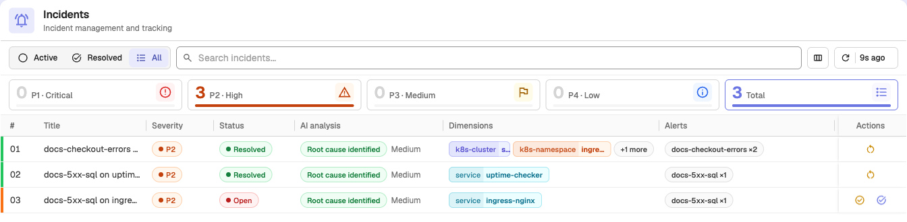
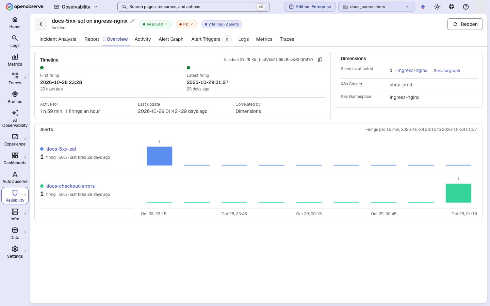
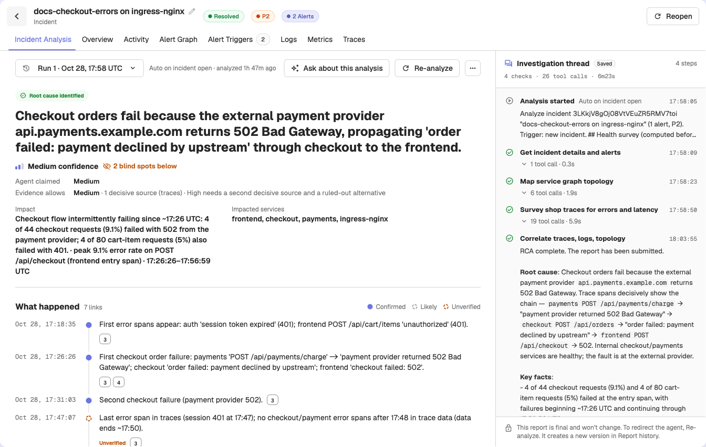
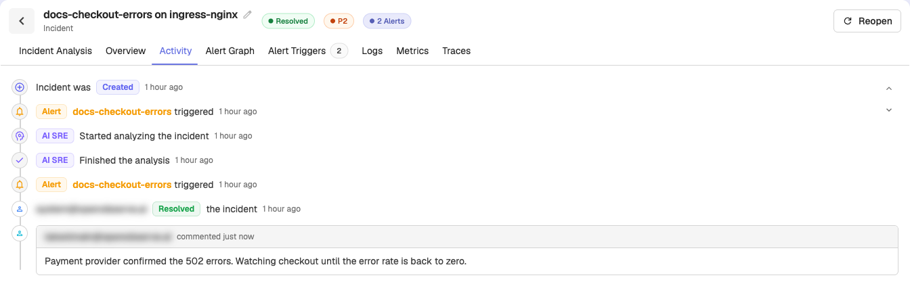
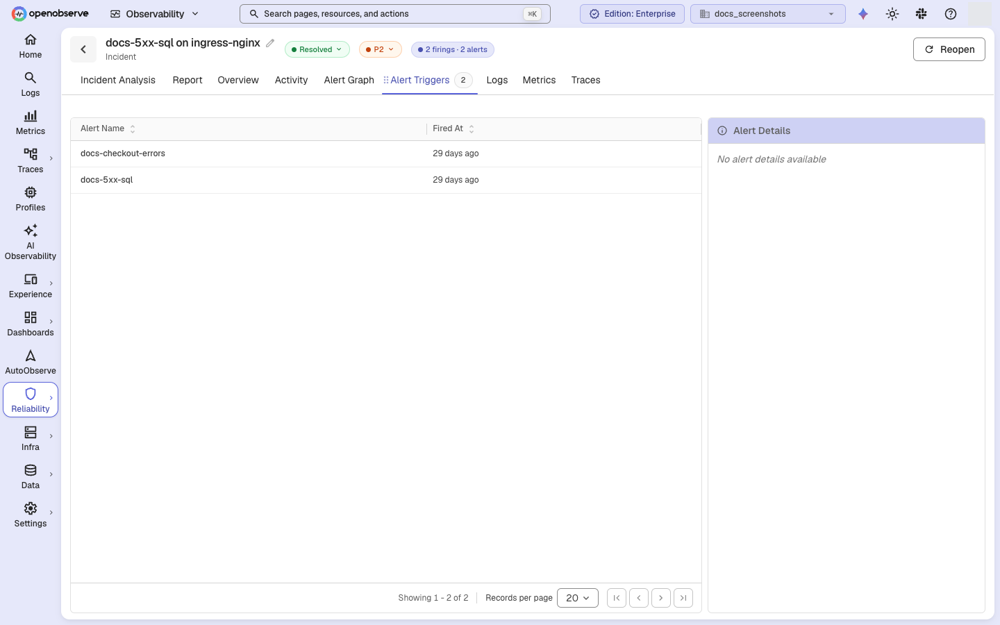
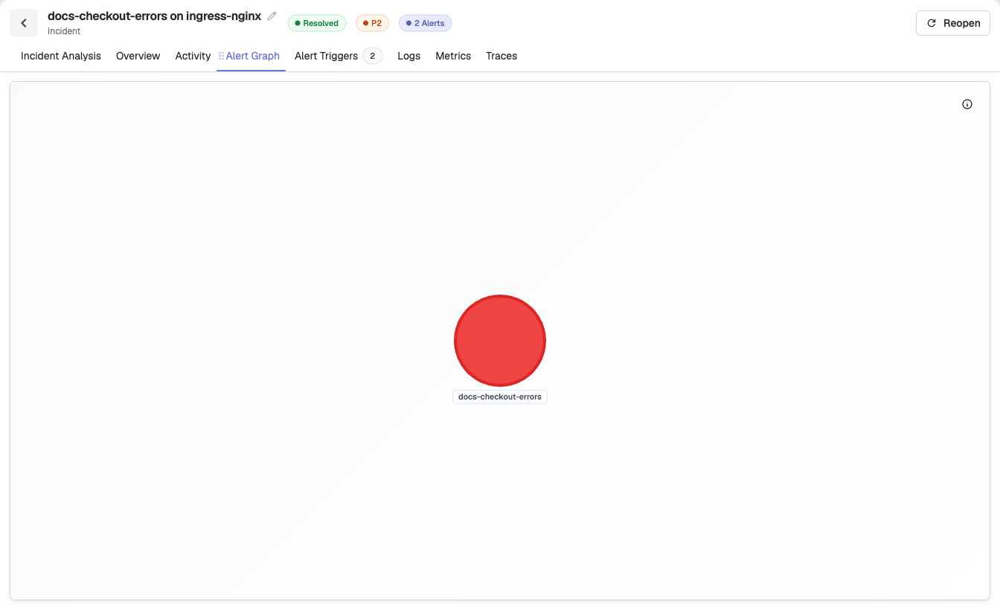

# Incident Management

Incident Management automatically groups related alert firings into unified incidents, reducing alert noise and helping you focus on root causes instead of individual alerts.

## Overview

When multiple alerts fire across your infrastructure, investigating each one individually is time-consuming and often misleading. Incident Management correlates related alerts into a single incident, giving you a unified view of what went wrong, when it started, and which services are affected.

It brings together alert data, service topology, AI-powered root cause analysis, and correlated telemetry (logs, metrics, traces) into one place — designed for SRE, DevOps, and platform engineering teams who need to quickly triage and resolve production issues.

:::note[Note]
Incident Management is available in OpenObserve Enterprise and Cloud editions. On self-hosted Enterprise, your operator enables it with `O2_INCIDENTS_ENABLED=true` (default `false`).
:::

:::note[Note]
On OpenObserve Cloud, automatic incident creation and RCA reanalysis consume AI credits from your organization's free credit pool. Once the pool is exhausted, incidents are not created for unpaid organizations until you subscribe. Alerts continue to fire.
:::

## Key features

### Automatic alert correlation

OpenObserve groups related alert firings into incidents using intelligent correlation. Alerts are matched based on shared dimensions such as service name, cluster, region, or namespace.

| Method | Priority | Description |
|--------|----------|-------------|
| **Service Discovery** | Highest | Groups alerts from services with known dependency relationships |
| **Primary Match** | High | Matches alerts sharing primary dimensions (cluster, region, namespace) |
| **Secondary Match** | Medium | Matches alerts sharing secondary dimensions (service, deployment) |
| **Alert ID** | Lowest | Isolates alerts by alert rule ID when no dimensional match exists |

Alerts from external systems such as Grafana or Prometheus Alertmanager can be correlated into incidents too. See [External Alert Sources](external-alert-sources.md).

An alert already in an open incident rejoins that incident first. An incident opened by an alert with no dimensions takes only that alert's own firings. A different alert can join an incident only within `ZO_INCIDENTS_JOIN_WINDOW_MINUTES` (default `240`) of the incident's first alert.

### Unrelated alerts

When a different alert joins an open incident, OpenObserve checks whether it is about the same problem. It uses the alerts' firing history, the service graph, and workload evidence, and asks the AI SRE Agent when those cannot decide.

An alert judged unrelated moves, with all its firings, to an incident of its own, and its **Activity** tab shows **Opened on its own**. If the alert is no longer firing, its new incident opens as resolved and sends no notification. The pair is remembered for 30 days, so the alert does not rejoin.

The check is on by default. Turn it off with `O2_INCIDENT_MEMBERSHIP_CHECK=false`. See [Environment variables](../../../administration/configuration/environment-variables.md).

### Incident notifications

When an alert has **Creates Incident** enabled, it no longer sends its regular notification. Instead, an incident notification is sent only when:

- A new incident is created.
- A new alert type joins an existing incident.
- The incident severity changes.

Repeated firings of the same alert are suppressed, which reduces notification noise. The incident notification is sent to the union of all correlated alerts' destinations and uses an incident JSON payload with the following fields: `id`, `title`, `event`, `service`, `severity`, `alert`, `time`, and `url`.

### Incident detail tabs

The incident detail view has these tabs, in this order by default: **Incident Analysis**, **Report**, **Overview**, **Activity**, **Alert Graph**, **Alert Triggers**, **Logs**, **Metrics**, and **Traces**. It opens on the first tab. Drag a tab to reorder them; your order is remembered in this browser.

### Incident overview dashboard

The **Overview** tab shows a real-time summary of the incident, each fact once:

- **Timeline**: **First firing**, **Peak**, **Latest firing**, **Active for** with the firing rate, **Last update**, and **Correlated by**.
- **Dimensions**: the correlation dimensions that group alerts into this incident. **Services affected** lists each distinct service, linked to the service catalog and to the **Service graph** for the incident's time window.
- **Alerts**: each alert in the incident with its firings drawn as bars on a shared time axis.

### Status and severity

Change the status and severity from the chips in the incident header. They work on every tab.

- **Status**: **Open**, **Acknowledged**, or **Resolved**.
- **Severity**: **P1** (critical) to **P4** (low).

### AI-powered root cause analysis

The built-in AI SRE Agent checks the incident's alerts, topology, recent changes, traces, logs, and metrics, then writes a root cause analysis report on the **Incident Analysis** tab. While it runs, you can follow its work in the **Investigation thread**. The report lists:

- **Hypotheses** it considered, with their status.
- **Evidence** behind them, filterable to decisive or supporting evidence.
- **Proposed actions**. These are suggestions only; nothing runs automatically.
- **Blind spots**: what the agent could not check, with a suggested fix for each.

Open **Full report** for the complete write-up. From the analysis bar you can **Re-analyze**, open **Report history**, **Copy report**, **Download as Markdown**, or **Ask about this analysis**.

#### Reanalysis

Root cause analysis reruns automatically on key incident lifecycle events: when a new alert type joins the incident, when dimensions upgrade, or when the incident is reopened. You can also re-trigger it after a severity change.

Reanalysis appends delta findings to the existing report rather than restarting it, so prior findings are preserved. An in-flight banner appears while analysis runs.

### Activity timeline and collaboration

On the **Activity** tab, every status change, severity update, AI analysis event, and user comment is recorded in a chronological activity timeline. Post comments to collaborate with your team directly within the incident.

- System events appear with colored icons (green for resolution, orange for acknowledgment, purple for AI analysis)
- User actions display the email of the person who performed the action
- The **Write a comment...** box at the bottom allows team members to share findings and context

### Alert triggers

The **Alert Triggers** tab lists every alert firing correlated to the incident, with its **Alert Name**, **Labels**, and **Fired At** time. When a row has more labels than fit, hover **+N** to see them all. Click an alert row to view its details in the side panel.

### Alert graph

The **Alert Graph** tab visualizes the topology of alerts within an incident using an interactive D3 force-directed graph. Nodes represent unique alert-service pairs and edges show relationships between them.

- **Red nodes** indicate root cause candidates
- **Orange nodes** indicate high-frequency alerts
- **Blue nodes** indicate normal alert activity
- **Purple arrows** represent temporal relationships (alert A fired before alert B)
- **Gray lines** represent service dependency relationships

:::info[Info]
The Alert Graph requires topology data from service discovery. If no topology data is available for the incident, the tab displays "Service Graph Unavailable."
:::

### Correlated telemetry

The **Logs**, **Metrics**, and **Traces** tabs provide direct access to telemetry data related to the incident. OpenObserve uses the incident's correlation dimensions (such as `service_name`, `host`, or `cluster`) to find matching streams automatically.

Each tab filters telemetry by the incident's time window and dimensions, so you can investigate the underlying data without leaving the incident detail view.

The **Metrics** tab uses selection **pills** (Essentials / Compute / Memory / Storage / Network / All) and **Pod / Node** scope chips to choose which metric streams to chart (Essentials is the default when curated streams are available).

:::note[Note]
Correlated telemetry requires that your logs, metrics, and traces share common dimensions with your alert definitions. Configure dimension names consistently across your alerts and telemetry ingestion for best results.
:::

## Getting started

**Prerequisites:**

- OpenObserve Enterprise or Cloud edition
- At least one alert configured and actively monitoring a stream

**To access incidents:**

1. In the left navigation, go to **Reliability > Incidents**
2. The incidents list displays all incidents for the current organization

## Triage an incident

1. Click any row in the incidents list to open the detail view.

2. Open the **Overview** tab for the timeline, dimensions, affected services, and alerts.

3. Check the status and severity chips in the incident header.

4. Click the **Alert Triggers** tab to see every correlated alert firing and its labels.

5. Use the **Incident Analysis** tab to run AI root cause analysis, check the **Activity** tab for the timeline and comments, or check the **Alert Graph** for a visual topology of alert relationships.

6. Explore correlated data in the **Logs**, **Metrics**, or **Traces** tabs.

7. Update the status using the status chip or the header buttons:
    - **Acknowledge** — investigation has started
    - **Resolve** — incident is closed
    - **Reopen** — reactivate a resolved incident

## Run AI root cause analysis

1. Open the incident and click the **Incident Analysis** tab.
2. Click **Analyze incident** to trigger the AI SRE Agent.
3. Follow the agent's progress in the **Investigation thread**. When it finishes, review the hypotheses, evidence, proposed actions, and blind spots, or open **Full report**.

:::tip[Tip]
Reanalysis reruns automatically when a new alert type joins the incident, when dimensions upgrade, or when the incident is reopened. You can also re-trigger it after a severity change. New findings are appended to the existing report.
:::

## Edit incident details

To set the title of new incidents, enter a template in the **Incident Title** field of an alert that has **Creates Incident** enabled, for example `{service_name} errors on {host}`. Use `{field}` for values from the triggering row or its grouping keys, plus `{alert_name}`, `{stream_name}`, `{stream_type}`, `{org_name}`, `{alert_time}`, `{alert_start_time}`, `{alert_end_time}`, and context attributes. Missing variables show as `–`. If none resolve, OpenObserve uses the default title.

- **Title**: Click the incident title in the header, edit it, and press Enter to save.
- **Severity**: Click the severity chip in the header and pick a level:

| Severity | Description |
|----------|-------------|
| **P1 - Critical** | Service outage or critical business impact |
| **P2 - High** | Significant degradation affecting users |
| **P3 - Medium** | Moderate issue with limited impact (default) |
| **P4 - Low** | Minor issue or informational |

## Incident lifecycle

| Status | Description | Available actions |
|--------|-------------|-------------------|
| **Open** | New or active incident with recent alerts | Acknowledge, Resolve, Edit |
| **Acknowledged** | A team member is investigating | Resolve, Edit |
| **Resolved** | Incident is closed (manually or auto-resolved) | Reopen, Edit |

Incidents auto-resolve after a period with no new alerts, set by `O2_INCIDENTS_AUTO_RESOLVE_AFTER_MINUTES` (default `4320`, 3 days; `-1` disables auto-resolve).

:::info[Info]
Severity can upgrade automatically when alert patterns indicate increasing impact. Manual overrides are always respected.
:::