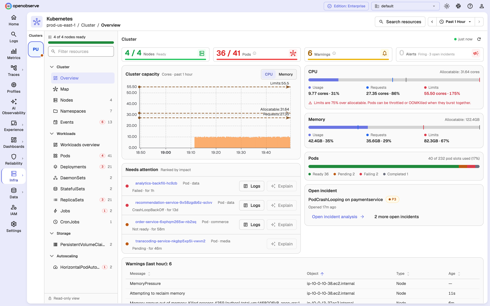
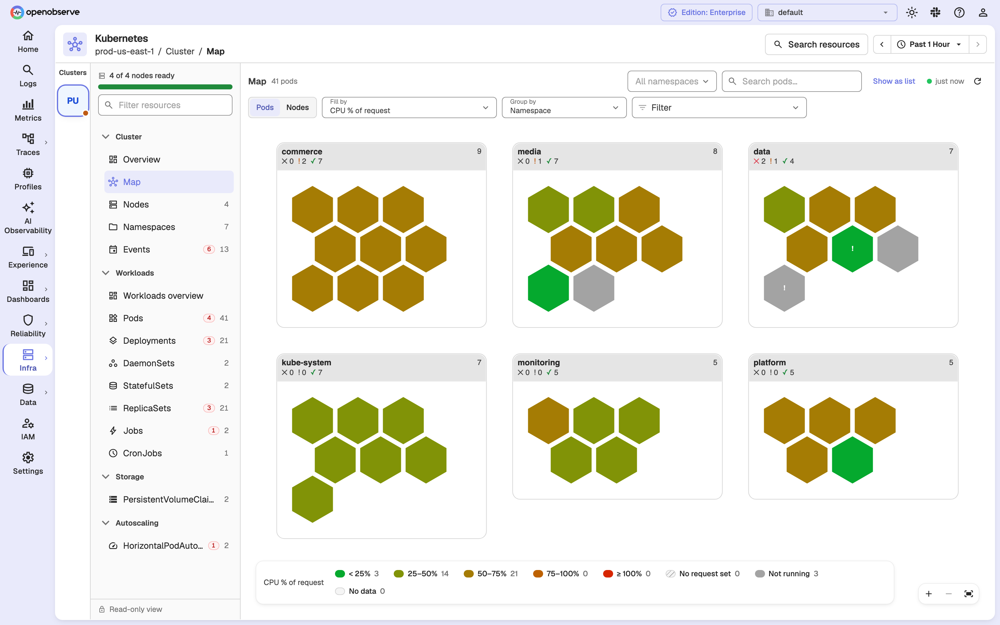
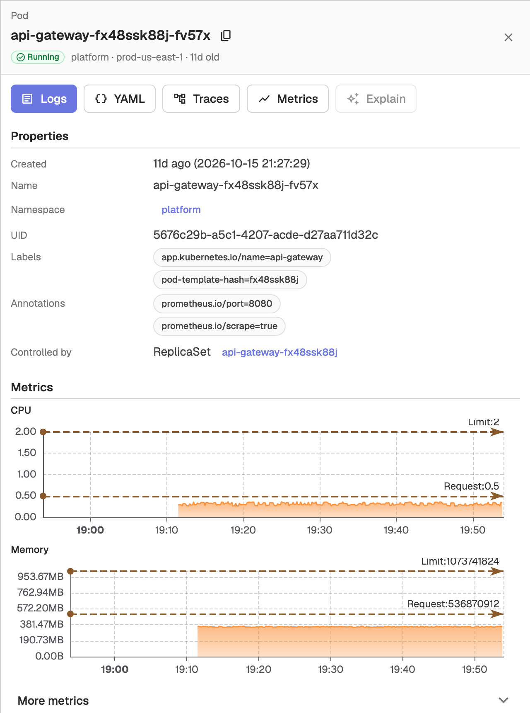
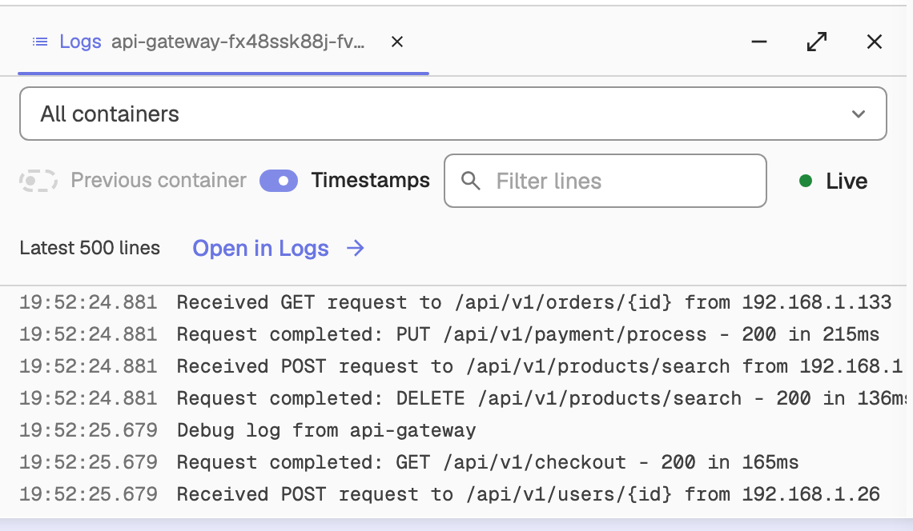

**Infra › Kubernetes** is a read-only browser for the Kubernetes telemetry you already send to OpenObserve. It reads three sources through the normal PromQL and SQL search APIs, so there is nothing extra to set up:

- **kube-state-metrics** for the object inventory: nodes, pods, workloads, PersistentVolumeClaims, HorizontalPodAutoscalers and namespaces.
- **kubelet stats** for CPU, memory, network and filesystem usage.
- The **`k8s_events`** stream for events, and for the object snapshots behind labels, container details and YAML.

The OpenObserve collector for Kubernetes sends all three; see [Kubernetes monitoring](../../integration/system/k8s.md). If none of them is present, the page shows **No Kubernetes telemetry visible to you yet** with collector setup instructions.

## Layout

- **Clusters strip** (far left): one tile per cluster with a health dot (**Healthy**, **Warning**, **Critical** or **Not reporting**). Hover a tile for the cluster name and node readiness, and click it to switch cluster. With more than one cluster, the **All clusters** button at the bottom of the strip opens a cluster search. On narrow screens a cluster select in the header replaces the strip.
- **Resource tree**: every view, grouped as below, with a count on each item and a red badge when objects in it have problems. **Filter resources** narrows the tree.
  - **Cluster**: **Overview**, **Map**, **Nodes**, **Namespaces**, **Events**
  - **Workloads**: **Workloads overview**, **Pods**, **Deployments**, **DaemonSets**, **StatefulSets**, **ReplicaSets**, **Jobs**, **CronJobs**
  - **Storage**: **PersistentVolumeClaims**
  - **Autoscaling**: **HorizontalPodAutoscalers**
- **Header**: the cluster / group / view breadcrumb, **Search resources**, and the time range picker.

On narrow screens a **View** select in the header replaces the tree.

### Search resources

Click **Search resources**, or press <kbd>Ctrl</kbd>+<kbd>K</kbd> (<kbd>Cmd</kbd>+<kbd>K</kbd> on macOS), to search pods, workloads, nodes, views and clusters. Results are grouped (**Go to**, **Needs attention**, **Workloads**, **Pods**, **Nodes**, **Clusters**); use the arrow keys and <kbd>Enter</kbd> to open one.

## Overviews

**Cluster › Overview** summarizes the selected cluster:

- KPI tiles for **Nodes**, **Pods**, **Warnings** (events in the last hour) and **Alerts**.
- A **Cluster capacity** chart of usage against requests, limits and allocatable, plus CPU and memory capacity cards and pod-slot usage.
- **Needs attention**: failing, pending and restarting pods and unready nodes, ranked by impact, each with a **Logs** button.
- Open incidents and **Firing alerts**, where they exist. Alerts are org-wide, because alerts are not labeled by cluster.

**Workloads › Workloads overview** shows a card per workload kind with a status bar, a **Workloads with problems** list and **Recent events**.

## Resource lists

Each resource view is a sortable, searchable table with columns for that kind, such as **CPU % req**, **Mem % lim**, **Restarts** and **Controlled By** for pods. Status chips above the table filter by state, for example **Ready**, **Pending** and **Failing** for pods, or **Warnings** and **Normal** for events. Use **Namespaces** to filter by namespace.

Click a row to open its details, or use the row's **⋮** menu for **Details**, **YAML**, **Metrics**, and for pods also **Logs** and **Traces**. Write actions such as **Scale**, **Restart** and **Delete** are shown disabled: the page never changes your cluster.

## Cluster map

The **Map** view draws pods or nodes as hexagonal cells:

- **Fill by**: for pods, **CPU % of request**, **CPU % of limit**, **Memory % of request**, **Memory % of limit**, **Restarts** or **Status**; for nodes, **CPU % of allocatable**, **Memory % of allocatable** or **Status**.
- **Group by** (pods): **Node**, **Namespace**, **Workload**, **None**, or any label observed on your pods.
- **Filter**: narrow the map with `key: value` label terms.

Hover a cell for a tooltip and click it to open its details. Click **Show as list** to see the same pods or nodes as a list.

## Details panel

Clicking any object opens a details panel beside the list or map, so you can keep browsing while it is open. It shows:

- Actions: **Logs**, **YAML**, **Traces** and **Metrics** (and **Pods** for workloads).
- **Properties** such as namespace, labels, annotations and the controlling object.
- **Metrics** charts for the selected time range, with request and limit lines where they are set.
- Sections specific to the kind, such as pod containers and conditions, or node capacity and allocatable.
- The object's **Events**.

## Logs and YAML

**Logs** and **YAML** open as tabs in a dock at the bottom of the page:

- **Logs** shows a pod's log lines, with a container picker, **Previous container**, **Timestamps**, a line filter and **Live** tail. **Open in Logs** opens the same query on the Logs page.
- **YAML** shows the object's manifest as the collector last observed it, read-only, with a copy button.

**Traces** and **Metrics** open the Traces and Metrics pages with the query pre-filled for the object.

## Offline clusters

If the selected cluster reported no nodes or pods in the time range, the page says it **hasn't reported recently**. Click **Show last known state** to widen the range to the last 24 hours, or **Collector setup guide** to check your collector.

## Share a view

The view, cluster, namespaces, search, sort, status chip, map settings and open details panel are kept in the URL, so you can bookmark or share exactly what you see.
