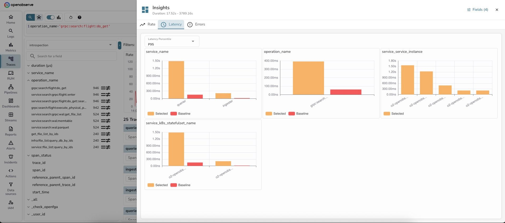
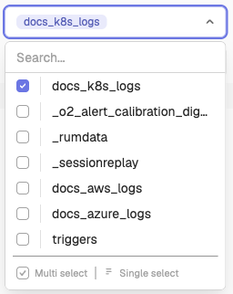
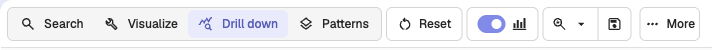
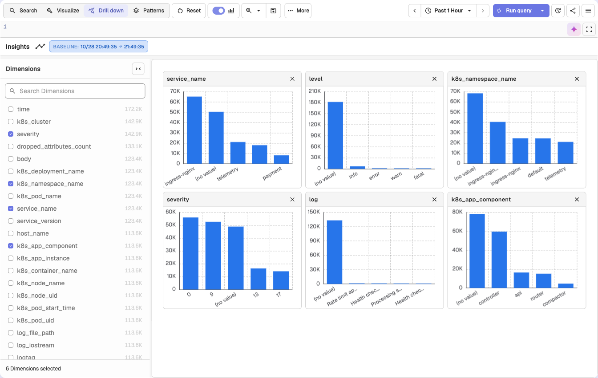

# Insights: Interactive Dimension Analysis

## Overview

Insights helps you find the root cause of a problem faster. It compares an unusual period against your baseline data. It does this across many dimensions at once, such as service or pod. Then it shows which ones changed the most.

### What It Does

- **Auto-selects relevant dimensions.** It picks them based on your data schema and telemetry standards.
- **Compares baseline vs selected periods.** It uses normalized metrics.
- **Ranks dimensions by impact.** This shows which factors best explain a change.
- **Visualizes differences.** It shows them in interactive bar charts.

### When to Use

**Use Insights for:**

- Exploring dimension patterns visually.
- Testing ideas during incidents.
- Quick spot checks, without waiting for AI analysis.
- Learning how your system behaves.

### Supported Telemetry

- **Logs**: Shows how log volume is spread across dimensions.
- **Traces**: Analyzes rate, latency (P50/P75/P95/P99), and errors.

### Key Terms

- **Stream**: Your data collection or index (e.g., `default`, `prod-logs`).
- **Baseline**: The full search time range (e.g., "last 24 hours").
- **Selected**: The window you're looking into (e.g., "high-latency period").
- **Dimension**: A field used for grouping (e.g., `service_name`, `pod_name`).
- **Brush selection**: Click and drag to select part of a chart.
- **RED metrics**: Rate, Errors, Duration. These are the key metrics for traces.

---

## How to Use

### For Log Analysis

1. Run a log query. Select a stream, a time range, and an optional filter.
 
2. Select the **Drill down** view in the toolbar. It is not available in SQL mode.

3. Review the dimension analysis dashboard.

4. **(Optional)** Change the dimensions in the **Dimensions** sidebar.

**Example**: Query `k8s_cluster = 'production'` shows which pods, services, and namespaces generate most logs.

---
### For Trace Analysis

1. Run a trace query. Select a stream, a time range, and an optional filter.
2. **Observe RED metrics** in the Rate, Errors, and Duration panels.
3. **(Optional)** Make a **brush selection**:
   - Drag vertically to select a latency range.
   - Drag horizontally to select a time range.
   - Drag diagonally to select both.
4. Click the **Drill down** button.
5. Review the analysis tabs: **Rate**, **Latency**, **Errors**.
6. **(Optional)** Change the percentile in the Latency tab.
7. **(Optional)** Change the dimensions in the **Dimensions** sidebar.

**Example**: Query `operation_name='api/checkout'` shows which services have the highest latency during incidents.

---

## Advanced Features

### Percentile Adjustment (Traces)
- **P50**: The median user experience.
- **P75**: The upper-middle tier.
- **P95**: The worst 5% (a common SLA target).
- **P99**: Tail latency (the worst 1%).

Click the refresh button after you change the percentile.

### Error-Only Mode (Traces)
Turn on the "Error Only" toggle to limit the analysis to error traces.

### Dimension Customization
Use the **Dimensions** sidebar to:

- Add or remove dimensions.
- Search for specific fields with **Search Dimensions**.
- Pick fields with 2-50 unique values. This is the best cardinality.

### Filter Management
- Each brush selection creates a filter chip that you can remove.
- Click X on a chip to clear that filter.

---

## Troubleshooting

**No analysis shown**
- Make sure search results are loaded (> 0 results).
- Click **Run query** first.
- For logs, turn off SQL mode. The **Drill down** view does not work with SQL queries.

> **Note:** If `logs_insights` RBAC is enabled (Enterprise/Cloud), your role needs Get permission on the relevant logs stream's `logs_insights` resource to use Insights.

**No dimensions shown**
- Select dimensions by hand in the **Dimensions** sidebar.

**Brush selection not working**
- Click and hold, drag across the chart, then release.

**Wrong latency values**
- Check the percentile dropdown setting (P50/P75/P95/P99).

---

## Additional Resources

- **Detailed guide with examples**: [From Symptoms to Quick Insights blog post](https://openobserve.ai/blog/observability-insights-troubleshooting-guide).
- **Logs guide**: [Logs documentation](index.md).
- **Traces guide**: [Traces documentation](../traces/index.md).
- **Alerts setup**: [Alerts documentation](../../analytics/alerts/index.md).

---

## Getting Help

- **Community**: [Slack](https://short.openobserve.ai/community).
- **GitHub Issues**: [Report bugs](https://github.com/openobserve/openobserve/issues).

