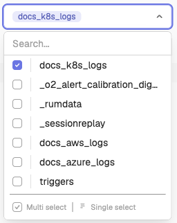
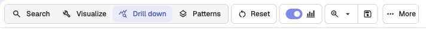
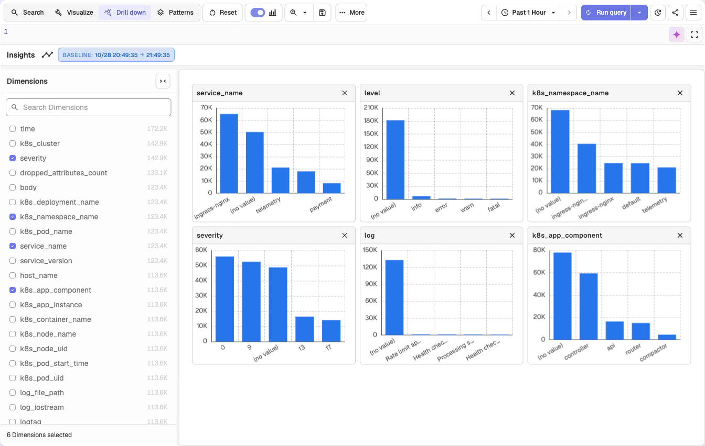

# Insights: Interactive Dimension Analysis

## Overview

Insights is an interactive dimension analysis feature that automates root cause identification by comparing anomaly periods against baseline data across multiple dimensions simultaneously.

### What It Does

- **Auto-selects relevant dimensions** based on your data schema and telemetry standards
- **Compares baseline vs selected periods** with normalized metrics
- **Ranks dimensions by impact** to show which factors most explain changes
- **Visualizes differences** with interactive bar charts

### When to Use

**Use Insights for:**
- Visual exploration of dimension patterns
- Hypothesis testing during incidents
- Quick spot checks without waiting for AI analysis
- Learning system behavior patterns

### Supported Telemetry

- **Logs**: Volume distribution analysis across dimensions
- **Traces**: Rate, latency (P50/P75/P95/P99), and error analysis

### Key Terms

- **Stream**: Your data collection/index (e.g., `default`, `prod-logs`)
- **Baseline**: Full search time range (e.g., "last 24 hours")
- **Selected**: Specific window you're investigating (e.g., "high-latency period")
- **Dimension**: Field used for grouping (e.g., `service_name`, `pod_name`)
- **Brush selection**: Click-and-drag to select chart regions
- **RED metrics**: Rate, Errors, Duration - key observability metrics for traces

---

## How to Use

### For Log Analysis

1. Run a log query (select stream, time range, optional filter)
 
2. Select the **Drill down** view in the toolbar. It is not available in SQL mode.

3. Review dimension analysis dashboard

4. **(Optional)** Customize dimensions in the **Dimensions** sidebar

**Example**: Query `k8s_cluster = 'production'` shows which pods, services, and namespaces generate most logs.

---
### For Trace Analysis

1. Run a trace query (select stream, time range, optional filter)
2. **Observe RED metrics** (Rate, Errors, Duration panels)
3. **(Optional)** Make a **brush selection**:
   - Drag vertically = Select latency range
   - Drag horizontally = Select time range
   - Drag diagonally = Select both
4. Click the **Drill down** button
5. Review analysis tabs: **Rate**, **Latency**, **Errors**
6. **(Optional)** Adjust percentile in Latency tab
7. **(Optional)** Customize dimensions in the **Dimensions** sidebar

**Example**: Query `operation_name='api/checkout'` shows which services have highest latency during incidents.

---

## Advanced Features

### Percentile Adjustment (Traces)
- **P50**: Median user experience
- **P75**: Upper-middle tier
- **P95**: Worst 5% (common SLA target)
- **P99**: Tail latency (worst 1%)

Click refresh button after changing percentile.

### Error-Only Mode (Traces)
Enable "Error Only" toggle to restrict analysis to error traces only.

### Dimension Customization
Use the **Dimensions** sidebar to:
- Add/remove dimensions
- Search for specific fields with **Search Dimensions**
- Optimal cardinality: 2-50 unique values

### Filter Management
- Each brush selection creates a removable filter chip
- Click X on chips to clear individual filters

---

## Troubleshooting

**No analysis shown**
- Ensure search results are loaded (> 0 results)
- Click **Run query** first
- For logs, turn off SQL mode: the **Drill down** view does not work with SQL queries

> **Note:** If `logs_insights` RBAC is enabled (Enterprise/Cloud), your role needs Get permission on the relevant logs stream's `logs_insights` resource to use Insights.

**No dimensions shown**
- Select dimensions manually in the **Dimensions** sidebar

**Brush selection not working**
- Click and hold, drag across chart, then release

**Wrong latency values**
- Verify percentile dropdown setting (P50/P75/P95/P99)

---

## Additional Resources

- **Detailed guide with examples**: [From Symptoms to Quick Insights blog post](https://openobserve.ai/blog/observability-insights-troubleshooting-guide)
- **Logs guide**: [Logs documentation](index.md)
- **Traces guide**: [Traces documentation](../traces/index.md)
- **Alerts setup**: [Alerts documentation](../../analytics/alerts/index.md)

---

## Getting Help

- **Community**: [Slack](https://short.openobserve.ai/community)
- **GitHub Issues**: [Report bugs](https://github.com/openobserve/openobserve/issues)

