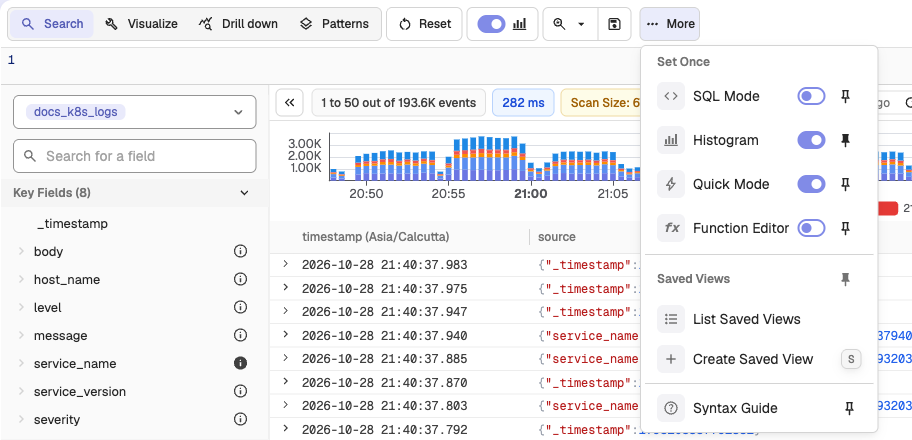
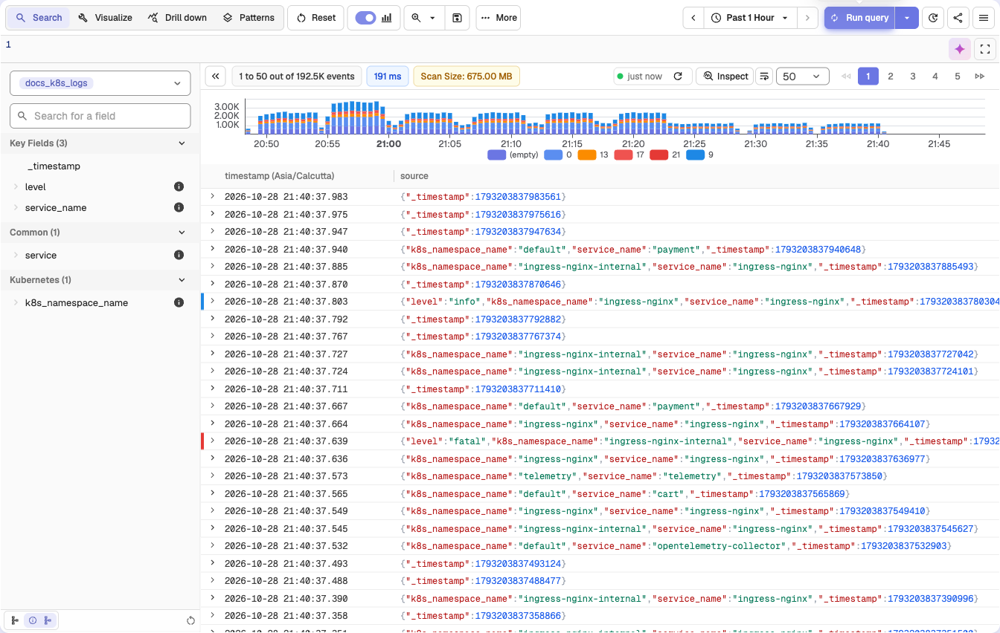
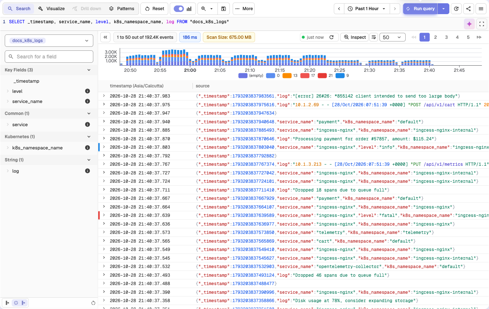

This guide explains how to use Quick Mode with Interesting Fields in OpenObserve to optimize log searches and improve query performance.

## Overview
Quick Mode is a performance optimization in OpenObserve that speeds up log searches by limiting the query to a small set of fields called Interesting Fields. Instead of scanning all fields in a stream, Quick Mode selects only the fields you mark as interesting, reducing query time, especially in streams with a large number of fields.

## Enable Quick Mode and select Interesting Fields

1. Go to the **Logs** page.
2. Select the desired stream from the left panel.
3. Open the **More** menu and turn on **Quick Mode** under **Set Once**. Select **Pin to toolbar** next to it to keep the switch on the toolbar.
4. The field list shows an **Interesting Fields** option next to **All Fields**. If the selected stream has **User-Defined Schema (UDS)** fields, a UDS option also appears. By default, the **Interesting Fields** list holds `_timestamp` plus any default quick mode fields that the stream has (see [Environment variables](#environment-variables-controlling-quick-mode-defaults)).
5. Use the **All Fields** or UDS fields toggles to navigate to the field you want to add to the **Interesting Fields** list.
6. Click the **i** icon beside a field name to mark it as an **Interesting Field**. The icon fills to indicate the field is now in the **Interesting Fields** list. 
7. Click **Run query** to view logs for all current Interesting Fields.
8. Optional. Turn on **SQL Mode** to view and edit the prebuilt query that lists only your **Interesting Field**s. If you add a new field to the SQL query while **Quick Mode** is on, that field is automatically added to the **Interesting Fields** list.

## How Quick Mode and Interesting Fields work together
- **Quick Mode** uses the **Interesting Fields** list to limit the query to those columns only.
- Changing the **Interesting Fields** list changes which columns are returned in Quick Mode.
- If you turn Quick Mode off, results follow schema rules: with UDS on you see only UDS fields and with UDS off you see all fields.
- When UDS fields are defined, adding `_all` as an Interesting Field returns a combined text field containing values from all non-UDS fields, which you can parse as needed.

## Environment variables controlling Quick Mode defaults
- `ZO_QUICK_MODE_ENABLED=true`: Enables **Quick Mode** by default. The default is `false`.
- `ZO_FEATURE_QUICK_MODE_FIELDS="kubernetes_namespace_name,kubernetes_container_name"`: Adds fields to the built-in default quick mode fields (`service`, `version`, `session_id`, `view_url`, `service_name`, `operation_name`, `trace_id`, `span_id`, `duration`). The fields in this combined list that a stream has are marked as **Interesting Fields** by default. The default is empty.

## Auto-add behavior in Quick Mode
When **Quick Mode** is enabled, running a query that references a field which is not already marked as an **Interesting Field** causes that field to be added to the **Interesting Fields** list automatically.

## When to Use Quick Mode
- When working with streams that have hundreds or thousands of fields.
- When you need to quickly search for patterns or values in a small subset of fields.
- When troubleshooting or validating logs using specific key fields.

## Best practices
Keep the number of **Interesting Fields** small to maximize performance gains, because scanning fewer fields reduces query execution time.

## Troubleshooting
**Issue**: Some fields are missing when **Quick Mode** is turned on.  
**Cause**: If you notice that some fields are missing when **Quick Mode** is enabled, this is expected behavior. **Quick Mode** limits results to the fields marked as **Interesting Fields**. 
**Solution**: To view all available fields, select **All Fields** in the field list.

- By default, the **Interesting Fields** list holds `_timestamp` plus any default quick mode fields that the stream has.
- Any other fields must be added manually by marking them as **Interesting Fields**.
- You can also turn on SQL mode to edit the query. Adding a field to the SQL query while **Quick Mode** is on automatically adds that field to the **Interesting Fields** list.

