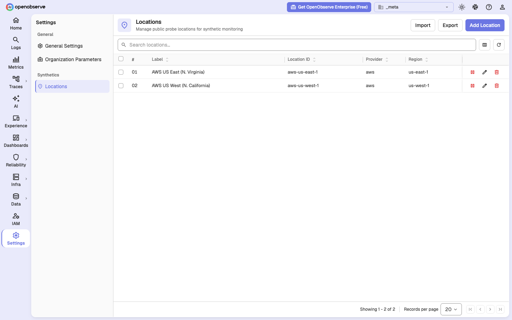

# AWS Lambda setup

On a self-hosted OpenObserve, Synthetics checks run from probe functions that you deploy to AWS Lambda in your own account. This page walks through deploying them, connecting OpenObserve, and running your first checks.

> **Note**: The probe container images are not yet publicly distributed. Contact OpenObserve for access before you start.

## Overview

Synthetic checks run in one of two venues:

| Venue | What runs the check | Available in |
|-------|---------------------|--------------|
| **AWS Lambda** | Functions you deploy; OpenObserve invokes one per check run | Open source and Enterprise |
| **Private agent** | A long-running agent inside your network | Enterprise only. See [Private locations](private-locations.md) |

AWS Lambda is the only venue on the open-source edition, and the setup is identical on Enterprise. Many Enterprise deployments use both: Lambda for public regions, agents for internal targets.

### How it works

Two functions do the work:

- `o2-synthetics-net-probe` runs HTTP, TCP, TLS, and SSH checks.
- `o2-synthetics-browser-probe` runs browser tests in Chromium.

For every check and location, the OpenObserve scheduler queues a job and invokes the matching function in that location's AWS region. The function runs the check against your target, then calls back to OpenObserve to fetch its job details and report results.

Traffic flows in both directions, and both must work:

1. **OpenObserve to AWS.** OpenObserve calls `lambda:InvokeFunction`, so it needs AWS credentials, and the function must exist in the region the location names.
2. **AWS to OpenObserve.** The function calls your OpenObserve API to report results, so that API must be reachable from the public internet. This is the step most often missed, and it shows up as a timeout about 15 minutes later rather than an immediate error.

The functions hold no configuration of their own. OpenObserve sends the API address and the short-lived credentials they need with every invocation.

## Prerequisites

- An AWS account where you can create ECR repositories, an IAM role, and Lambda functions
- Docker with `buildx`, and AWS CLI v2, authenticated
- OpenObserve v0.92.0 or later, with a node running the scheduler role (single-node deployments qualify)
- A public HTTPS address for your OpenObserve API
- The OpenObserve root user, since only root can register locations
- Access to the probe images

Choose the AWS region your checks should run from. Each region is a separate deployment, so start with one. Expect about 30 minutes for the first region, most of it image build time.

## Step 1: Push the probe images to ECR

AWS Lambda only runs container images stored in Amazon ECR. Build and push both probes into your own ECR repositories, once per region: private ECR repositories are regional, so a function in `us-east-1` cannot use an image stored only in `us-west-1`.

```bash
export AWS_REGION=us-west-1
export ACCT=<your-account-id>

# Network probe: http, tcp, tls, ssh
cd openobserve-synthetic-net-probe
AWS_REGION=$AWS_REGION \
ECR_REPO=$ACCT.dkr.ecr.$AWS_REGION.amazonaws.com/o2-synthetics-net-probe \
CREATE_ECR_REPO=1 \
./scripts/build-and-push-ecr.sh

# Browser probe: Chromium journeys
cd ../openobserve-synthetics-browser-probe
AWS_REGION=$AWS_REGION \
ECR_REPO=$ACCT.dkr.ecr.$AWS_REGION.amazonaws.com/o2-synthetics-browser-probe \
CREATE_ECR_REPO=1 \
./scripts/build-and-push-ecr.sh
```

Each run prints the pushed image URI. To confirm:

```bash
aws ecr describe-images --region $AWS_REGION \
  --repository-name o2-synthetics-net-probe --query 'imageDetails[].imageTags'
```

The scripts only build and push. They do not create the Lambda functions; that is the next step.

## Step 2: Create the Lambda functions

### Create the execution role

Do this once per AWS account. The probes make no AWS API calls of their own, so the role only needs permission to write CloudWatch Logs.

```bash
aws iam create-role --role-name o2-synthetics-probe-role \
  --assume-role-policy-document '{
    "Version":"2012-10-17",
    "Statement":[{"Effect":"Allow",
                  "Principal":{"Service":"lambda.amazonaws.com"},
                  "Action":"sts:AssumeRole"}]}'

aws iam attach-role-policy --role-name o2-synthetics-probe-role \
  --policy-arn arn:aws:iam::aws:policy/service-role/AWSLambdaBasicExecutionRole
```

### Create the functions

Do this once per region.

> **Warning**: The two probes are built for different CPU architectures: the network probe for `arm64`, the browser probe for `x86_64`. A wrong `--architectures` value creates the function successfully, then fails on every invocation with an exec format error.

```bash
# Network probe: arm64, 256 MB
aws lambda create-function \
  --region $AWS_REGION \
  --function-name o2-synthetics-net-probe \
  --package-type Image \
  --code ImageUri=$ACCT.dkr.ecr.$AWS_REGION.amazonaws.com/o2-synthetics-net-probe:latest \
  --role arn:aws:iam::$ACCT:role/o2-synthetics-probe-role \
  --architectures arm64 \
  --timeout 840 \
  --memory-size 256

# Browser probe: x86_64, 2048 MB for Chromium
aws lambda create-function \
  --region $AWS_REGION \
  --function-name o2-synthetics-browser-probe \
  --package-type Image \
  --code ImageUri=$ACCT.dkr.ecr.$AWS_REGION.amazonaws.com/o2-synthetics-browser-probe:latest \
  --role arn:aws:iam::$ACCT:role/o2-synthetics-probe-role \
  --architectures x86_64 \
  --timeout 840 \
  --memory-size 2048
```

| Function | Architecture | Memory | Timeout |
|----------|--------------|--------|---------|
| `o2-synthetics-net-probe` | `arm64` | 256 MB | 840 s |
| `o2-synthetics-browser-probe` | `x86_64` | 2048 MB | 840 s |

Keep the 840-second timeout. OpenObserve accepts checks that can run for up to 840 seconds, so a shorter function timeout lets AWS stop a run partway through and report a failure your target never had. See [Timeout budget](#timeout-budget).

Use the same function names in every region. OpenObserve invokes one configured name in whichever region a location points to.

Leave the functions outside a VPC unless you have a reason not to. A function inside a VPC has no internet access without a NAT gateway, so it can reach neither your targets nor your OpenObserve API.

To confirm:

```bash
aws lambda get-function-configuration --region $AWS_REGION \
  --function-name o2-synthetics-net-probe \
  --query '{Timeout:Timeout,Memory:MemorySize,Arch:Architectures}'
# {"Timeout": 840, "Memory": 256, "Arch": ["arm64"]}
```

### Update the functions later

Once a function exists, push a new image and update it in one command per region:

```bash
AWS_REGION=$AWS_REGION \
ECR_REPO=$ACCT.dkr.ecr.$AWS_REGION.amazonaws.com/o2-synthetics-net-probe \
UPDATE_LAMBDA=1 \
./scripts/build-and-push-ecr.sh
```

`UPDATE_LAMBDA=1` also resets the timeout to 840 seconds, correcting any change made in the AWS console.

## Step 3: Allow OpenObserve to invoke the functions

Attach this policy to the identity your OpenObserve scheduler node runs as:

```json
{
  "Version": "2012-10-17",
  "Statement": [{
    "Effect": "Allow",
    "Action": "lambda:InvokeFunction",
    "Resource": [
      "arn:aws:lambda:*:<account-id>:function:o2-synthetics-net-probe",
      "arn:aws:lambda:*:<account-id>:function:o2-synthetics-browser-probe"
    ]
  }]
}
```

The `*` in the region position lets the same policy cover every region you add later.

OpenObserve finds AWS credentials through the standard AWS credential chain, so any of these work:

- Environment variables: `AWS_ACCESS_KEY_ID`, `AWS_SECRET_ACCESS_KEY`, and `AWS_SESSION_TOKEN`
- A shared profile under `~/.aws`
- EC2 instance metadata
- IRSA or EKS Pod Identity. On Kubernetes, attach the policy to the service account and set no credential variables at all.

> **Note**: `AWS_DEFAULT_REGION` does not choose where functions are invoked. The region always comes from the location, as described in [Step 6](#step-6-register-a-location).

> **Tip**: Temporary STS credentials expire, after which every invocation fails with `ExpiredTokenException`. Use them only for short evaluations.

## Step 4: Configure OpenObserve

Set these environment variables:

```bash
ZO_SYNTHETICS_ENABLED=true
ZO_SYNTHETICS_LAMBDA_NET=o2-synthetics-net-probe
ZO_SYNTHETICS_LAMBDA_BROWSER=o2-synthetics-browser-probe
ZO_SYNTHETICS_API_ENDPOINT=https://openobserve.example.com
```

Then restart OpenObserve. `ZO_SYNTHETICS_ENABLED` only takes effect on restart. The other Synthetics variables can be changed later with a configuration reload.

> **Warning**: `ZO_SYNTHETICS_LAMBDA_NET` is empty by default. Left empty, HTTP, TCP, TLS, and SSH checks are scheduled and queued but never sent to Lambda, and nothing in the log says why. Always set it.

`ZO_SYNTHETICS_LAMBDA_BROWSER` already defaults to `o2-synthetics-browser-probe`, so browser tests work as soon as a function with that name exists.

To confirm, check that the Synthetics entry appears under **Experience** in the left sidebar. See [Environment variables](#environment-variables) for the full list.

## Step 5: Make your API reachable from AWS

The functions call your OpenObserve API to report results, and an address such as `http://localhost:5080` is not reachable from Lambda.

Set `ZO_SYNTHETICS_API_ENDPOINT` to your public HTTPS address. Left empty, it falls back to `ZO_WEB_URL`.

For a quick evaluation from a laptop, a tunnel works:

```bash
ngrok http 5080
# then set
ZO_SYNTHETICS_API_ENDPOINT=https://<generated>.ngrok-free.dev
```

Tunnel addresses change on every restart. Because this variable can be reloaded, update it and reload the configuration instead of restarting OpenObserve.

To confirm, run this from a machine outside your network. If it fails there, it fails from Lambda too.

```bash
curl -s https://openobserve.example.com/healthz
```

## Step 6: Register a location

A location is a place checks run from. OpenObserve ships with no locations, so until you add one there is nowhere for a check to run and the **Locations** card on a check offers no choices.

Locations are managed by the root user in the `_meta` organization:

1. Switch to the `_meta` organization.
2. Go to **Settings > Synthetics > Locations**.



3. Click **Add Location**.
4. Set **Provider** to **AWS**, enter the AWS **Region**, for example `us-west-1`, and give it a **Label** such as `AWS US West (N. California)`. The **Location ID** fills in as `aws-us-west-1`.
5. Click **Create & Close**.


> **Warning**: The location ID must be `aws-` followed by the AWS region, because OpenObserve reads the invoke region from it. An ID such as `us-west-1` or `oregon` fails every run with `cannot derive an AWS region from the job's location`. Choosing **AWS** as the provider sets the ID correctly.

One location serves both function types. Browser tests and protocol checks that select it both run in that region.

### Add several locations at once

On the **Locations** page, click **Import** and paste a JSON array, or upload it as a file. The preview shows the location ID each entry gets before you click **Import**.

```json
[
  { "provider": "aws", "region": "eu-west-1", "label": "AWS EU West (Ireland)" },
  { "provider": "aws", "region": "ap-south-1", "label": "AWS Asia Pacific (Mumbai)" }
]
```


### Register locations with the API

The same registry is available over the API as the root user. Set `kind` to `public`: it defaults to `private`, which the open-source edition rejects.

```bash
curl -u "$ROOT_USER:$ROOT_PASS" -X POST \
  "https://openobserve.example.com/api/_meta/synthetics/locations" \
  -H 'Content-Type: application/json' \
  -d '{"kind":"public",
       "provider":"aws",
       "region":"us-west-1",
       "id":"aws-us-west-1",
       "label":"AWS US West (N. California)",
       "enabled":true}'
```

To register several in one request, send `{"locations": [ ... ]}` with one such object per region.

## Step 7: Create your first checks

Create one check of each kind so both functions are exercised:

1. Go to **Experience > Synthetics** in your working organization and create an **HTTP / API** check against a URL you control. See [Protocol checks](protocol-checks.md).
2. Create a **Browser Test** with a single navigate step. See [Browser tests](browser-tests.md).
3. In the **Locations** card of each, select the location you registered.

## Step 8: Verify

Wait one schedule interval, then open the checks list. Each check shows a status and response time once its first run completes. Open a check to see its [results](results.md).

On the server, a healthy run produces log lines like these:

```text
[synthetics scheduler]  job enqueued job_id=… location=aws-us-west-1
[synthetics dispatcher] attempting Lambda invoke: job_id=… fn=o2-synthetics-net-probe region=us-west-1
[synthetics dispatcher] Lambda invoked status_code=200
```

If a check stays without a result, or fails unexpectedly, see [Troubleshooting](#troubleshooting). Every run that cannot be sent records the reason in the run detail and in the `synthetics_results` stream.

## Adding more regions

For each additional region:

1. Push both images to that region's ECR, as in [Step 1](#step-1-push-the-probe-images-to-ecr).
2. Create both functions there with the same names, as in [Step 2](#step-2-create-the-lambda-functions).
3. Register a location with the ID `aws-<region>`, as in [Step 6](#step-6-register-a-location).

No OpenObserve configuration changes are needed. A check can select several locations and runs from each.

## Environment variables

| Variable | Default | Applies on | Description |
|----------|---------|------------|-------------|
| `ZO_SYNTHETICS_ENABLED` | `false` | Restart | Turns on Synthetics |
| `ZO_SYNTHETICS_LAMBDA_NET` | empty | Reload | Network probe function name. Empty means protocol checks are never sent to Lambda |
| `ZO_SYNTHETICS_LAMBDA_BROWSER` | `o2-synthetics-browser-probe` | Reload | Browser probe function name |
| `ZO_SYNTHETICS_API_ENDPOINT` | `ZO_WEB_URL` | Reload | Address the functions call back on |
| `ZO_SYNTHETICS_MAX_CHECK_BUDGET_SECS` | `840` | Reload | Longest a single check may run. Keep equal to the function timeout |
| `ZO_SYNTHETICS_JOB_LEASE_SECS` | `900` | Reload | How long a run may take before it is retried. Must be greater than the check budget |
| `ZO_SYNTHETICS_MAX_NET_TIMEOUT_MS` | `300000` | Reload | Longest a single protocol check attempt may take |
| `ZO_SYNTHETICS_BROWSERS` | `chromium` | Reload | Browser engines offered to checks |
| `ZO_SYNTHETICS_DEVICES` | `desktop:1440:900,tablet:768:1024,mobile:375:667` | Reload | Device viewports offered to browser tests |
| `ZO_SYNTHETICS_SCHEDULER_JITTER_ENABLED` | `true` | Reload | Spreads checks with the same frequency across their interval |

## Timeout budget

Three limits must nest inside each other:

| Limit | Default | Rule |
|-------|---------|------|
| Check budget (`ZO_SYNTHETICS_MAX_CHECK_BUDGET_SECS`) | 840 s | OpenObserve rejects checks whose worst case exceeds it |
| Lambda function timeout | 840 s | At least the check budget |
| Job lease (`ZO_SYNTHETICS_JOB_LEASE_SECS`) | 900 s | Strictly greater than the check budget |

- **Function timeout below the budget**: OpenObserve accepts a check that AWS then stops partway through, reporting a failure the target never had.
- **Lease at or below the budget**: a run that uses its full budget has no time left to report, so it is retried and the check runs twice, producing duplicate results and possibly a duplicate alert.

For browser tests, the worst case is multiplied by the number of browser and device combinations, because they run one after another in a single job. OpenObserve rejects a configuration that would exceed the budget when you save it.

OpenObserve cannot read your function's timeout. If you change one side, change the other.

## Screenshots and traces

Browser tests capture screenshots and traces. Where they are stored decides what the functions must reach:

- **Local disk storage**: the functions upload through your OpenObserve API, which [Step 5](#step-5-make-your-api-reachable-from-aws) already covers.
- **Object storage such as S3**: OpenObserve gives the functions presigned upload URLs, so the storage endpoint must be reachable from AWS. A MinIO instance on `localhost` is not, which is the usual cause of passing browser tests with no screenshots during local evaluation.

## Open source and Enterprise

| Capability | Open source | Enterprise |
|------------|-------------|------------|
| AWS Lambda venue and public locations | Yes | Yes |
| Private locations and in-network agents | No | Yes |
| Alert notifications when a check fails | No. Results are recorded, but no notification is sent | Yes |
| Per-resource access control on Synthetics | No | Yes |

## Troubleshooting

Check three places: the run detail page, the `error` and `error_source` fields in the `synthetics_results` stream, and server log lines starting with `[synthetics dispatcher]`.

| What you see | Cause | Fix |
|--------------|-------|-----|
| Protocol checks are queued but never run, with no errors | `ZO_SYNTHETICS_LAMBDA_NET` is empty | Set it, as in [Step 4](#step-4-configure-openobserve) |
| `no Lambda function configured for this pool` | Function name in OpenObserve does not match AWS | Match the names, as in [Step 2](#step-2-create-the-lambda-functions) |
| `cannot derive an AWS region from the job's location` | Location ID is not `aws-<region>` | Re-create the location, as in [Step 6](#step-6-register-a-location) |
| `ResourceNotFoundException` | Function does not exist in that region | Deploy it there, as in [Adding more regions](#adding-more-regions) |
| `AccessDeniedException` | Missing `lambda:InvokeFunction` permission | Attach the policy, as in [Step 3](#step-3-allow-openobserve-to-invoke-the-functions) |
| `ExpiredTokenException` | Temporary AWS credentials expired | Refresh or replace them, as in [Step 3](#step-3-allow-openobserve-to-invoke-the-functions) |
| Function invoked, then a timeout about 15 minutes later with no result | Function cannot reach your OpenObserve API | Fix the address or VPC routing, as in [Step 5](#step-5-make-your-api-reachable-from-aws) |
| `exec format error` | Wrong function architecture | Use `arm64` for the network probe and `x86_64` for the browser probe |
| Check stopped partway although the target was healthy | Function timeout is below the check budget | See [Timeout budget](#timeout-budget) |
| Browser test passes but has no screenshots | Object storage is not reachable from AWS | See [Screenshots and traces](#screenshots-and-traces) |
| `no enabled ingest token for this organisation` | The organization has no ingestion token | Create one with `POST /api/<org>/ingestion-tokens` and the body `{"name":"default"}` |
