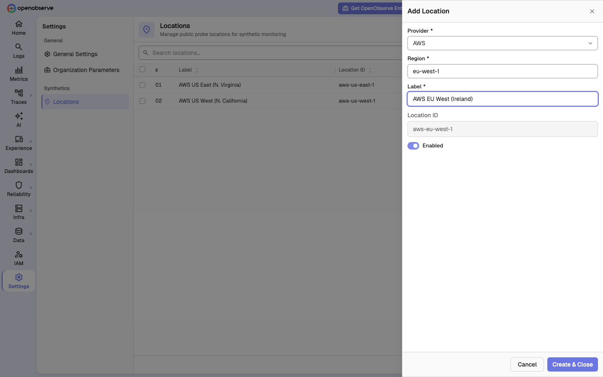
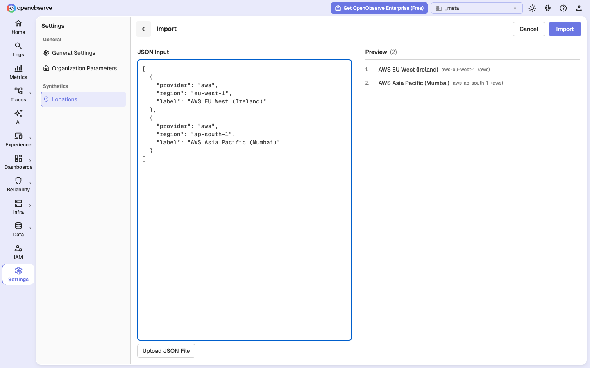

# Self-hosted setup

This page explains how to run Synthetics on your own OpenObserve deployment. It applies to the Open Source edition and the Enterprise edition. The steps are the same on both. Where a capability exists only in one edition, the page says so.

By the end, you will have HTTP and browser checks that run on a schedule, with results in the UI.

## What you get in each edition

Synthetics ships in the Open Source edition. A small part of it stays Enterprise.

| Capability | Open Source | Enterprise |
|---|---|---|
| Browser, HTTP, TCP, TLS, and SSH checks | Yes | Yes |
| Public locations served by AWS Lambda probes | Yes | Yes |
| Variables, environments, folders, tags | Yes | Yes |
| Results, run history, screenshots, traces | Yes | Yes |
| Status pages | Yes | Yes |
| Private locations served by agents in your network | No | Yes |
| Alert notifications to destinations on failure and recovery | No | Yes |
| Per-check and per-folder RBAC (role-based access control) | No | Yes |
| Super cluster (checks shared across regions) | No | Yes |
| Custom domains for status pages | No | Yes |

On Open Source, checks run from public locations only. A public location is an AWS region where you deploy the two probe functions. If you need checks that run inside a private network, you need Enterprise and [Private locations](private-locations.md).

On Open Source, a failing check records the failure and shows it in the UI. It does not send a notification to a destination. The alert fields on a check are accepted but have no effect.

## How it works

A check runs in a probe. A probe is a function or an agent that performs the check and reports the result. On a self-hosted deployment, public locations use two AWS Lambda functions that you deploy in your own AWS account.

```
  OpenObserve                                    AWS
  -----------                                    ---
  scheduler   -- creates one job per
                 (check x location) --+
                                      v
  dispatcher  -- lambda:InvokeFunction ---->  o2-synthetics-net-probe      (http, tcp, tls, ssh)
                 region comes from the        o2-synthetics-browser-probe  (browser journeys)
                 location id                          |
                                                      | runs the check
                                                      v
                                                 your target
                                                      |
        <------ POST /api/{org}/synthetics/jobs/resolve --+  auth: o2syn_ probe token
        <------ POST /api/{org}/synthetics/jobs/ack     --+  auth: o2syn_ probe token
        <------ POST /api/{org}/synthetics_results/_json --+  auth: o2oi_ ingest token
```

Traffic flows in both directions. Both directions must work.

1. OpenObserve calls AWS Lambda. The scheduler node needs AWS credentials. The function must exist in the region named by the location id. A location id of `aws-us-west-1` invokes the function in `us-west-1`.
2. The probe calls OpenObserve. The probe fetches its job and reports the result over HTTPS. Your OpenObserve API must be reachable from AWS. If it is not, the failure shows up as a lease timeout about 15 minutes later, not as an immediate error.

The probe holds no configuration of its own. The endpoint, the probe token, and the ingest token arrive in the invoke payload for each job.

Enterprise deployments can also run agents inside their own network. Those agents pull work from OpenObserve. They do not need AWS. See [Private locations](private-locations.md).

## Prerequisites

- OpenObserve v1.0.1 or later, with a node that runs the `scheduler` role. Single-node and local mode both qualify.
- An AWS account where you can create ECR repositories, an IAM role, and Lambda functions.
- Docker and the AWS CLI v2, signed in to that account.
- A public HTTPS URL for your OpenObserve API. A tunnel is fine for a trial.
- Root user credentials for OpenObserve. Only the root user can register a location.

Decide which AWS regions the checks run from. Each region is a separate deployment. Start with one. The first region takes about 30 minutes.

## Step 1: Get the probe images

The probe images are public on GitHub Container Registry (GHCR):

| Image | Runs | Architecture for Lambda |
|---|---|---|
| `ghcr.io/openobserve/openobserve-synthetic-net-probe` | HTTP, TCP, TLS, SSH checks | `arm64` |
| `ghcr.io/openobserve/openobserve-synthetics-browser-probe` | Browser journeys | `amd64` |

AWS Lambda pulls container images from Amazon ECR only. It rejects any other registry. Private ECR repositories are also scoped to one region. So you copy each image into an ECR repository in every region where you run the function.

Pin a release tag. Do not use `latest` in production. Release tags look like `v0.0.12`.

```bash
export AWS_REGION=us-west-1
export ACCT=<your-aws-account-id>
export PROBE_VERSION=v0.0.12
export ECR=$ACCT.dkr.ecr.$AWS_REGION.amazonaws.com

aws ecr get-login-password --region $AWS_REGION \
  | docker login --username AWS --password-stdin $ECR

aws ecr create-repository --region $AWS_REGION --repository-name o2-synthetics-net-probe
aws ecr create-repository --region $AWS_REGION --repository-name o2-synthetics-browser-probe

# Protocol probe: arm64
docker pull --platform linux/arm64 ghcr.io/openobserve/openobserve-synthetic-net-probe:$PROBE_VERSION
docker tag ghcr.io/openobserve/openobserve-synthetic-net-probe:$PROBE_VERSION $ECR/o2-synthetics-net-probe:$PROBE_VERSION
docker push $ECR/o2-synthetics-net-probe:$PROBE_VERSION

# Browser probe: amd64
docker pull --platform linux/amd64 ghcr.io/openobserve/openobserve-synthetics-browser-probe:$PROBE_VERSION
docker tag ghcr.io/openobserve/openobserve-synthetics-browser-probe:$PROBE_VERSION $ECR/o2-synthetics-browser-probe:$PROBE_VERSION
docker push $ECR/o2-synthetics-browser-probe:$PROBE_VERSION
```

Make sure that both images are in ECR:

```bash
aws ecr describe-images --region $AWS_REGION \
  --repository-name o2-synthetics-net-probe --query 'imageDetails[].imageTags'
aws ecr describe-images --region $AWS_REGION \
  --repository-name o2-synthetics-browser-probe --query 'imageDetails[].imageTags'
```

Both images detect Lambda mode at start, from the `AWS_LAMBDA_FUNCTION_NAME` variable that Lambda sets. The same images also run as private agents on Enterprise.

## Step 2: Create the Lambda functions

### Execution role

Create the role once per account. The probes make no AWS API calls of their own, so the role only needs CloudWatch Logs.

```bash
aws iam create-role --role-name o2-synthetics-probe-role \
  --assume-role-policy-document '{
    "Version":"2012-10-17",
    "Statement":[{"Effect":"Allow",
                  "Principal":{"Service":"lambda.amazonaws.com"},
                  "Action":"sts:AssumeRole"}]}'

aws iam attach-role-policy --role-name o2-synthetics-probe-role \
  --policy-arn arn:aws:iam::aws:policy/service-role/AWSLambdaBasicExecutionRole
```

### Let Lambda pull from ECR

Lambda pulls the image with its own service identity. Attach a pull policy to each repository, once per region.

```bash
cat > /tmp/lambda-pull.json <<EOF
{"Version":"2012-10-17","Statement":[{"Sid":"LambdaECRImageRetrievalPolicy",
  "Effect":"Allow","Principal":{"Service":"lambda.amazonaws.com"},
  "Action":["ecr:BatchGetImage","ecr:GetDownloadUrlForLayer"]}]}
EOF
aws ecr set-repository-policy --region $AWS_REGION \
  --repository-name o2-synthetics-net-probe --policy-text file:///tmp/lambda-pull.json
aws ecr set-repository-policy --region $AWS_REGION \
  --repository-name o2-synthetics-browser-probe --policy-text file:///tmp/lambda-pull.json
```

### Functions

Create the functions once per region. The two probes use different CPU architectures. If you set `--architectures` wrong, the function is created but fails at invoke time with an exec format error.

```bash
# Protocol probe: arm64, 256 MB
aws lambda create-function \
  --region $AWS_REGION \
  --function-name o2-synthetics-net-probe \
  --package-type Image \
  --code ImageUri=$ECR/o2-synthetics-net-probe:$PROBE_VERSION \
  --role arn:aws:iam::$ACCT:role/o2-synthetics-probe-role \
  --architectures arm64 \
  --timeout 840 \
  --memory-size 256

# Browser probe: x86_64, 2048 MB (Chromium needs the memory)
aws lambda create-function \
  --region $AWS_REGION \
  --function-name o2-synthetics-browser-probe \
  --package-type Image \
  --code ImageUri=$ECR/o2-synthetics-browser-probe:$PROBE_VERSION \
  --role arn:aws:iam::$ACCT:role/o2-synthetics-probe-role \
  --architectures x86_64 \
  --timeout 840 \
  --memory-size 2048
```

These are the values that OpenObserve Cloud runs:

| Function | Architecture | Memory | Timeout |
|---|---|---|---|
| `o2-synthetics-net-probe` | `arm64` | 256 MB | 840 s |
| `o2-synthetics-browser-probe` | `x86_64` | 2048 MB | 840 s |

> **Warning**: Keep `--timeout 840`. OpenObserve compares every check against `ZO_SYNTHETICS_MAX_CHECK_BUDGET_SECS`, which defaults to 840. If the function timeout is lower, AWS kills a check that OpenObserve accepted, and the run reports a failure that your target never had. See [The timeout budget](#the-timeout-budget).

The function names must match your OpenObserve configuration exactly. They must also be the same in every region. The dispatcher invokes one configured name in whichever region a job resolves to.

### Networking

Leave the functions outside a VPC unless you have a specific reason. A Lambda function inside a VPC has no internet route without a NAT gateway. Then the probe can reach neither your targets nor your OpenObserve API, and both directions fail without a clear error.

Make sure that the function has the expected values:

```bash
aws lambda get-function-configuration --region $AWS_REGION \
  --function-name o2-synthetics-net-probe \
  --query '{Timeout:Timeout,Memory:MemorySize,Arch:Architectures}'
# -> {"Timeout": 840, "Memory": 256, "Arch": ["arm64"]}
```

### Update a function later

To move to a new probe release, push the new tag to ECR as in Step 1, then point the function at it:

```bash
aws lambda update-function-code --region $AWS_REGION \
  --function-name o2-synthetics-net-probe \
  --image-uri $ECR/o2-synthetics-net-probe:$PROBE_VERSION
```

## Step 3: Let OpenObserve invoke the functions

Attach this policy to the identity that your scheduler node runs as:

```json
{
  "Version": "2012-10-17",
  "Statement": [{
    "Effect": "Allow",
    "Action": "lambda:InvokeFunction",
    "Resource": [
      "arn:aws:lambda:*:<your-aws-account-id>:function:o2-synthetics-net-probe",
      "arn:aws:lambda:*:<your-aws-account-id>:function:o2-synthetics-browser-probe"
    ]
  }]
}
```

The `*` in the region position matters once you serve more than one region.

OpenObserve resolves credentials through the standard AWS SDK chain. Any of these work:

- Environment variables: `AWS_ACCESS_KEY_ID`, `AWS_SECRET_ACCESS_KEY`, and `AWS_SESSION_TOKEN` for a temporary key.
- A shared profile under `~/.aws`.
- EC2 instance metadata.
- IRSA or EKS Pod Identity on Kubernetes. Attach the policy to the service account and set no credential variables at all.

> **Note**: `AWS_DEFAULT_REGION` does not select the invoke region. The region comes from the location id, as described in Step 6. `AWS_DEFAULT_REGION` only seeds the SDK default.

Temporary STS credentials expire. When they do, every dispatch fails with `ExpiredTokenException`. Refresh them before you continue.

## Step 4: Configure OpenObserve

Set these variables on every OpenObserve node:

```bash
ZO_SYNTHETICS_ENABLED=true
ZO_SYNTHETICS_LAMBDA_NET=o2-synthetics-net-probe
ZO_SYNTHETICS_LAMBDA_BROWSER=o2-synthetics-browser-probe
ZO_SYNTHETICS_API_ENDPOINT=https://openobserve.example.com
```

Then restart OpenObserve. `ZO_SYNTHETICS_ENABLED` controls both the background workers and the HTTP routes. A configuration reload cannot turn it on or off. Every other `ZO_SYNTHETICS_*` variable can change through `POST /config/reload` without a restart.

Two variables need attention:

- `ZO_SYNTHETICS_LAMBDA_NET` is empty by default. Empty means that public locations are served by agents, which is an Enterprise path. If you leave it empty on Open Source, protocol checks are scheduled, queued, and never dispatched, and the log does not say why. Set it.
- `ZO_SYNTHETICS_LAMBDA_BROWSER` already defaults to `o2-synthetics-browser-probe`. Browser checks work as soon as a function exists under that name.

The full list is in [Environment variables](#environment-variables).

On the Helm chart, put the variables under `config:` in `values.yaml`. The chart sets no `ZO_SYNTHETICS_*` key by default.

Make sure that the server picked up the change:

```bash
curl -s https://openobserve.example.com/config | jq '{build_type, synthetics_enabled, synthetics_private_locations_enabled}'
```

Expected on Open Source:

```json
{ "build_type": "opensource", "synthetics_enabled": true, "synthetics_private_locations_enabled": false }
```

If `synthetics_enabled` is `false`, the restart did not pick up the variable.

## Step 5: Make your API reachable from AWS

The probe calls your API back. An address such as `http://localhost:5080` is not reachable from Lambda.

In production, point `ZO_SYNTHETICS_API_ENDPOINT` at your public HTTPS endpoint. If you leave it empty, OpenObserve uses `ZO_WEB_URL`.

For a trial on a laptop, a tunnel works:

```bash
ngrok http 5080
# then
ZO_SYNTHETICS_API_ENDPOINT=https://<generated>.ngrok-free.dev
```

This variable is reloadable. Tunnel URLs change on every restart, so update the variable and call `POST /config/reload` instead of a restart.

Make sure that the endpoint answers from outside your network:

```bash
curl -s https://openobserve.example.com/config | jq .synthetics_enabled
```

If this fails from a machine on the public internet, it also fails from Lambda.

## Step 6: Register a location

A location is a place that a check runs from. OpenObserve ships with no locations. Until you add one, there is nowhere for a check to run, and the check editor offers no choice.

### In the UI

1. Switch to the `_meta` organization.
2. Open **Settings**, then **Locations** under **Synthetics**.


3. Click **Add Location**. Leave **Provider** as **AWS**, set **Region** to the AWS region where you created the functions, for example `us-west-1`, and enter a **Label** such as `AWS US West (N. California)`. All three are required.
4. Keep **Enabled** on and click **Create & Close**.



The **Location ID** fills in as `aws-<region>`, for example `aws-us-west-1`. The dispatcher reads the region from this id, so choosing **AWS** as the provider is what makes routing work.

To add several regions at once, click **Import** and paste a JSON array, or upload it as a file. Each entry needs `provider`, `region`, and `label`. The preview shows the location ID each entry gets before you import.

```json
[
  { "provider": "aws", "region": "eu-west-1", "label": "AWS EU West (Ireland)" },
  { "provider": "aws", "region": "ap-south-1", "label": "AWS Asia Pacific (Mumbai)" }
]
```



### With the API

The root user can register a location directly:

```bash
O2=https://openobserve.example.com
AUTH="$ROOT_USER:$ROOT_PASS"

curl -u "$AUTH" -X POST "$O2/api/default/synthetics/locations" \
  -H 'Content-Type: application/json' \
  -d '{"kind":"public",
       "provider":"aws",
       "region":"us-west-1",
       "id":"aws-us-west-1",
       "label":"AWS US West 1",
       "enabled":true}'
```

Set `kind` to `public`. It defaults to `private`, which Open Source refuses. To register several regions in one request, send `{"locations": [ ... ]}` with one such object per region.

One location serves both probes. Protocol checks use a pool named `net-<location id>`. Browser checks always use the `aws-browser` pool. You do not set the pool by hand.

Make sure that the location exists:

```bash
curl -s -u "$AUTH" "$O2/api/default/synthetics/locations" \
  | jq '.locations[] | {id, pool, enabled}'
```

> **Note**: On Open Source, a request with `"kind":"private"` is refused with HTTP 400. Private locations are served by agents inside your network, which is an Enterprise capability.

## Step 7: Create the first checks

Open **Experience**, then **Synthetics**, and click **New Check**. An HTTP check against a health endpoint is the fastest way to see a result. The [Protocol checks](protocol-checks.md) and [Browser tests](browser-tests.md) pages explain each type.

To exercise both functions from the command line, create one check of each family:

```bash
LOC=aws-us-west-1

# HTTP: protocol probe
curl -s -u "$AUTH" -X POST "$O2/api/default/synthetics" \
  -H 'Content-Type: application/json' -d '{
  "name":"first-http","type":"http","target":"https://example.com",
  "config":{"method":"GET","timeout_ms":10000,
            "assertions":[{"field":"status_code","operator":"eq","value":200}]},
  "frequency":{"type":"minutes","interval":5},
  "locations":["'"$LOC"'"],"enabled":true,"retries":0}'

# Browser: browser probe
curl -s -u "$AUTH" -X POST "$O2/api/default/synthetics" \
  -H 'Content-Type: application/json' -d '{
  "name":"first-browser","type":"browser","target":"https://example.com",
  "config":{"browser_devices":[{"browser":"chromium","device":"desktop"}],
            "timeout_ms":30000,"journey_budget_ms":120000,
            "steps":[{"id":"s1","action":"navigate","name":"open",
                      "url":"https://example.com"}]},
  "frequency":{"type":"minutes","interval":5},
  "locations":["'"$LOC"'"],"enabled":true,"retries":0}'
```

Two schema rules reject an otherwise sensible payload:

- Assertion operators are `eq`, `ne`, `lt`, `gt`, `contains`, and `not_contains`. The value `equals` is rejected.
- Browser step actions are `navigate`, `click`, `hover`, `fill`, `press`, `select`, `check`, `uncheck`, `upload`, and `assert`. The value `goto` is rejected.

## Step 8: Make sure that checks run

Wait one scheduling interval. Then list the checks:

```bash
curl -s -u "$AUTH" "$O2/api/default/synthetics" \
  | jq -r '.checks[] | "\(.name)\t\(.type)\t\(.status)\t\(.last_response_ms)"'
```

A working setup looks like this:

```
first-http      http     passed   17
first-browser   browser  passed   13810
```

The server log shows the whole path in four lines:

```
[synthetics scheduler]  firing synthetic synthetics_id=... run_id=... job_count=1
[synthetics scheduler]  job enqueued job_id=... location=aws-us-west-1
[synthetics dispatcher] attempting Lambda invoke: job_id=... fn=o2-synthetics-net-probe region=us-west-1
[synthetics dispatcher] Lambda invoked status_code=200
```

If `status` stays `unknown`, or a check fails, go to [Troubleshooting](#troubleshooting). Every abandoned dispatch records why, in both the run detail and the `synthetics_results` stream.

## Add more regions

For each additional region:

1. Push both images to that region's ECR, as in Step 1.
2. Attach the pull policy and create both functions with the same names, as in Step 2.
3. Register a location with id `aws-<region>`, as in Step 6.

OpenObserve needs no configuration change. The function names are already set, and the region comes from the location id. A check can list several locations and runs from each.

## Enterprise: private locations

An Enterprise deployment can also run agents inside its own network. An agent is a long-running process that pulls jobs from OpenObserve, runs them, and reports the result. It needs outbound HTTPS to OpenObserve and nothing from AWS.

The UI composes the install command for you. Open **Experience**, then **Synthetics**, then the **Private Locations** tab, and click **Set up an agent**. The command downloads a public install script from `ZO_SYNTHETICS_INSTALL_SCRIPT_URL` and runs the agent on Docker, Kubernetes, Linux, or Windows. See [Private locations](private-locations.md) for the full procedure and the token management.

Two more variables apply to agents:

- `ZO_SYNTHETICS_INSTALL_SCRIPT_URL` points at the install script that the setup drawer shows. If you mirror the script, change it.
- `ZO_SYNTHETICS_AGENT_STALE_SECS` is the number of seconds without a lease or heartbeat after which an agent counts as stale.

On Open Source, these two variables are read but have no effect. The agent routes under `/api/{org}/synthetics/jobs/lease`, `/agent/register`, `/agent/heartbeat`, and `/agent-setup` return HTTP 404.

## Environment variables

| Variable | Default | Reload | Edition | Notes |
|---|---|---|---|---|
| `ZO_SYNTHETICS_ENABLED` | `false` | restart | Both | Master switch. Controls the workers and the HTTP routes. |
| `ZO_SYNTHETICS_LAMBDA_NET` | empty | hot | Both | Protocol probe function name. Empty disables Lambda dispatch for protocol checks. |
| `ZO_SYNTHETICS_LAMBDA_BROWSER` | `o2-synthetics-browser-probe` | hot | Both | Browser probe function name. |
| `ZO_SYNTHETICS_API_ENDPOINT` | empty, falls back to `ZO_WEB_URL` | hot | Both | URL that the probe calls back on. |
| `ZO_SYNTHETICS_MAX_CHECK_BUDGET_SECS` | `840` | hot | Both | Ceiling on the worst case of one check. Keep equal to the function timeout. |
| `ZO_SYNTHETICS_JOB_LEASE_SECS` | `900` | hot | Both | How long a job stays leased before it is queued again. Must be greater than the budget. |
| `ZO_SYNTHETICS_MAX_NET_TIMEOUT_MS` | `300000` | hot | Both | Ceiling for one attempt of a protocol check. |
| `ZO_SYNTHETICS_BROWSER_MAX_STEPS` | `50` | hot | Both | Maximum steps in one browser journey. |
| `ZO_SYNTHETICS_BROWSERS` | `chromium` | hot | Both | Browser engines offered to checks. Each needs its own function. |
| `ZO_SYNTHETICS_DEVICES` | `desktop:1440:900,tablet:768:1024,mobile:375:667` | hot | Both | Viewports offered to browser checks, as `id:width:height`. |
| `ZO_SYNTHETICS_SCHEDULER_JITTER_ENABLED` | `true` | hot | Both | Spreads checks with the same frequency across their interval. |
| `ZO_SYNTHETICS_ORPHAN_DETECTION_ENABLED` | `true` | hot | Both | Reports enabled checks that no scheduler claims. |
| `ZO_SYNTHETICS_RECORDER_EXTENSION_URL` | Chrome Web Store listing | hot | Both | Link to the recorder extension in the browser test editor. |
| `ZO_SYNTHETICS_INSTALL_SCRIPT_URL` | GitHub raw URL of `install.sh` | hot | Enterprise | Private agent install script shown in the setup drawer. |
| `ZO_SYNTHETICS_AGENT_STALE_SECS` | `120` | hot | Enterprise | Seconds before an agent counts as stale. |
| `ZO_SYNTHETICS_SUBTESTS_REPLICATION_GRACE_SECS` | `300` | restart | Enterprise | Super cluster only. Grace period for subtests that are not yet replicated. |

"Hot" means that `POST /config/reload` applies the change. "Restart" means that you must restart the process.

## The timeout budget

Three limits sit inside each other:

```
check worst case  <=  MAX_CHECK_BUDGET_SECS  <=  Lambda timeout  <  JOB_LEASE_SECS
   (enforced)               840                     840                900
```

If the function timeout is below the budget, OpenObserve accepts a check that AWS then kills mid-run. The run reports a failure that your target never had.

If the lease is at or below the budget, a run that finishes at the budget has no time left to acknowledge. The reaper queues the job again, and the check runs a second time. You get duplicate results, double browser cost, and an alert caused by the duplicate.

For browser checks, the budget is multiplied by the number of browser and device combinations. The probe runs them one after another inside one job. A `desktop + mobile` configuration with retries can exceed a 900 second lease from values that look small. OpenObserve rejects such a check at save time and shows the arithmetic.

OpenObserve cannot read your function timeout. Nothing checks these numbers for you. If you change one side, change the other.

## Artifacts and object storage

Browser checks produce screenshots and traces. Where they go depends on your storage configuration.

- Local disk. The probe uploads them back through `POST /api/{org}/synthetics/jobs/upload`, the same endpoint as in Step 5. Nothing extra to configure.
- S3 or another object store. OpenObserve hands the probe presigned PUT URLs. A presigned URL is a URL that carries its own authorization. The probe must be able to reach that URL. A MinIO on `localhost:9000` is not reachable from Lambda. This is the usual cause of "the check passes but there are no screenshots" during a local trial. Use local storage on a laptop.

No extra IAM is needed in either case.

## Troubleshooting

Failures are recorded, not guessed. Look in three places: the run detail in the UI, the `synthetics_results` stream (fields `error` and `error_source`), and the server log under `[synthetics dispatcher]`.

| What you see | Cause | Fix |
|---|---|---|
| Checks are queued, nothing dispatches, no errors | `ZO_SYNTHETICS_LAMBDA_NET` is empty. The most common mistake on Open Source. | Step 4 |
| `no Lambda function configured for this pool` | Function name differs between the configuration and AWS | Step 2 |
| `cannot derive an AWS region from the job's location` | Location id is not `aws-<region>` | Step 6 |
| `ResourceNotFoundException` | The function is missing in that region | Add more regions |
| `ExpiredTokenException` | Temporary STS credentials expired | Step 3 |
| `AccessDeniedException` | Missing `lambda:InvokeFunction` | Step 3 |
| `Lambda does not have permission to access the ECR image` | Missing repository pull policy | Step 2 |
| Invoked, then a lease timeout about 15 minutes later with no result | The probe cannot reach your API | Step 5. Also look at VPC and NAT. |
| `exec format error` in the Lambda error payload | Wrong `--architectures` | `arm64` for net, `x86_64` for browser. Step 2 |
| Check killed mid-run although the target was healthy | Function timeout below the check budget | The timeout budget |
| Browser check passes but screenshots are missing | Presigned URLs not reachable from Lambda | Artifacts and object storage |
| `no enabled ingest token for this organisation` | The organization has no ingestion token | See below |
| A protocol check stays pending forever | Its location is not registered, so the job went to a pool that nothing serves | Step 6 |
| A failing check sends no notification | Notifications are Enterprise only | What you get in each edition |

### Tokens

Two credentials ride in the invoke payload. OpenObserve mints both. An `o2syn_` probe token authenticates the `resolve` and `ack` calls. An `o2oi_` ingest token authenticates the result write. A missing probe token is minted on the fly at dispatch. A missing ingest token is not. If an organization predates ingestion tokens, create one:

```bash
curl -u "$AUTH" "$O2/api/default/ingestion-tokens"
curl -u "$AUTH" -X POST "$O2/api/default/ingestion-tokens" \
  -H 'Content-Type: application/json' -d '{"name":"default"}'
```

Probe tokens are managed under **IAM**, then **Synthetics Tokens**. See [Managing agent tokens](private-locations.md#managing-agent-tokens).

**Need help:**

  [Community Slack](https://short.openobserve.ai/community)

  [GitHub issues](https://github.com/openobserve/openobserve/issues)
