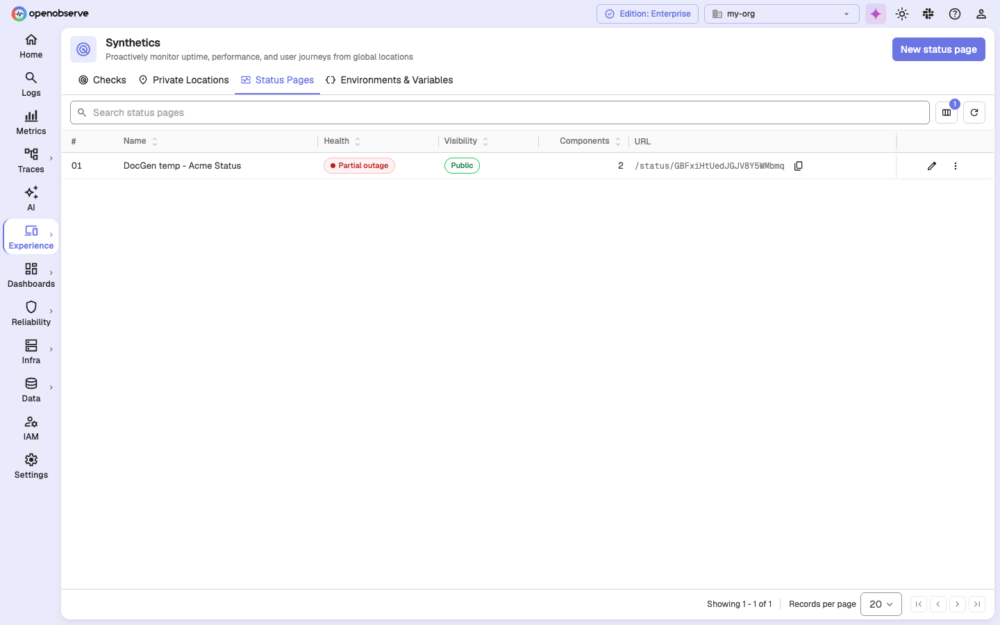
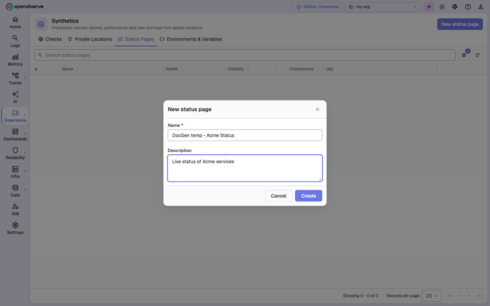
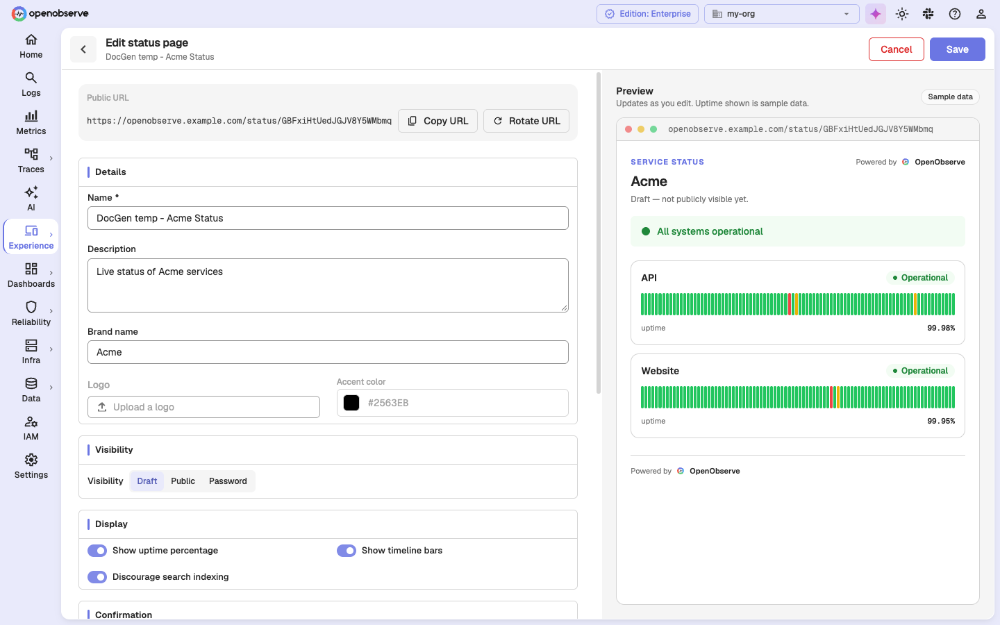
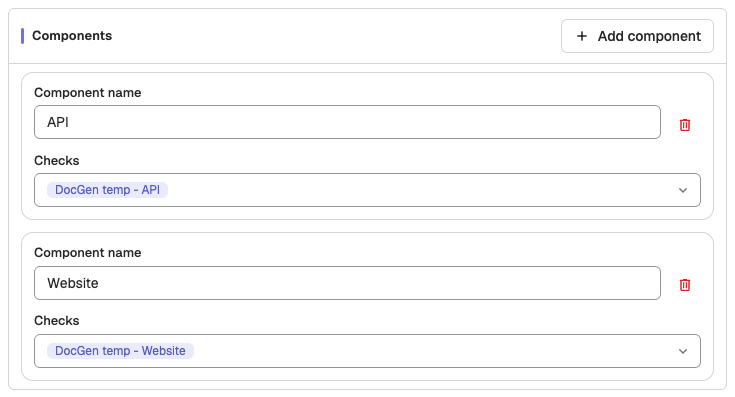
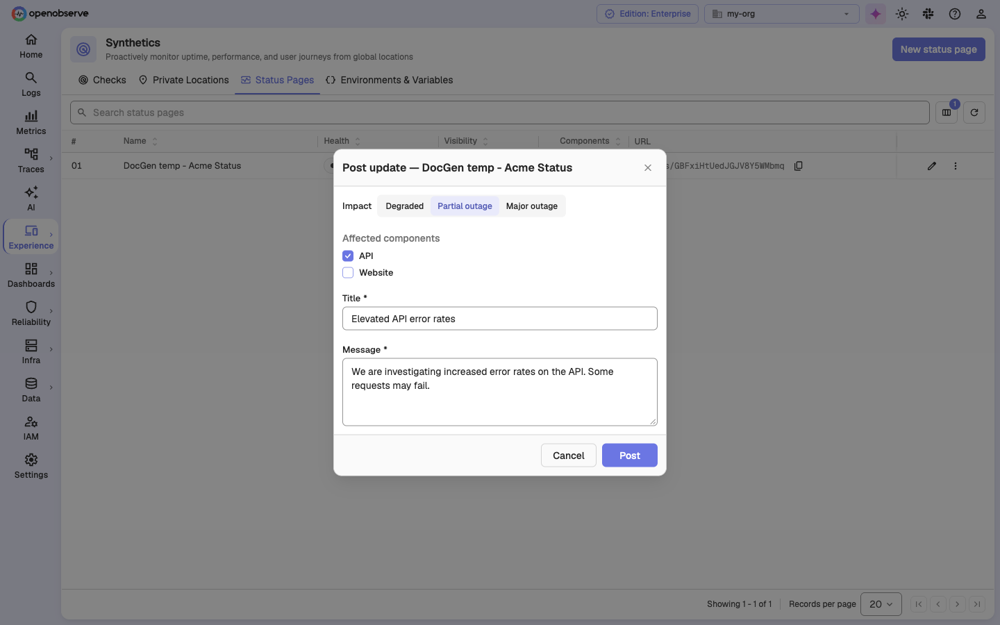
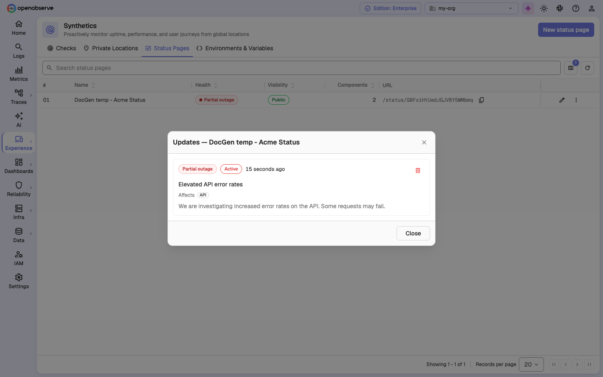
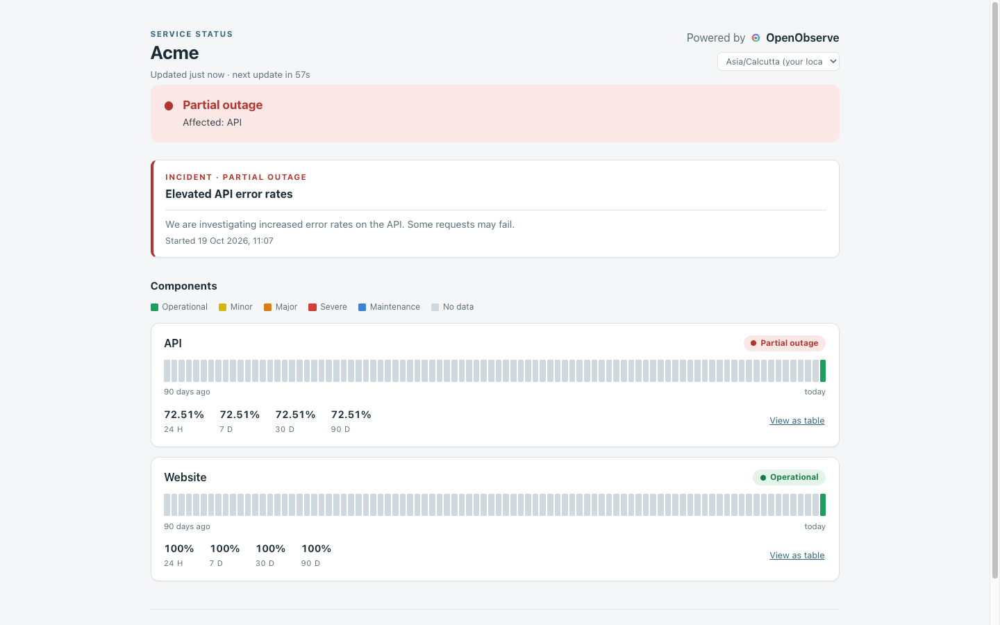
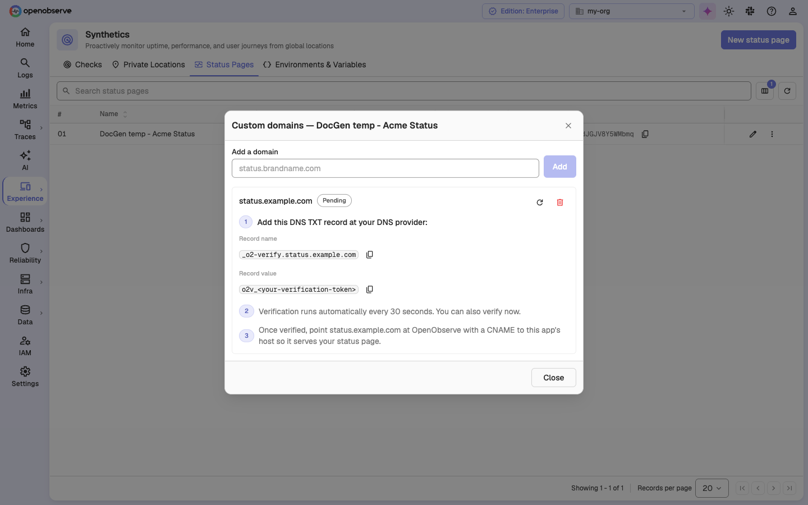

# Status Pages

Status Pages turn your synthetic checks into a public, branded page that your customers can open to see whether your services are up. You group checks into components, and OpenObserve opens and resolves incidents automatically as those checks fail and recover. You can also post manual updates during an outage.

:::note[Availability]
Status Pages are part of **Synthetics**, which is controlled by `ZO_SYNTHETICS_ENABLED` (on by default). For a self-hosted deployment, see [Self-hosted setup](self-hosted-setup.md). Creating pages, automatic incidents, and public serving work in every edition. **Manual updates**, **custom domains**, and **logo upload** require OpenObserve Enterprise or OpenObserve Cloud. In the open-source edition, these options show a lock icon.
:::

## How status pages work

Each status page is a snapshot of the health of its components, rebuilt every 60 seconds by default. Each component maps to one or more synthetic checks. As those checks fail and recover, OpenObserve opens and resolves **automatic incidents** and computes uptime from the downtime they record.

Visitors reach a public page at `/status/<slug>` on your OpenObserve host or, on Enterprise and Cloud, on a custom domain that you own.

## Open Status Pages

1. In the left navigation, select **Experience** > **Synthetics**.
2. Select the **Status Pages** tab.

The list shows each page's **Name**, **Health**, **Visibility**, number of **Components**, and public **URL**. **Health** is one of *Operational*, *Degraded*, *Partial outage*, *Major outage*, *Maintenance*, or *No data*. Use **Search status pages** to filter the list. The **More actions** (⋯) menu on each row has **Edit**, **Post update**, **View updates**, **Copy URL**, **Manage domains**, and **Delete**.

## Create a status page

1. On the **Status Pages** tab, click **New status page**.
2. Enter a **Name** and, optionally, a **Description**.
3. Click **Create**.

The page opens in the editor. Every new page starts as a **Draft**, so visitors can't see it until you publish it. Each page gets a random URL slug. To change the slug, click **Rotate URL** in the editor. The old URL stops working once you save. Click **Copy URL** to copy the public URL.

## Edit a status page

The editor has the settings on the left and a live **Preview** on the right. The preview updates as you type and uses sample uptime data. Click **Save** to apply your changes.

### Details

- **Name** and **Description** appear at the top of the public page.
- **Brand name**, **Accent color** (a `#RRGGBB` value), **Logo**, and **Favicon** control branding. Logo and favicon upload require Enterprise or Cloud. On self-hosted Enterprise, the logo defaults to your organization's logo. Click **Revert to org logo** to go back to it.

### Visibility

| Option | What visitors see |
| --- | --- |
| **Draft** | Nothing. The page isn't served. |
| **Public** | Anyone with the URL can view the page. |
| **Password** | Visitors must enter a password first. |

For **Password** pages, the password is stored as a hash and is never shown again. When you edit the page, leave the field blank to keep the current password.

### Display

- **Show uptime percentage** and **Show timeline bars** are on by default.
- **Discourage search indexing** asks search engines not to index the page. It is on by default.

### Confirmation

- **Confirm failures** is the number of consecutive failed runs before an incident opens. The default is `2`.
- **Confirm recovery** is the number of consecutive passing runs before the incident resolves. The default is `2`.

Both values accept `1` to `10`. Higher values prevent a single failed run from showing an outage.

### Components

A component is a part of your service that visitors see on the page, such as *API*, *Web App*, or *Database*.

1. In the **Components** section, click **Add component**.
2. Enter a **Component name**.
3. Under **Checks**, select the synthetic checks that drive the component's health.

:::note
On Enterprise, you can only add a check to a component if you have read access to that check's folder. A status page can never publish the status of a check that you can't read.
:::

## Automatic incidents

OpenObserve watches the checks on each page and turns failures into incidents:

- An incident opens after the **Confirm failures** count of consecutive failures.
- It resolves after the **Confirm recovery** count of consecutive recoveries.
- If the check fails again within 10 minutes, the same incident reopens instead of a new one being created. A flapping check stays a single incident.
- Only incidents with an impact of **partial outage** or worse count as downtime. Overlapping incidents are never counted twice.

If an automatic incident was a false alarm, an Enterprise or Cloud user can mark it as a false positive through the API (`POST /api/<org_id>/status_pages/notices/<notice_id>/mark_false_positive`). This resolves the incident and snoozes the check for a number of hours, so the same incident does not reopen right away. There is no UI action for this yet.

Uptime covers the last 90 days. For a new page, uptime is counted from the first time the page left **Draft**, so a young page never shows a misleading long history.

## Post a manual update

:::note[Enterprise and Cloud]
Manual updates require OpenObserve Enterprise or OpenObserve Cloud.
:::

Use a manual update to tell visitors about a problem that your checks don't catch, or to add detail to an ongoing incident.

1. On the **Status Pages** tab, open the page's **More actions** (⋯) menu and select **Post update**.
2. Choose the **Impact**: *Degraded*, *Partial outage*, or *Major outage*.
3. Under **Affected components**, all components are selected by default. Clear the ones that aren't affected. At least one must stay selected.
4. Enter a **Title** and a **Message**.
5. Click **Post**.

If the page already has an active incident, the dialog shows an **Update type** choice:

- **Add to existing incident** appends your message to that incident's timeline. Use **Escalate impact** to raise its impact, or keep **No change**.
- **Post as new incident** opens a separate incident.

### View and remove updates

Open the page's **More actions** (⋯) menu and select **View updates**. The dialog lists every update with its state (*Scheduled*, *Active*, or *Resolved*) and the components it affects. To remove an update from the public page, delete it from this list.

## Publish a status page

1. In the editor, set **Visibility** to **Public** or **Password**.
2. Click **Save**.

The page is now served at `/status/<slug>`. It shows the overall status, any active updates, and each component's uptime for the last 24 hours, 7 days, 30 days, and 90 days. Visitors can pick a **Display timezone** for the timestamps. The page refreshes itself, so visitors see new status without reloading.

Visitors and tools can also read the page through these public endpoints:

| Endpoint | Returns |
| --- | --- |
| `/api/status_pages_public/<slug>` | The page snapshot as JSON |
| `/api/status_pages_public/<slug>/badge.svg` | An SVG badge with the overall status |
| `/api/status_pages_public/<slug>/feed.xml` | An Atom feed of the page's updates |

The badge and feed return `404` for draft pages, password-protected pages, and unknown slugs, so they never reveal anything to visitors who aren't signed in. Public endpoints are rate-limited per IP address. Visitors who go over the limit get HTTP `429`.

## Use a custom domain

:::note[Enterprise and Cloud]
Custom domains require OpenObserve Enterprise or OpenObserve Cloud.
:::

You can serve a status page on your own domain, such as `status.example.com`, instead of your OpenObserve host.

1. On the **Status Pages** tab, open the page's **More actions** (⋯) menu and select **Manage domains**.
2. Under **Add a domain**, enter your domain and click **Add**.
3. Copy the **Record name** (`_o2-verify.<your-domain>`) and the **Record value**, and add them as a DNS `TXT` record.
4. Click **Verify now**, or wait for the automatic check, which runs every 30 seconds by default. The domain moves from *Pending* to *Verified*. If it shows *Failed*, the dialog shows the reason: *TXT record not found* (not created yet or not propagated), *TXT record found, but the value doesn't match* (re-copy the value), or *DNS resolution failed* (retry later).
5. After the domain is verified, add a `CNAME` record that points your domain at your OpenObserve host.

Two organizations can never claim the same domain. After you verify or remove a domain, it can take up to about 30 seconds to take effect. Your OpenObserve host itself is never treated as a status page domain.

:::note[Self-hosted HTTPS]
On a self-hosted deployment, you handle HTTPS for the custom domain. Point your reverse proxy or CDN at OpenObserve and forward the original `Host` header.
:::

## Permissions

On Enterprise, status pages appear as **Status Pages** in role permissions. You can grant access to each page separately from your other Synthetics permissions. The public page and its endpoints don't require sign-in.

## Billing

On OpenObserve Cloud, protocol checks that are added to a status page draw on a separate monthly allowance of free status-page steps. Status-page checks first use any steps left in your one-time free protocol allowance, then the monthly allowance, which resets each month. If both run out, extra steps are billed as regular protocol steps. When your one-time protocol allowance runs out, status-page checks keep running on the monthly allowance. Browser checks don't get the monthly allowance, even when they are on a status page.

## Configuration reference

| Variable | Default | Description |
| --- | --- | --- |
| `ZO_SYNTHETICS_ENABLED` | `true` | Turns on Synthetics, including Status Pages. Requires a restart to change. |
| `ZO_STATUS_PAGE_REBUILD_INTERVAL` | `60` | Seconds between status page snapshot rebuilds. Requires a restart to change. |
| `ZO_STATUS_PAGE_DOMAIN_VERIFY_INTERVAL` | `30` | Seconds between custom domain DNS checks. Requires a restart to change. |
| `ZO_STATUS_PAGE_PUBLIC_RPM` | `240` | Requests per minute per IP for public endpoints. Set to `0` to turn off the limit. Takes effect without a restart. |
| `O2_SYNTHETICS_FREE_STATUS_STEP_POOL` | `43200` | Enterprise: monthly free protocol steps for checks on a status page. |
