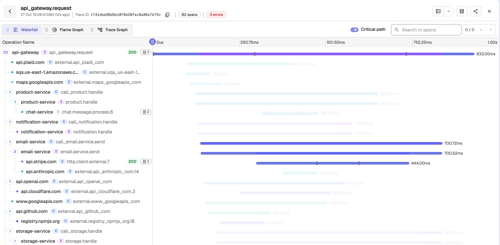
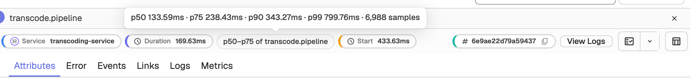
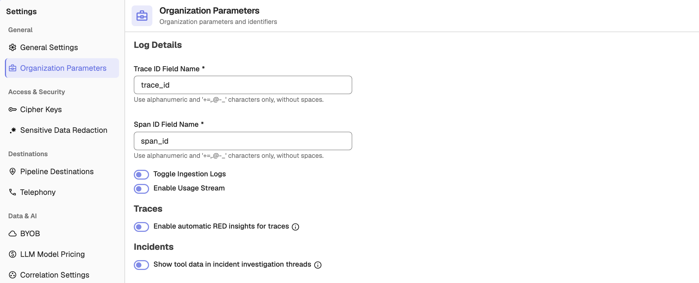

These tools help you find what slowed down or broke a request once you have a trace open, and keep your trace searches at hand.

## Critical path

On a trace's **Waterfall** tab, turn on **Critical path**. Each span bar then marks the part that lies on the critical path, the chain of work that set the trace's total duration, and other spans are dimmed. The selected span is never dimmed. The toggle is off by default and remembers your choice. For a trace with several roots, only the primary root is followed.

## Span percentiles

When you select a span, its sidebar shows how its duration compares with other spans of the same operation, for example `p90–p99 of GET /checkout`. Hover the tag to see p50, p75, p90, p99, and the sample count. The tag uses the warning colour for p90 to p99 and the error colour above p99. It is hidden when there are fewer than 20 samples.

## View a span's profile

If profile samples carry the span's `trace_id` and `span_id`, the span sidebar shows **View Profile**. It opens the Profiles page on that span's flame graph.

## Automatic RED insights

:::info[Enterprise]
RED insights is available in Enterprise builds only.
:::

Go to **Settings** > **Organization Parameters** and, under **Traces**, turn on **Enable automatic RED insights for traces**. It is off by default. Every 6 hours, OpenObserve then creates rate, error-ratio, and p95-latency anomaly detectors for up to 20 of the busiest services, those with at least 10,000 requests in 24 hours. The detectors go in the **RED insights** alert folder, tagged `auto:red-insights`, which only admins see until it is shared. Turning the setting off deletes them at the next cycle.

Recent anomalies appear in an **Insights** strip in the [Service Catalog](service-catalog.md), with links to the traces for that window and to the detector's **Charts** tab.

## Service Catalog request counts

Requests, errors, error rate, and latency in the Service Catalog count only server and consumer spans, plus root spans of any kind. Services with no such spans in the range show **—** for status, error rate, and latency.

## Saved views

In **Spans** or **Traces** mode, use the saved-views dropdown in the search bar to save, apply, update, or delete a view. Applying a view restores the stream, query, time range, mode, sort, and columns, and runs the search. Traces views are kept separate from logs views.

## Trace Graph tab

The **Trace Graph** tab of a trace has the same **Tree View | Graph View** toggle and **Search Services** box as the [Service Graph](service-graph.md), scoped to the services in that trace. In Graph View, a search keeps the matching services and their direct neighbours. In Tree View, it keeps the match, its ancestors, and its direct children.

## Drill down and RED Metrics

After a search in **Spans** or **Traces**, click **Drill down** next to the mode tabs to open the analysis as a full page. Click **Back to results** or press **Escape** to return to your results without re-running the query. The RED metrics charts switch is in the **More** menu as **RED Metrics**.
