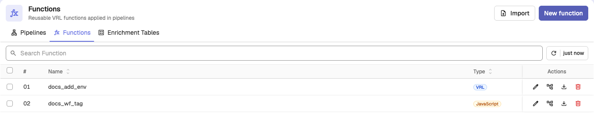
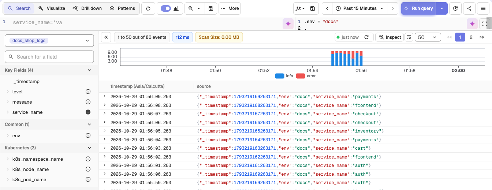
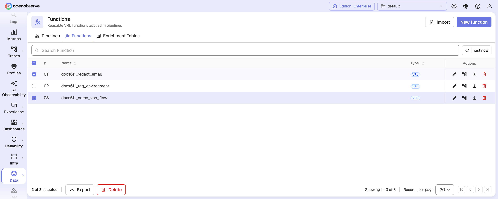
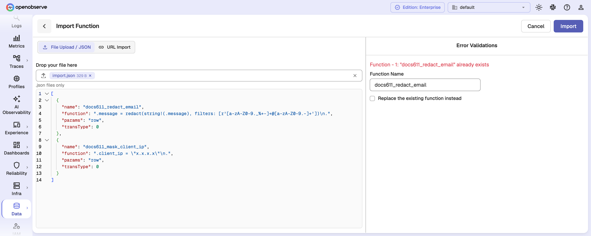

# Functions

## What are functions?

Functions in OpenObserve are defined using Vector Remap Language ([VRL](https://vrl.dev)) and can be used during ingestion or query to aid advanced capabilities like enrichment, redaction, log reduction, compliance, etc. 

There are also inbuilt query functions like `match_all` etc which can be used for full text search based on user's settings for stream or default settings. Please refer [SQL functions reference](../../../reference/sql-reference.md) for complete list of inbuilt functions.

To navigate to functions in OpenObserve, select preferred organization using organization selection control, then click on **Data > Functions** (or the **Functions** tab on the **Pipelines** page), which will take you to functions list screen. This screen lists all the functions for selected organization.  

<kbd>

</kbd>

List screen details:

- Search in listed functions
- **New function** and **Import** buttons
- Name and **Type** (**VRL** or **JavaScript**) of existing functions
- Actions — update the function, view **Associated Pipelines**, export, or delete the function

There are two ways to use function during query:

- Function with row as input
- Function with specified input columns/fields


## Function with row as input

On logs search page, you can select existing function or write new function using vrl function editor to apply function on row. The returned results will be based on function being applied.

Please note that functions on rows can be used to experiment with result of function application on a specific stream , however applying functions at query time is costly operation .Hence if applicable, after exploration and desired outcome of function during query time , we encourage users to apply such function at ingest time by associating function with stream.

<kbd>

</kbd>

## Function with specified input columns/fields
These are like sql functions, which are defined by user and act on specified input columns/fields.

## Example
Let's try a function on logs page to parse vpc flow logs ,mentioned below is sample vpc flow log record in OpenObserve.

```json
{
  "_timestamp": 1683089619868496,
  "message": "2 058694856476 eni-03c0f5ba79a66ef17 10.3.166.71 10.3.35.163 443 53672 6 49 12973 1680838556 1680838578 ACCEPT OK"
}
```
Create a vrl function which retains the `_timestamp` field from original record and parses `message` field to multiple fields like `account_id`, `action` etc:

```ruby
ts = ._timestamp  # store value of _timestamp in ts
. = parse_aws_vpc_flow_log!(.message) # assign value of object resulting from parse_aws_vpc_flow_log to current record
._timestamp = ts #set value of _timestamp from ts
. # return record
```

The function outputs the record below:
```json
{
  "_timestamp": 1683097426943815,
  "account_id": 58694856476,
  "action": "ACCEPT",
  "bytes": 12973,
  "dstaddr": "10.3.35.163",
  "dstport": 53672,
  "end": 1680838578,
  "interface_id": "eni-03c0f5ba79a66ef17",
  "log_status": "OK",
  "packets": 49,
  "protocol": 6,
  "srcaddr": "10.3.166.71",
  "srcport": 443,
  "start": 1680838556,
  "version": 2
}
```

The function can be saved using save button on top of vrl function editor, additional one can select existing function to try.

The same function can be added to a pipeline as a **Function** node to apply it at ingestion. See [Pipelines](../pipelines/pipelines.md). 

## Import and export functions

### Export

On the **Functions** list, click the **Export** (download) icon in a function's row, or hover over the row and press `x`. To export several functions at once, select their rows and click **Export** in the selection bar. OpenObserve downloads a JSON file: `<function-name>.json` for one function, or `functions-<date>.json` for several. Each entry holds the function's name, body, parameters and language.

<kbd>

</kbd>

### Import

1. On the **Functions** list, click **Import**, or press `i`.
2. On the **File Upload / JSON** tab, upload a JSON file or paste its contents; or, on the **URL Import** tab, enter the URL of one. A file may hold a single function or an array of functions, such as a file you exported.
3. Click **Import**.

When you click **Import**, OpenObserve first checks every function in the file. If any check fails, nothing is imported: the problems are listed under **Error Validations**, each with a control to fix it in place. Fix them and click **Import** again. The checks are:

- The name is present and valid: letters, numbers and underscores only, starting with a letter or underscore.
- The name appears only once in the file.
- No function with that name already exists in the organization.
- The function body is not empty, and the language (`transType`) is `0` for VRL or `1` for JavaScript.

To resolve an existing name, either enter a new name in **Function Name**, or select **Replace the existing function instead**. Replacing a function also changes every pipeline that uses it, so OpenObserve lists those pipelines under the checkbox before you import.

<kbd>

</kbd>
