Use this guide to create and run scheduled pipelines. Scheduled pipelines run at a fixed interval. They query existing data from a stream using SQL or PromQL, apply optional transformations, and write the results to a destination stream or external system.

> Visit the [Pipelines overview](https://openobserve.ai/docs/user-guide/data-processing/pipelines/pipelines/) page before starting. 

## Prerequisites
- Your OpenObserve Cloud or self-hosted instance is running.
- You have permissions to work with pipelines. Access is controlled from IAM > Roles > Permissions.

## Steps to create a scheduled pipeline

:::accordion[Step 1: Open the pipeline editor]
### Step 1: Open the pipeline editor
1. Log in to OpenObserve.
2. In the left navigation panel, go to **Data > Pipelines**. By default, the system opens the **Pipelines** tab. 
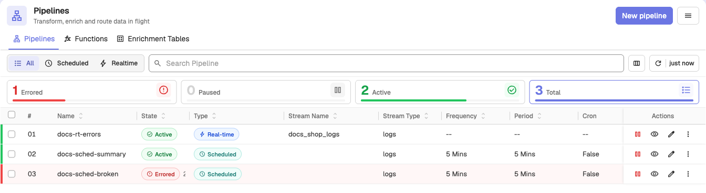
3. Click **New pipeline** at the top-right corner.
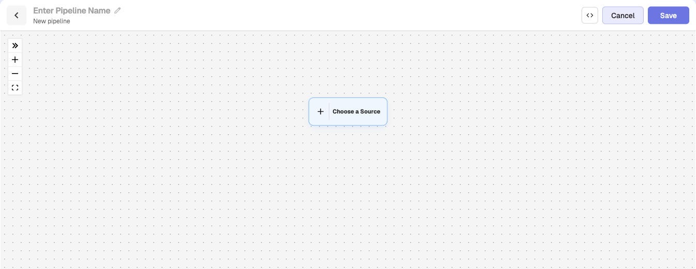
:::
:::accordion[Step 2: Enter a pipeline name]
### Step 2: Enter a pipeline name
Enter a unique name in the input box at the top of the editor.
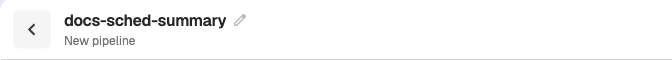
:::
:::accordion[Step 3: Configure the Source node (Query)]
### Step 3: Configure the Source node (Query)
Scheduled pipelines do not use a **Stream** node as the source. They always begin with a **Query** node.

1. From the **Source** section, drag the **Query** node into the editor. On an empty canvas, you can also click **Choose a Source** and select **Query**.  
2. The **Associate Query** panel opens. The panel contains the following sections, **Build Query**, **SQL Query** editor, **Output**, **Set Variables**. 
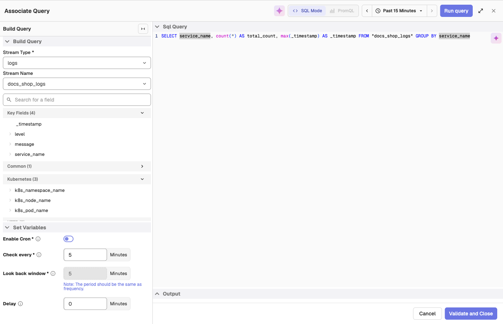 
3. In the **Build Query** section: 

    1. Select the **Stream Type**.  
    2. Select the **Stream Name**.  
4. Edit or write your SQL query in the **Sql Query** editor. For metrics streams, you can switch to PromQL.  
5. Select the time range from the time range selector at the top-right corner. 
5. Click **Run query** to preview data in the **Output** panel.  
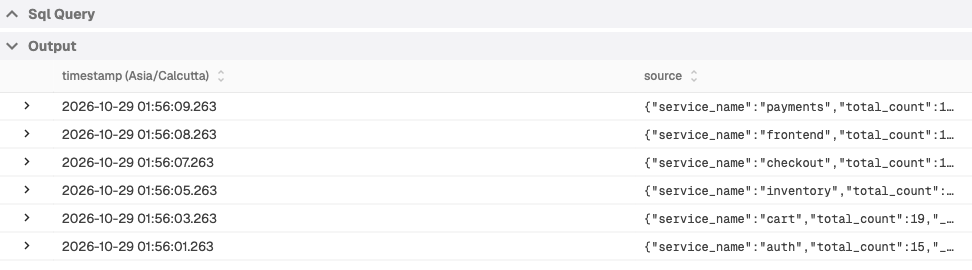
6. In the **Set Variables** section configures how the pipeline runs using the following settings: 

    - **Enable Cron**: Switch from interval-based scheduling to cron-based scheduling.  
    - **Check every**: How often the pipeline runs (the frequency).  
    - **Look back window**: The data window to process (the period). Without cron, it must equal **Check every**.  
    - **Delay**: How many minutes the pipeline waits after the scheduled time before execution. 

    > See the [Pipelines overview](https://openobserve.ai/docs/user-guide/data-processing/pipelines/pipelines/) page to learn more about frequency, period, and cron.
    > See the [Configurable Delay in Scheduled Pipelines](https://openobserve.ai/docs/user-guide/data-processing/pipelines/configurable-delay-in-scheduled-pipelines/) page to learn how to configure delay in scheduled-pipelines.

    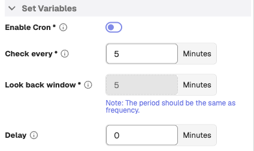

7. After configuring the query and variables, click **Validate and Close**. This adds the Query node to the editor.
:::

:::accordion[Step 4: Configure the Transform node]
### Step 4: Configure the Transform node

1. From the **Transform** section, drag either a **Conditions** or **Function** node into the editor. You can also hover over a node and click **+** to pick the next step.
2. If you add a Conditions node:
    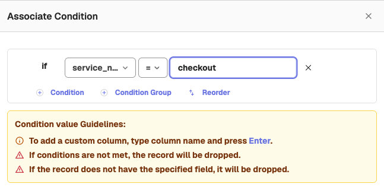

    1. In the **Associate Condition** screen, select the field name in the **Column** drop-down list. This list displays the fields detected in the source stream. To use a field that is not listed, type its name and press **Enter**.
    2. Select an operator.
    3. Enter a value in the **Value** input box.
    4. Add more conditions with **Condition**, or nested AND/OR groups with **Condition Group**, if needed.

    :::note[Guidelines]
    - Use an empty string to check for empty values. For example, `app_name != ""`
    - Use null to check for null values. For example, `app_name != null`
    - If the condition does not match, the record is dropped.
    - If the record does not contain the specified field, it is also dropped.
    :::

3. If you add a Function node:

    Use a Function node to transform events using a VRL function.
    > A Function does not require predefined fields. You can use it even if the source stream has no schema.  

    :::note[To create a new function:]
    1. In the **Associate Function** panel, enable the **Create New Function** toggle. The function editor opens in the panel.
    2. Enter the function name. 
    3. Write a VRL function. Pipelines run VRL functions only.
    4. To test it, in the **Query** section select the stream type, stream name, and duration, and click **Run query**. The results appear under **Events**. 
    5. Click **Test Function** and check the result under **Output**. 
    6. Click **Save** to save the function. 
    :::

4. The **After Flattening** toggle is enabled by default. It ensures the function processes normalized data. Disable this toggle only if you need the original structure.

    :::note[Guidelines]
    - **RBF (Run Before Flattening)**: Function executes before data structure is flattened. 
    - **RAF (Run After Flattening)**: Function executes after data structure is flattened. 
    :::

5. Click **Save** to confirm the transform node.
:::

::::accordion[Step 5: Configure the Destination node]
### Step 5: Configure the Destination node
A destination defines where the processed events are written. You can forward data to another stream or to an external system.

**To add a stream destination:** 
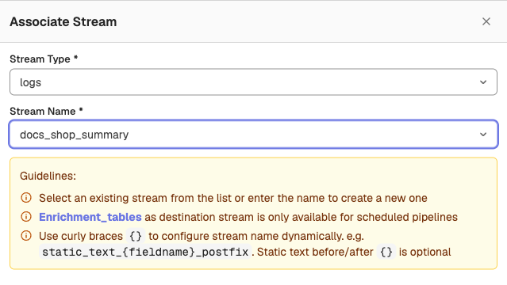

1. Drag a **Stream** node into the editor.
2. In the **Associate Stream** panel, configure the destination stream.
3. Select the **Stream Type**, then select an existing stream in **Stream Name**, or type a new name to create a new stream.  

:::note[Note]
You can add **Enrichment_tables** as a destination stream for scheduled pipelines. 
:::

:::note[Dynamic stream names]
You can configure the stream name dynamically with curly braces.  
Example: `static_text_{fieldname}_postfix`  
Static text before and after the braces is optional.
:::

**To add an external destination:** 

1. Drag a **Remote** node into the editor. The **Remote** node is available in the self-hosted Enterprise Edition.
2. In the **External Destination** panel, either select an existing destination or enable **Create New Destination** and fill in the required details such as destination type, name, URL, method, output format, and headers.
4. Click **Save**.

> For detailed steps on configuring external destinations, see the [Remote Destination](https://openobserve.ai/docs/user-guide/data-processing/pipelines/remote-destination/) guide. 
::::

:::accordion[Step 6: Connect the nodes]
### Step 6: Connect the nodes
Use the connection icon to link Source > Transform > Destination. 
To remove a link, select the link and press delete on your keyboard. 
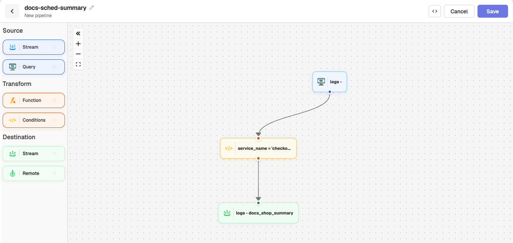
:::

:::accordion[Step 7: Save the pipeline]
### Step 7: Save the pipeline
Click **Save**. The pipeline becomes active immediately.
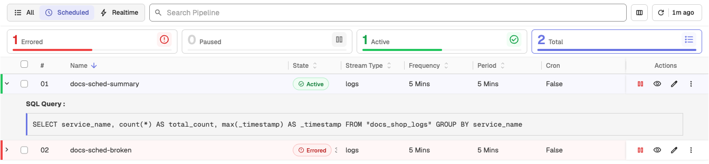
:::

## Use the scheduled pipeline

:::accordion[Step 1: Ingest data]
### Step 1: Ingest data
Use curl or any supported ingestion method.
To find the sample curl command, go to **Data Sources** > **Custom** > **Logs** > **Curl**. 
The scheduled pipeline does not run immediately when data is ingested.  
It processes data only when the schedule triggers, using the configured frequency, period, and delay.
:::
:::accordion[Step 2: Verify output]
### Step 2: Verify output
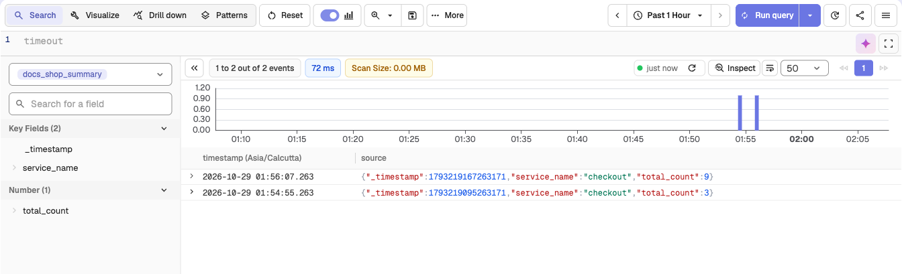

1. Go to **Logs**.
2. From the stream selection dropdown, select the stream you added as destination. 
3. Select the time range from the time range selector. 
3. Click **Run query** to view the result. 
:::

## Related links
- [Pipelines in OpenObserve](pipelines.md)
- [Create and Use Real-time Pipeline](create-and-use-real-time-pipeline.md)
- [Import and Export Pipelines](import-and-export-pipelines.md)
- [Manage Pipelines](manage-pipelines.md)
- [Configurable Delay in Scheduled Pipelines](configurable-delay-in-scheduled-pipelines.md)
