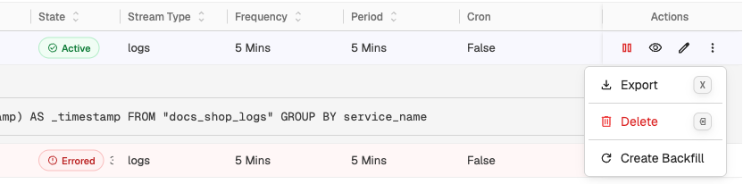
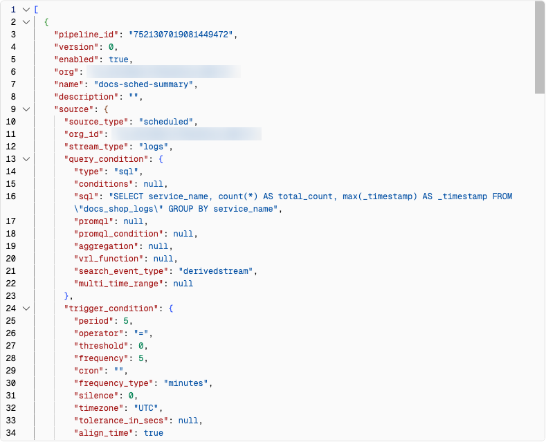
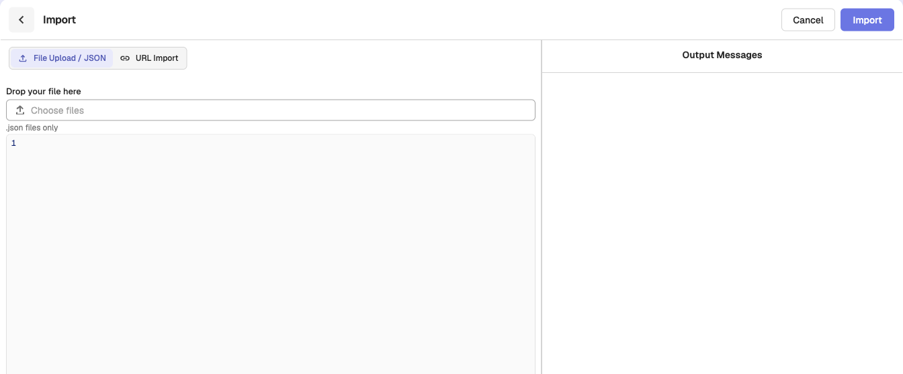

This guide explains how to import and export pipelines. Use this feature to replicate existing pipelines across environments without recreating them from scratch.

## Export a pipeline

To export an existing pipeline configuration:

1. From the left navigation menu, go to **Data > Pipelines**.  
2. In the **Pipelines** tab, locate the pipeline you want to export.   
3. In the **Actions** column of the pipeline, click **More actions** (⋮) and select **Export**. You can also hover over the row and press `x`. To export several pipelines at once, select their rows and click **Export** in the selection bar.  

The downloaded file is named `<pipeline-name>.json` for one pipeline, or `pipelines_export_<date>.json` for several. It contains the pipeline configuration and can be used to import the pipeline into another environment. It also carries the functions the pipeline uses, so the import can create them in the target organization. 
Exporting the pipeline `scheduled-pipeline-demo` generates a JSON file similar to the following:  

## Import a pipeline
To import a previously exported pipeline:

1. Go to **Data > Pipelines**.  
2. Open the **More actions** menu (☰) in the top-right corner and select **Import**, or press `i`.   
3. Choose one of the supported import methods:  

    - **File Upload / JSON**: Upload one or more JSON files containing pipeline configurations from your local system, or paste the JSON pipeline definition in the JSON editor.  
    - **URL Import**: Provide a URL to fetch the pipeline configuration.

4. To import pipelines in bulk, choose multiple JSON files. 
5. Click **Import**. 
The imported pipeline appears in the **Pipelines** tab.

## Handle validation errors while importing pipelines

If any validation errors occur during import, they are listed under **Error Validations**, with a field to correct each value in place. Refer to the following resolutions:

- **Pipeline name already exists:** Enter a unique pipeline name.  
- **Source stream name already exists**: Enter a unique source stream.   
- **Source stream type does not exist**: Enter stream type.    
- **Source time zone does not exist (for scheduled pipeline)**: Ensure the source time zone is accurate when you want to import scheduled pipelines.   
- **The SQL query does not exist (for scheduled pipeline):** Ensure the SQL query exists if you want to import scheduled pipelines.  
- **Destination stream type does not exist:** Enter the destination stream type.   
- **Organization ID does not exist:** Enter the organization ID.   
- **Function name does not exist:** Enter the function name, or import a file that includes the function. If a function in the file has the same name as an existing function but different logic, OpenObserve creates a copy under a new name and uses it in the imported pipeline.  
- **Remote Destination does not exist:** Ensure the remote destination is accurate. 

## Related links
- [Pipelines in OpenObserve](pipelines.md)
- [Create and Use Real-time Pipeline](create-and-use-real-time-pipeline.md)
- [Create and Use Scheduled Pipeline](create-and-use-scheduled-pipeline.md)
- [Manage Pipelines](manage-pipelines.md)
- [Configurable Delay in Scheduled Pipelines](configurable-delay-in-scheduled-pipelines.md)
