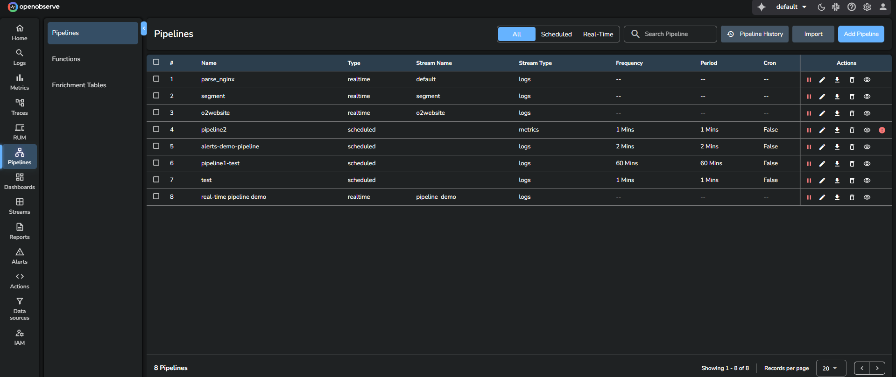
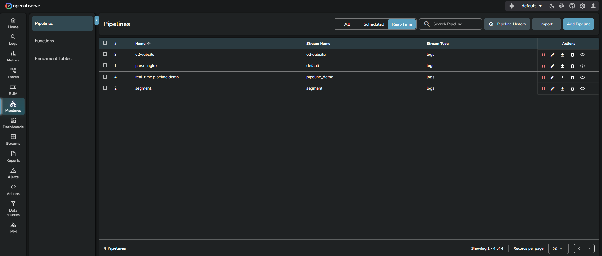
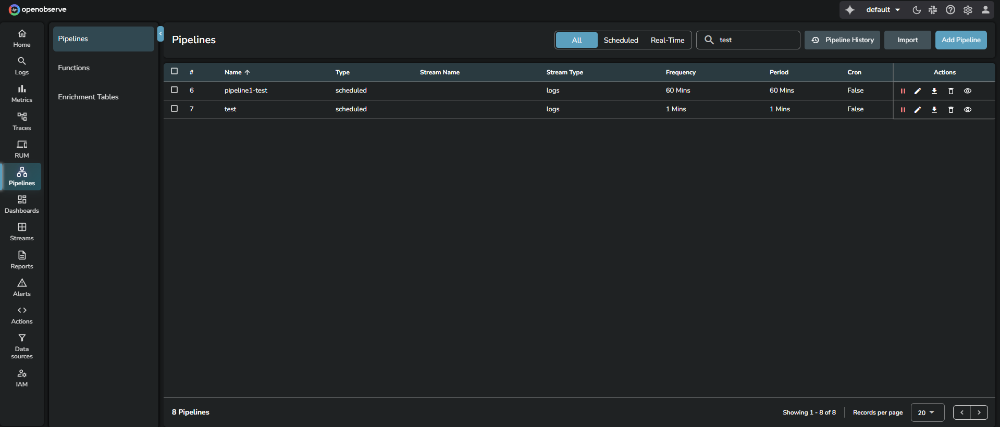
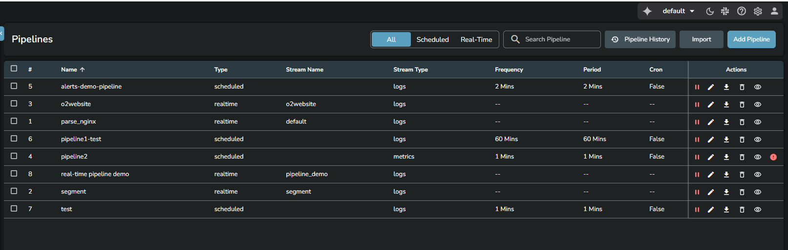
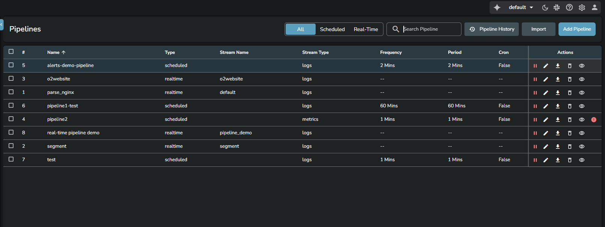
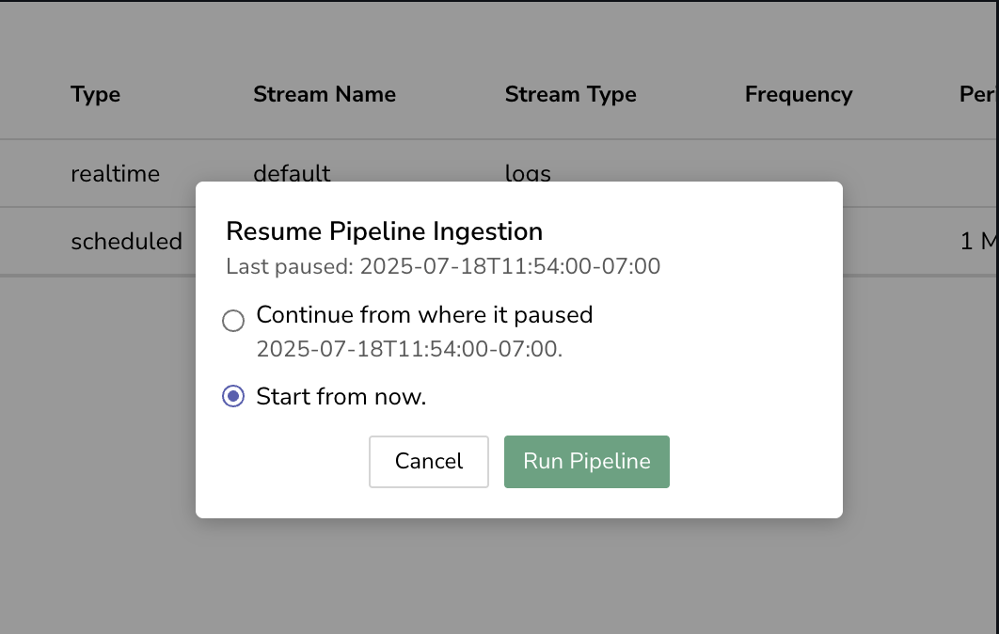
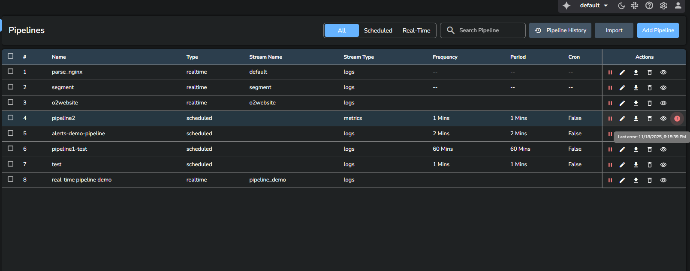
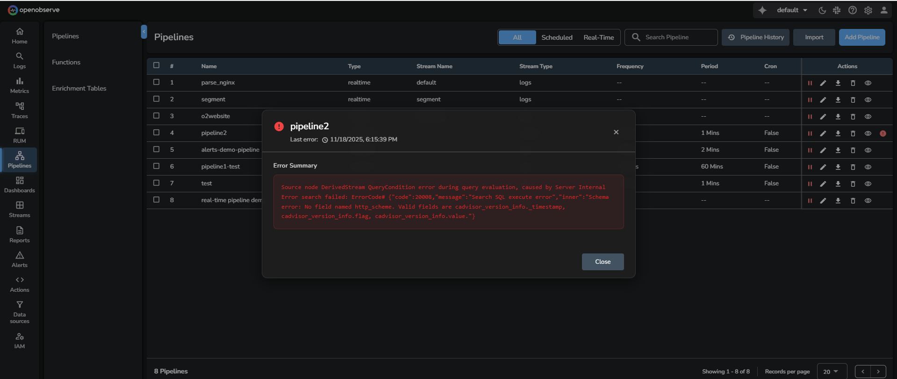
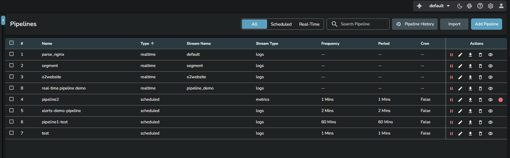

This page describes how to manage real-time and scheduled pipelines in OpenObserve. 

## Pipeline management options
Go to **Data > Pipelines**. You can filter, search, view, edit, pause, resume, export, or delete pipelines from a single interface.

:::accordion[Filter pipelines]
## Filter pipelines
Use the filter options **All**, **Scheduled**, and **Realtime** to view only the type of pipelines you want to work with.

The summary strip above the table shows how many pipelines are **Errored**, **Paused**, **Active**, and in **Total**. Click a count to show only the pipelines in that state.

:::

:::accordion[Search pipelines]
## Search pipelines
Use the **Search Pipeline** box to locate pipelines by name or attributes.

:::

:::accordion[Pipeline list view]
## Pipeline list view
The pipeline list displays key information for each pipeline.

- **Name**: Identifies the pipeline.
- **State**: Shows whether the pipeline is **Active**, **Paused**, or **Errored**.
- **Type**: Indicates whether the pipeline is real-time or scheduled.
- **Stream Name**: Shows the associated source stream.
- **Stream Type**: Indicates the type of data in the source stream such as logs, metrics, or traces.
- **Frequency**: Displays how often the scheduled pipeline runs.
- **Period**: Shows the time duration used for each execution window of a scheduled pipeline.
- **Cron**: Indicates whether the pipeline is configured using a cron expression.
:::

:::accordion[Actions tab]
## Actions tab
Each pipeline row includes the following actions. **Start**/**Pause**, **View**, and **Edit** are icons in the row; the others are in the **More actions** (⋮) menu.

- Start or pause pipeline
- View pipeline
- Edit pipeline
- Export pipeline configuration
- Delete pipeline
- **Create Backfill** (scheduled pipelines, Enterprise Edition): reprocess a past time range
- **View Error** (only when the pipeline has an error)

To act on several pipelines at once, select their rows. The selection bar offers **Export**, **Pause**, **Resume**, and **Delete**.

### Pause and resume pipelines

You can pause both real-time and scheduled pipelines.  

**Pausing a pipeline:**

- When paused, the pipeline stops executing on its scheduled intervals. 
- The system preserves the exact timestamp when the pause occurred. 
- Pipeline configuration and state are maintained during the pause. 

**Resuming a real-time pipeline**:

- Real-time pipelines resume instantly with one click.
- No dialog or additional options are shown.
- Processing continues from the current moment.

**Resuming a scheduled pipeline**: 

Scheduled pipelines display a Resume Pipeline Ingestion dialog with two options.

  - **Continue from where it paused:**

    - Processes all data from the pause timestamp to the current time. 
    - Maintains complete data continuity with no gaps. 
    - May consume significant system resources for long pause periods. 

    > **Note:** Use the **Continue from where it paused** option, when data completeness is critical. 

  - **Start from now:**

    - Begins processing from the current timestamp. 
    - Creates a data gap between the pause and resume timestamps. 
    - Provides immediate resumption with minimal resource usage. 

    > **Note:** Use the **Start from now** option, when data gaps are acceptable. 

### Pipeline error
If a pipeline encounters an error, its **State** shows **Errored** and the **More actions** (⋮) menu shows **View Error**.

Selecting **View Error** opens a dialog that displays the **Error Summary** and any **Node Errors**.

:::

:::accordion[Pipeline history]
## Pipeline history
You can view past executions, errors, and performance statistics in the Pipeline History page. To open it, click **Pipeline History** at the top of the **Pipelines** page.

The [Pipeline History](https://openobserve.ai/docs/user-guide/data-processing/pipelines/pipeline-history/) page provides a complete timeline of runs with detailed execution information.
:::

:::accordion[Import and export pipelines]
## Import and export pipelines
You can export any pipeline and import pipeline configurations through the **Import** and **Export** options. For more details, see [Import and export pipelines](https://openobserve.ai/docs/user-guide/data-processing/pipelines/import-and-export-pipelines/).
:::

:::accordion[Sort columns]
## Sort columns

You can sort the Pipelines table by selecting any column header. The table supports ascending, descending, and alphabetical sorting depending on the data in that column.
:::

## Related links
- [Pipelines in OpenObserve](pipelines.md)
- [Create and Use Real-time Pipeline](create-and-use-real-time-pipeline.md)
- [Create and Use Scheduled Pipeline](create-and-use-scheduled-pipeline.md)
- [Import and Export Pipelines](import-and-export-pipelines.md)
- [Configurable Delay in Scheduled Pipelines](configurable-delay-in-scheduled-pipelines.md)