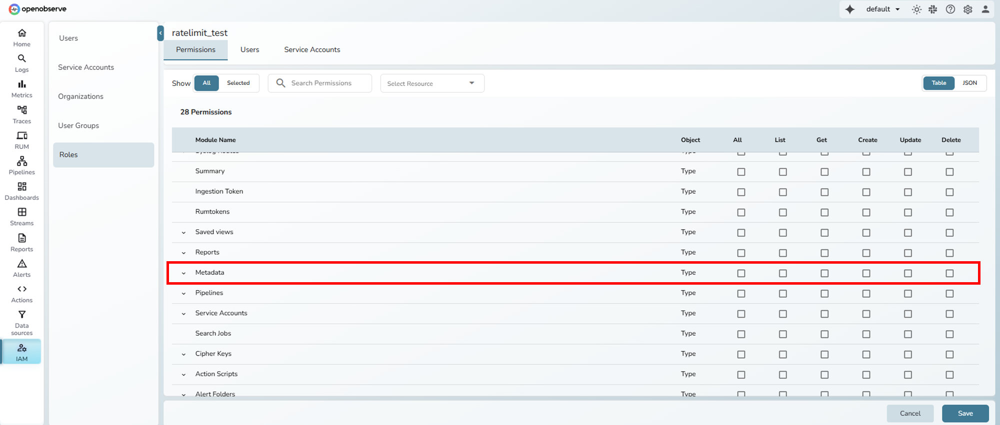
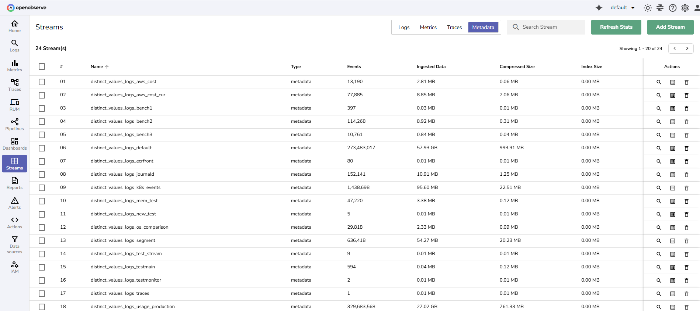

This document explains how the distinct values feature in OpenObserve works.

## Overview
The distinct values feature speeds up field value lookups, such as the values a dashboard variable lists in its dropdown. When a dashboard variable reads values from a field in a logs or traces stream, OpenObserve records that field as a distinct value field of the stream. While **Enable Distinct Values** is on for the stream, OpenObserve indexes these fields like secondary index fields, so value lookups are served from the index instead of a full scan.

:::note[Where to find it]
1. Go to **Streams**.
2. In the **Actions** column, select the **Stream Detail** icon.
3. Open the **Configuration** tab and use the **Enable Distinct Values** toggle. It is on by default.
:::

## How it works
1. When you save a dashboard whose variables read values from a field of a logs or traces stream, OpenObserve adds that field to the stream's distinct value fields.
2. While **Enable Distinct Values** is on, these fields are indexed together with the stream's secondary index fields. The list of distinct value fields stays separate from the **Secondary index** fields you set in **Schema Settings**.
3. Field value lookups on these fields use the index. Fields that cannot be secondary-indexed, such as full text search keys and partition keys, fall back to a normal scan.
4. A field is indexed only from the time it was added. Data written before that is still searched with a normal scan.

Turning **Enable Distinct Values** off stops indexing these fields. It does not change the **Secondary index** fields you set yourself.

## Legacy distinct_values streams
Before v1.0.0, OpenObserve wrote distinct values into metadata streams named `distinct_values_<type>_<stream>`, for example `distinct_values_logs_default`, controlled by `ZO_DISTINCT_VALUES_INTERVAL` and `ZO_DISTINCT_VALUES_HOURLY`. These environment variables were removed in v1.0.0 and no new records are written to these streams. Existing `distinct_values_*` streams still appear under **Streams > Metadata** until their data ages out through retention.

