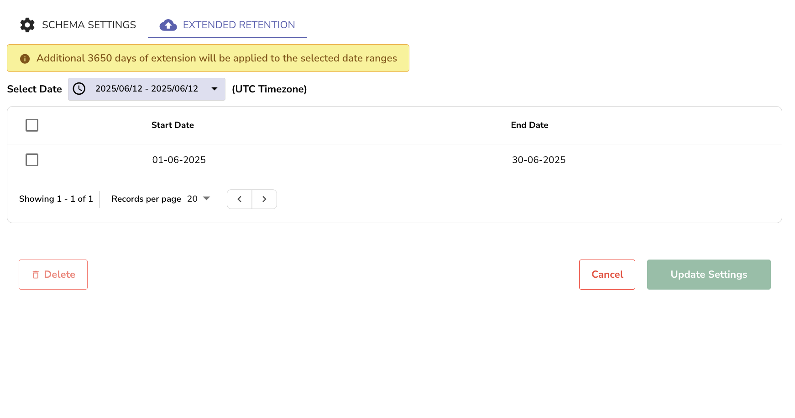

The **Extended Retention** feature in **Stream Details** allows you to retain specific segments of your stream data beyond the configured stream-level or global retention period. 

## When to use extended retention
This feature is helpful when you want to preserve logs, metrics, or traces related to specific incidents or investigations.  
For example, logs from a known incident that occurred last month, you can configure extended retention for those specific time ranges.

## How to apply extended retention

1. From the **Streams** page, select the **Stream Detail** icon in the **Actions** column. 
2. The [**Stream Details**](stream-details.md#stream-details) panel opens.  
3. Select the **Extended Retention** tab.  
4. Next to **Select Date**, use the date selector to specify a time range in UTC. Click **Apply**.  
5. Click **Update Settings** to apply the retention policy.

:::note[Note]
The data within the selected time range is retained for an additional number of days set by `ZO_COMPACT_EXTENDED_DATA_RETENTION_DAYS` (default 3650). The tab shows this number above the date selector.
:::

:::note[Note]
- **Flexible Range Selection**: You can add multiple time ranges. This enables retaining non-contiguous segments of data, such as a two-day period this week and another from the previous month.  
- **Retain Within Allowed Window**: You can only apply extended retention to data that currently exists. You cannot select ranges older than the current retention limit because that data has already been deleted and cannot be restored.
:::
