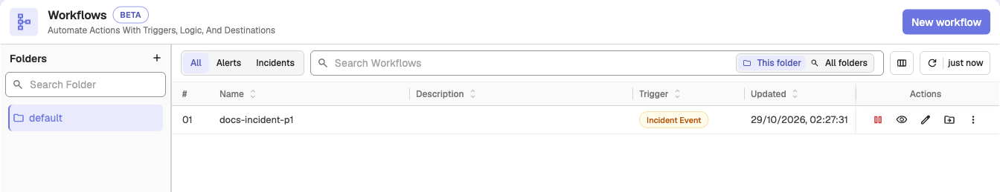
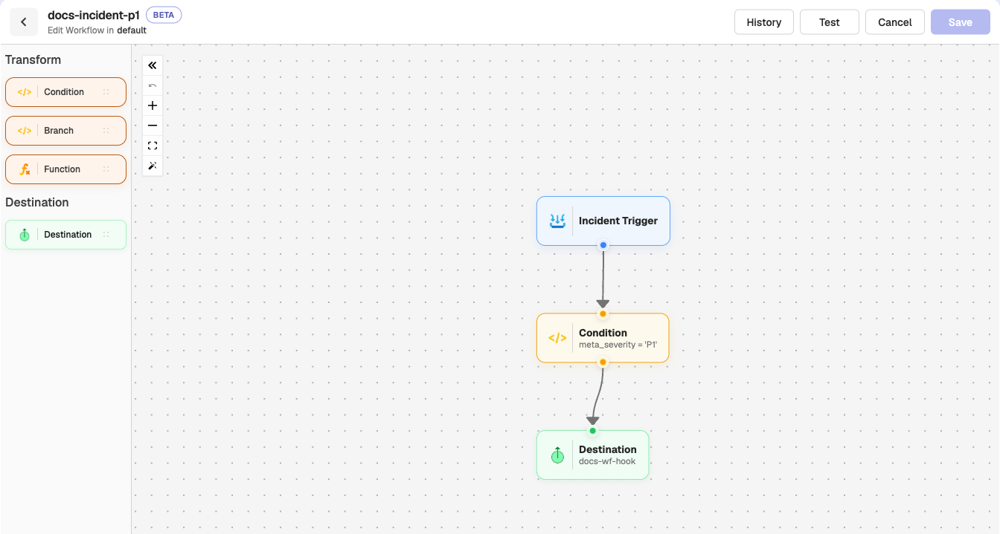
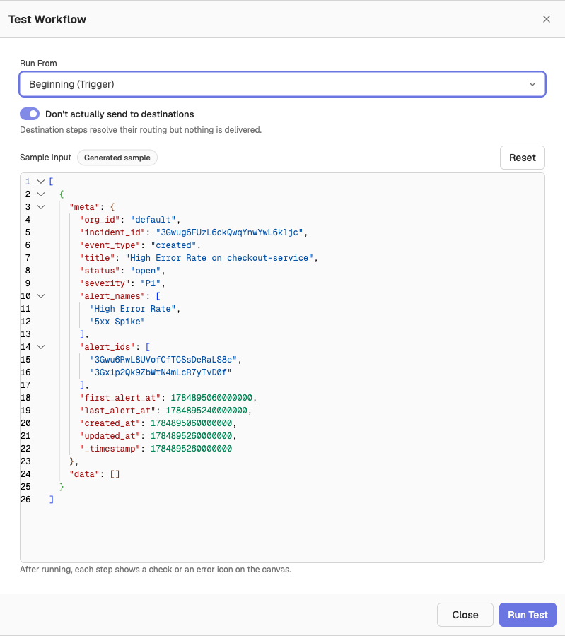
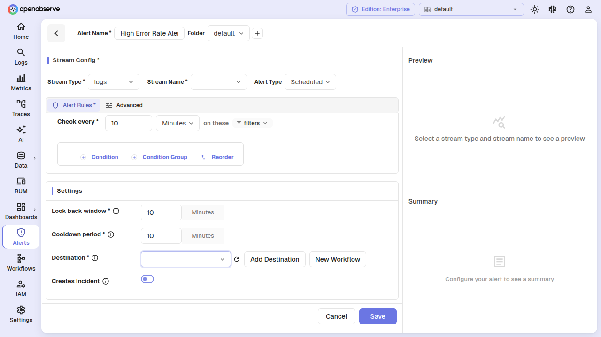
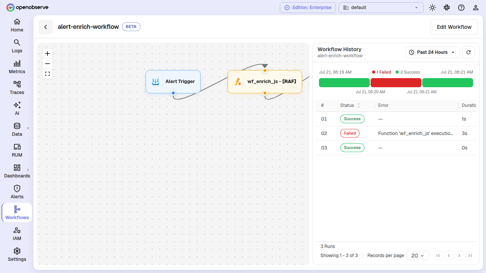
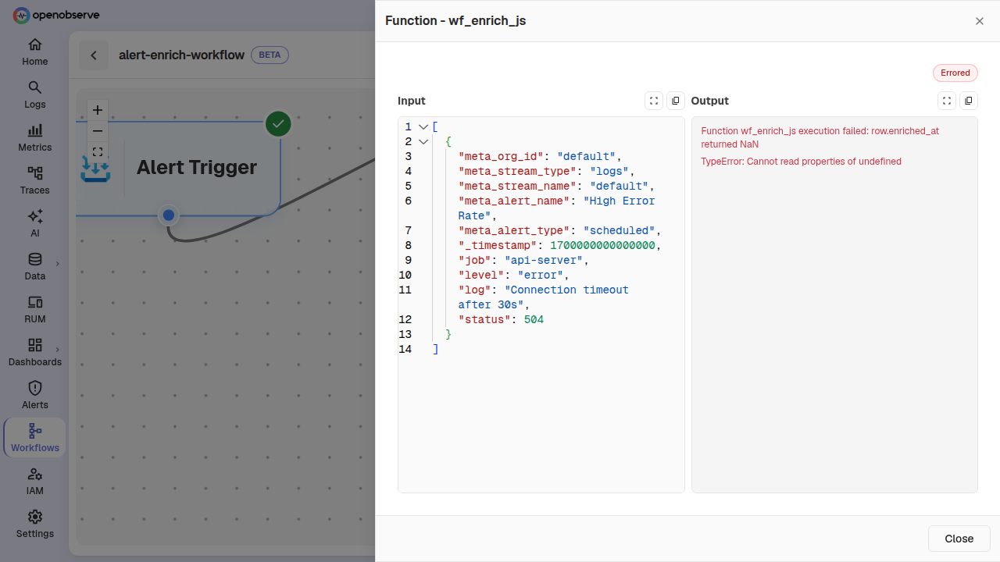

# Workflows

Workflows let you define automated chains of operations that execute in response to a trigger: an alert firing, a firing alert resolving, or an incident event. When the trigger occurs, the workflow runs through a sequence of steps — transforming the payload with JavaScript functions, evaluating conditions, branching, and routing results to a pipeline destination.

Workflows are available in the Enterprise Edition and OpenObserve Cloud, in **Beta**, gated by the `O2_WORKFLOWS_ENABLED` configuration flag. Trial access is available on request. They share the same visual node-edge builder as pipelines but introduce workflow-specific node types: **Trigger**, **Condition**, **Branch**, **Function** (JavaScript only), and **Destination**.



To navigate to workflows, select your organization and click **Data > Workflows** in the left navigation. To organize workflows into folders, see [Workflow Folders](workflow-folders.md).

## Core concepts

### How workflows differ from pipelines

| Aspect | Pipelines | Workflows |
|---|---|---|
| **Trigger** | Real-time ingestion or scheduled | Alert fires, alert resolves, or incident event |
| **Input** | Individual log/metric/trace records | Alert event payload with metadata and result rows |
| **Node types** | Stream, Query, Function, Conditions, Remote | Trigger, Condition, Branch, Function (JS only), Destination |
| **Functions** | VRL only | JavaScript only |
| **Output** | Streams, remote destinations | Pipeline destinations |

### Node types

A workflow graph is built from the following nodes connected by edges:

- **Trigger** — The entry point. Choose **Alert Fired** (shown on the canvas as **Alert Trigger**), **Alert Resolved**, or **Incident Event**. An alert trigger receives the alert metadata (org, stream, alert name, trigger time) and the alert's result rows wrapped in a `data` array. For incident events, see [Incident-Event-Triggered Workflows](incident-event-trigger.md).
- **Function** — Applies a JavaScript function to each record. VRL functions are not supported in workflows; use a JavaScript function with `trans_type = 1`.
- **Condition** — Continues only with the records that match a rule.
- **Branch** — Routes each record down the first matching path. Paths are checked top to bottom; records that match no path leave through **Everything Else**.
- **Destination** — Sends data to a pipeline destination (HTTP webhook). Alert-type destinations are not supported.

## Create a workflow



1. Navigate to **Data > Workflows** and click **New workflow**.
2. Enter a name in the title field (**Untitled Workflow**) and an optional **Description**.
3. On the canvas, click **Choose a Trigger** and select the trigger.
4. Build the rest of the graph:
   - Drag steps from the palette (**Transform**: **Condition**, **Branch**, **Function**; **Destination**: **Destination**) onto the canvas, or click a step in the palette to append it. You can also hover over a step and click **+** to pick the next one.
   - Connect steps by drawing edges between them.
5. Configure each step (function, conditions, branch paths, destination).
6. Click **Save as Draft** to keep working later, or **Publish** to make the workflow live. After you publish an alert-triggered workflow, the **Link Workflow To Alerts** dialog lets you select the alerts that run it.

### Workflow validation rules

When you save a workflow, OpenObserve validates the following:

- Every node must be a workflow-compatible type.
- Condition nodes must have non-empty conditions.
- Edges must connect all nodes; the minimum number of edges is `nodes - 1`.
- Edge sources and targets must reference nodes that exist in the graph.
- All reachable nodes from the trigger must be valid; unreachable nodes are not allowed.
- Leaf/terminal nodes must be **Stream** or **Destination** nodes.
- Functions referenced in Function nodes must be JavaScript functions (VRL functions are rejected).
- Destinations referenced in Destination nodes must be **pipeline**-type destinations (alert destinations are not supported).

## Test a workflow

You can test a workflow without waiting for an alert to trigger it.

1. Open the workflow and click **Test**.
2. In **Sample Input**, edit the generated sample, or select **Use input from run…** to reuse a recorded input. The input is a JSON array of records.
3. Optionally, in **Run From**, select a step to start execution from (useful for debugging a specific step). The default is **Beginning (Trigger)**.
4. Turn on **Don't actually send to destinations** if destination steps must not deliver during the test.
5. Click **Run Test**. Each step shows a check or an error icon on the canvas.



The test endpoint is also available via the API at `POST /api/{org_id}/workflows/test`.

## Link a workflow to an alert

To have a workflow execute when an alert fires, link it in the alert configuration.



1. Open an existing alert or create a new one.
2. In the alert's destinations field, select one or more workflows from the **Workflows** group.
3. Save the alert.

You can also link alerts from the workflow side in the **Link Workflow To Alerts** dialog that opens after you publish an alert-triggered workflow.

When the alert fires, each linked workflow receives the alert's result rows and metadata as input. Metadata includes:

| Field | Description |
|---|---|
| `org_id` | Organization ID |
| `stream_type` | Stream type (logs, metrics, traces) |
| `stream_name` | Name of the monitored stream |
| `alert_name` | Alert name |
| `alert_type` | `realtime` or `scheduled` |
| `alert_period` | Trigger condition period in minutes |
| `alert_operator` | Trigger condition operator |
| `alert_threshold` | Trigger condition threshold |
| `alert_count` | Number of rows in the trigger batch |
| `alert_start_time` | Start of the alert evaluation window (microseconds) |
| `alert_end_time` | End of the alert evaluation window (microseconds) |

A workflow trigger payload looks like:

```json
{
  "meta": {
    "org_id": "default",
    "stream_type": "logs",
    "alert_name": "High Error Rate",
    "alert_count": "3"
  },
  "data": [
    { "_timestamp": 1711500000000000, "level": "error", "message": "..." },
    { "_timestamp": 1711500001000000, "level": "error", "message": "..." }
  ]
}
```

## View execution history

The workflow history shows every execution of a published workflow, with timing and status. Drafts have no runs.



1. Open a published workflow and click **History**. To see every run in a full page, select **Open Full Runs View**.
2. Use the time range picker to filter executions. The default range is the last 7 days (subject to the `max_query_range` setting on the `triggers` stream).
3. Each row shows:
   - **Started** — When the execution started.
   - **Duration** — Total execution time.
   - **Status** — **Success** or **Failed**.
   - **Type** — Marks test runs started from the editor. Use **Show test run(s)** to include them.

History data is stored in the internal `triggers` stream with `module = 'workflow'`.

## Handle errored runs

When a workflow run produces node-level errors, the errors and the input data that caused them are stored for debugging and retry.

### View errors

1. Open the workflow and select a specific run from **History**.
2. The error detail view shows:
   - Each errored node with its error messages.
   - The input data that reached each errored node.
   - The complete initial input data for the run.



### Retry a failed run

You can retry a failed workflow run from the error details page or via the API:

1. Click **Retry** on the failed run.
2. Confirm in the **Retry this run?** dialog. Retry creates a new run from the input the failed run recorded, and destination steps dispatch for real.
3. The workflow re-executes and returns the new errors, if any.

The retry API is at `POST /api/{org_id}/workflows/{id}/retry`.

## Enable or disable a workflow

To temporarily stop a workflow from executing without deleting it, disable it:

1. On the **Workflows** list, click **Pause** in the workflow's row. Click **Start** to enable it again.
2. When paused, the workflow silently skips execution even when linked alerts fire.

Use the API directly at `PUT /api/{org_id}/workflows/{id}/enable?value=false` (or `true`).

## Delete a workflow

1. On the **Workflows** list, open the **More actions** (⋮) menu of the workflow's row.
2. Click **Delete** and confirm.

> A workflow cannot be deleted while it is linked to any alert. Unlink the workflow from all alerts first.

## Configuration reference

| Environment variable | Default | Description |
|---|---|---|
| `O2_WORKFLOWS_ENABLED` | `true` | Master switch for the workflows feature. Set to `false` to disable all workflow APIs and trigger handling. |
| `ZO_WORKFLOW_ERROR_RETAIN_DURATION` | `2592000` (30 days) | Retention period for errored workflow input data, in seconds. Minimum value is 3600 (1 hour). |

The `workflows_enabled` flag is also exposed in the `/api/config` response so that the UI can hide or show workflows pages.

## RBAC permissions

Workflows use OFGA-based authorization. The following permissions are available on the `workflows` resource:

| Permission | Controls |
|---|---|
| `LIST` | List workflows in an organization |
| `POST` | Create a new workflow (no OFGA check) |
| `GET` | View workflow details, history, and errors |
| `PUT` | Update workflow configuration, enable/disable |
| `DELETE` | Delete a workflow |

Workflow permissions are scoped per organization and support self-parent hierarchy, allowing fine-grained access control through roles.

## API reference

| Method | Path | Description |
|---|---|---|
| `GET` | `/api/{org_id}/workflows` | List all workflows in the organization |
| `POST` | `/api/{org_id}/workflows` | Create a new workflow |
| `PUT` | `/api/{org_id}/workflows/{id}` | Update an existing workflow |
| `DELETE` | `/api/{org_id}/workflows/{id}` | Delete a workflow |
| `POST` | `/api/{org_id}/workflows/test` | Test a workflow with custom inputs |
| `POST` | `/api/{org_id}/workflows/{id}/trigger` | Trigger an existing workflow with given input |
| `GET` | `/api/{org_id}/workflows/{id}/history` | Get execution history for a workflow |
| `GET` | `/api/{org_id}/workflows/{id}/errors/{run_id}` | Get errors and input data for a specific run |
| `POST` | `/api/{org_id}/workflows/{id}/retry` | Retry a failed workflow run |
| `PUT` | `/api/{org_id}/workflows/{id}/enable` | Enable or disable a workflow (`?value=true\|false`) |
| `PATCH` | `/api/v2/{org_id}/workflows/move` | Move workflows to another folder |
| `POST` | `/api/{org_id}/workflows/promote/{id}` | Publish a draft |

## In this section

::child-pages
