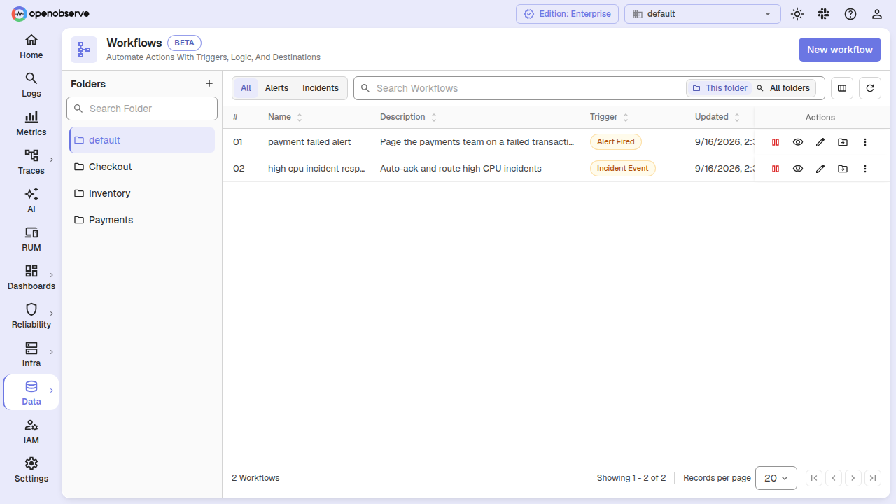
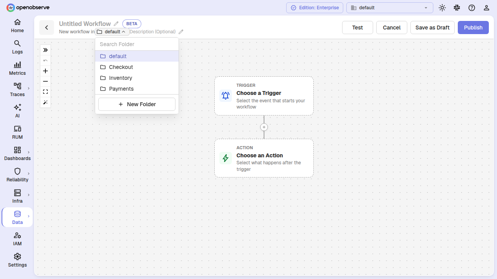
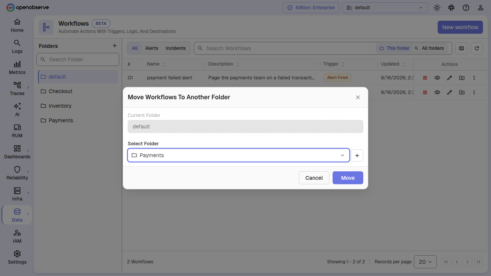
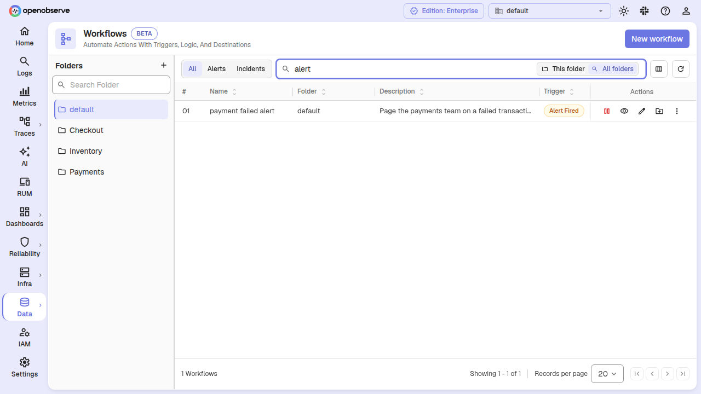
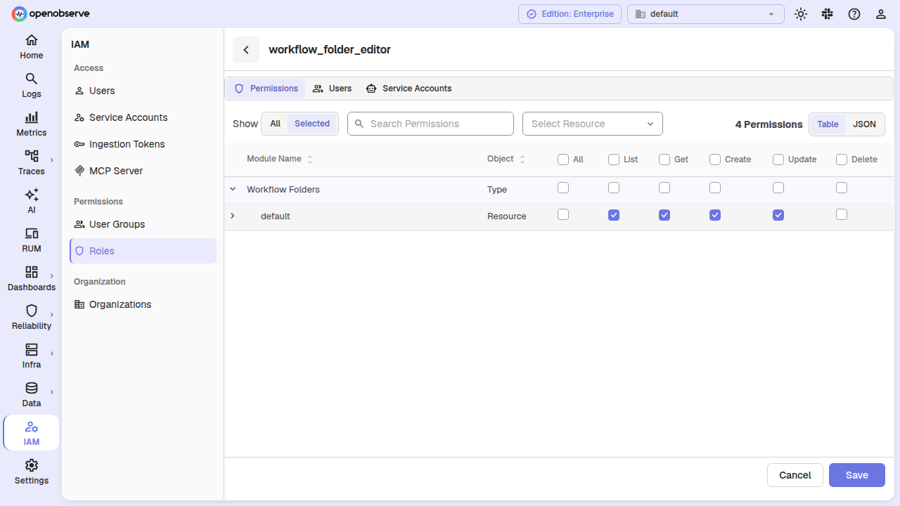

# Workflow Folders

Workflow folders let you group workflows the same way you group dashboards, alerts, reports, and synthetics. Each workflow (and each draft) lives in exactly one folder, and with RBAC enabled you can scope a role's workflow access to a single folder instead of granting it across the whole organization.

Every organization starts with a **default** folder. Existing workflows and drafts are automatically placed there when you upgrade, so you can adopt folders at your own pace without reorganizing anything first.

## Browse workflows by folder

The Workflows list page shows a **Folders** rail on the left, alongside the workflow table.

1. Navigate to **Data > Workflows**.
2. In the **Folders** rail on the left, select a folder. The table lists only the workflows (and drafts) in that folder.
3. The active folder is carried in the URL as `?folder=`, so a folder view is linkable and survives a page reload.

To create a folder, click **+** at the top of the **Folders** rail, then give it a **Name** and an optional **Description**.

## Create a workflow in a folder

When you click **New workflow**, the editor opens scoped to the folder you were browsing, so a new workflow lands in that folder automatically.

1. On the **Workflows** list, select the folder you want to create into.
2. Click **New workflow**. The editor header reads **New workflow in** followed by a folder selector seeded with the folder you were browsing.
3. Change the folder with the selector if needed (or click **New Folder** in the selector to create one), then build and save the workflow.

Drafts are folder-scoped the same way: a draft is saved into the folder selected in the editor, and that is the folder it publishes into.

## Move workflows between folders

1. On the **Workflows** list, click the **Move to folder** icon on the workflow's row. Drafts cannot be moved; publish them first.
2. In the **Move Workflows To Another Folder** dialog, pick the destination under **Select Folder** (or click **+** to create a new folder).
3. Click **Move**.

The workflow keeps its ID and history; only its folder (and therefore its permission scope) changes. With RBAC enabled, moving requires update access to every workflow being moved **and** write access to the destination folder, so a read-only role cannot relocate workflows between folders.

## Search within or across folders

The search box on the Workflows list has two scopes, and the toolbar has trigger-type tabs.

- **This folder**: search only within the folder selected in the rail. This is the default.
- **All folders**: search across every folder you can see. This is a search mode, not a browse mode: with an empty search box the list stays in the selected folder, matching how the Alerts and Dashboards lists behave. When you switch to **All folders**, the table shows a **Folder** column naming each row's folder.

The tabs (**All**, **Alerts**, **Incidents**, and any other enabled trigger kinds) filter the table by the workflow's trigger type.

## Scope RBAC permissions to a folder

Workflow folders add a new permission resource, **Workflow Folders**. In the role editor, workflow permissions are granted per folder instead of being all-or-nothing across the organization.

1. Go to **IAM > Roles** and open the role.
2. On the **Permissions** tab, find **Workflow Folders** and expand it to list the folders.
3. Set the permissions (**List**, **Get**, **Create**, **Update**, **Delete**) on a folder. Expand a folder to grant permissions on individual workflows inside it.
4. Click **Save**.

How folder scoping resolves:

- A grant on a folder applies to every workflow in that folder.
- A grant on an individual workflow keeps working regardless of which folder the workflow is in.
- Listing and creating are checked against the folder, so a role scoped to one folder sees only that folder in the rail, lists only its workflows, and can create workflows only in it.

## Default folder and upgrade behavior

When you upgrade to a version that supports workflow folders:

- A **default** folder is created for each organization.
- Every existing workflow and draft is placed in that folder.
- Any existing org-wide workflow grant on a role is copied to an org-wide **Workflow Folders** grant, so existing roles keep working. Nothing is removed, so an interrupted upgrade over-grants briefly rather than locking anyone out.

A folder that still contains workflows cannot be deleted. Move or delete the workflows first; otherwise the delete returns the error `Folder contains workflows, please move/delete workflows from folder`.

## API reference

| Method | Path | Description |
|---|---|---|
| `GET` | `/api/{org_id}/workflows` | List workflows in a folder (`?folder=`), across folders (`?all_folders=true`), and/or matching a substring (`?search_substring=`). |
| `POST` | `/api/{org_id}/workflows` | Create a workflow in a folder (`?folder=`); add `?draft=true` to save a draft. |
| `PATCH` | `/api/v2/{org_id}/workflows/move` | Move workflows to a folder. Body: `{ "workflow_ids": [...], "dst_folder_id": "..." }`. |
| `POST` | `/api/{org_id}/workflows/promote/{id}` | Publish a draft, optionally into a folder (`?folder=`). |
| `GET`/`POST` | `/api/v2/{org_id}/folders/workflows` | List or create workflow folders. |
| `GET`/`PUT`/`DELETE` | `/api/v2/{org_id}/folders/workflows/{folder_id}` | Get, update, or delete a workflow folder. |
| `GET` | `/api/v2/{org_id}/folders/workflows/name/{folder_name}` | Get a workflow folder by name. |
