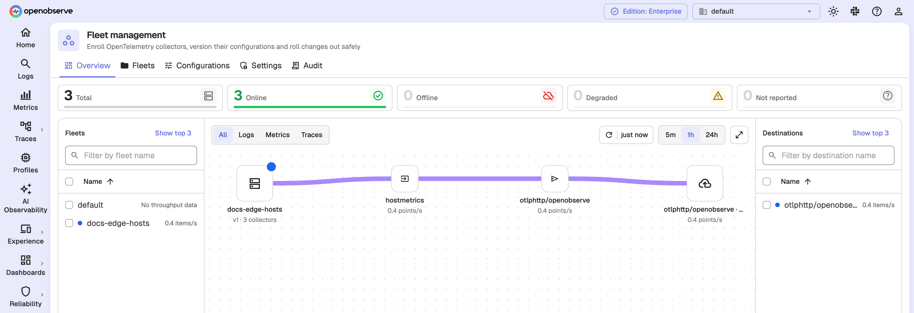
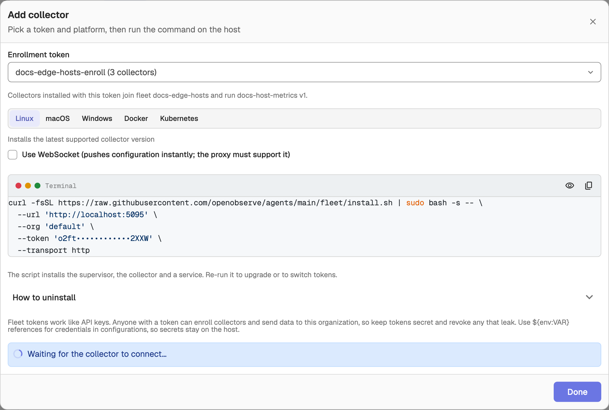
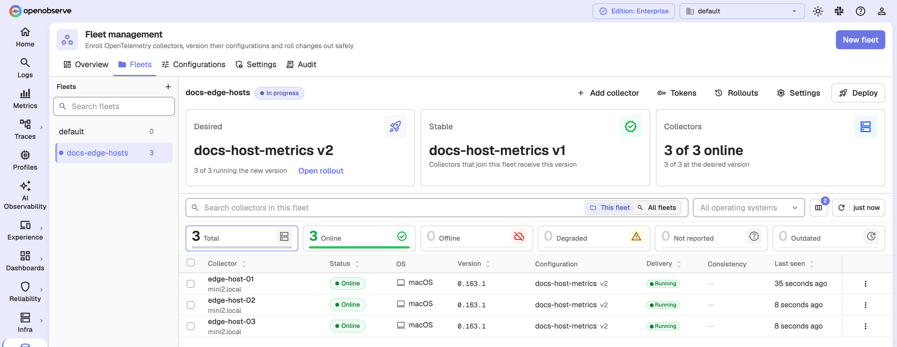
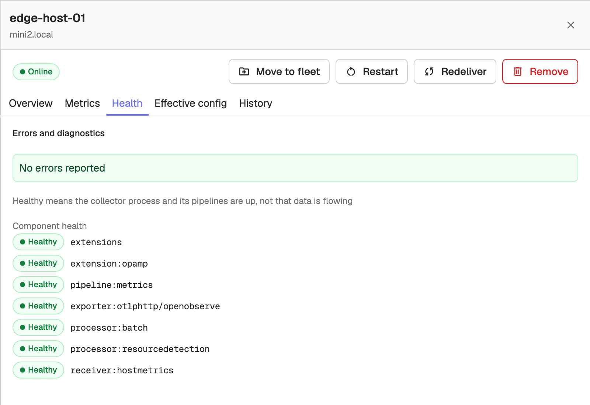
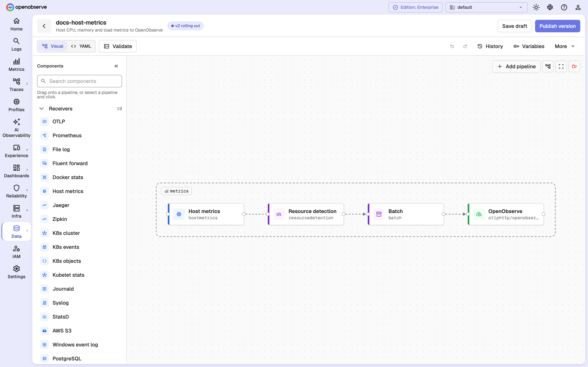
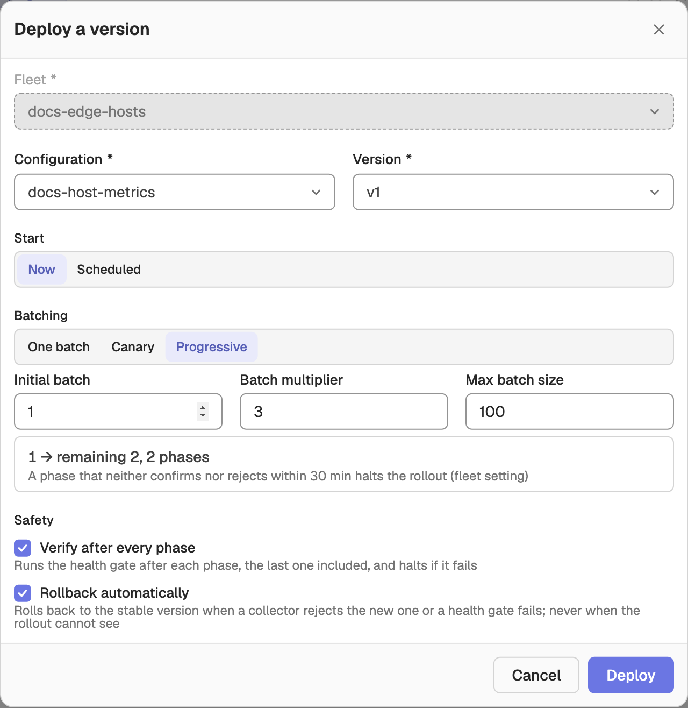

# Fleet Management

Fleet Management lets you manage fleets of OpenTelemetry collectors from OpenObserve over the OpAMP protocol. Enroll collectors with tokens, track their health and version, publish versioned collector configurations, and deploy them in phases with health gates and automatic rollback.

To open it, go to **Data** > **Fleet management**. The page has five tabs: **Overview**, **Fleets**, **Configurations**, **Settings**, and **Audit**.

## Enable

Fleet Management is an Enterprise feature and is on by default. Set `O2_FLEET_ENABLED=false` to turn it off: reads still work, writes are refused, and the OpAMP endpoint answers `503`. The setting is read at startup.

## Fleets

A **fleet** groups collectors that run the same configuration version. Every org has a **default** fleet, which cannot be deleted; create more fleets to stage changes or split environments.

On the **Fleets** tab, pick a fleet from the list on the left to see its collectors. The fleet's toolbar has **Add collector**, **Tokens**, **Rollouts**, **Settings**, and **Deploy**.

Select collectors and use **Move to fleet** to re-assign them. Moved collectors receive the destination fleet's current version straight away, without a rollout. A fleet can be deleted only after its collectors are moved or removed and its tokens are revoked.

## Enroll collectors

A collector joins a fleet with an enrollment token.

1. On the **Fleets** tab, select the fleet and click **Tokens**, then **New token**.
2. Enter a **Name**, choose when it **Expires** (7, 30, or 90 days, or never), and optionally set **Max uses** (leave it empty for unlimited).
3. Click **Add collector**, choose the token and a platform (Linux, macOS, Windows, Docker, or Kubernetes), and run the install command on the collector host. The dialog waits for the collector to connect.

The token's plaintext (`o2ft_...`) is returned only when it is created; OpenObserve stores only a hash. The UI keeps it available until you sign out or switch orgs, so store it somewhere secure.

:::warning[Warning]
Revoking a token, or letting it expire, takes effect immediately: every collector enrolled with it loses its management connection and its data is rejected.
:::

## Collectors

The collectors table shows each collector's **Status** (Online, Degraded, Offline, or Not reported), OS, architecture, **Version** (tagged **Outdated** when it is behind the target version), configuration, delivery state, and when it was last seen.

Click a collector to open its details, with **Overview**, **Metrics**, **Health**, **Effective config**, and **History** tabs. From the details you can **Move to fleet**, **Restart** (if the collector supports it), **Redeliver** its configuration, or **Remove** it. Removing deletes only the record; a collector that is still running reappears on its next heartbeat. **Rename** is in the row's action menu.

## Configurations

Configurations are versioned collector YAML configs, managed on the **Configurations** tab. Open a configuration to edit it in the **YAML** or **Visual** editor. The visual editor shows pipelines as connected receivers, processors, and exporters, and lets you add components and pipelines without editing YAML.

Click **Validate** to check the YAML. A version with validation errors cannot be published; warnings are allowed. Publishing creates a new version that you can then deploy to fleets. Components listed under **Restricted components** in **Settings** fail validation.

## Rollouts

To change the version a fleet runs, select the fleet and click **Deploy**. In **Deploy a version**, pick the configuration version and set:

- **Start**: **Now** or **Scheduled** at a start time.
- **Batching**:
    - **One batch**: all collectors at once.
    - **Canary**: a **First batch** of collectors, then the rest.
    - **Progressive**: an **Initial batch** that grows by a **Batch multiplier** per phase, capped at **Max batch size**.
- **Verify after every phase**: pause at a health gate after each phase.
- **Rollback automatically**: roll back on its own when the rollout halts with evidence of harm.

Collectors that are offline when the rollout starts are skipped and take the new version when they reconnect.

If a rollout halts, it reports a cause:

- **Proven bad**: collectors rejected the configuration or are crash-looping.
- **Looks worse**: a health gate failed.
- **Cannot see**: no data, the phase timed out, or collectors went offline.

Automatic rollback applies only to **Proven bad** and **Looks worse**, never to **Cannot see**. Otherwise, open **Rollouts** and resume, skip the failing collectors, roll back, or fix forward with a new version; the options offered depend on the cause.

## Settings

The **Settings** tab holds org-wide settings:

- **Target collector version**: collectors on an older version are tagged **Outdated**.
- **Restricted components**: component types that configurations may not use.
- **Fleet defaults**: heartbeat interval, offline after missed heartbeats, offline-ratio event threshold, phase timeout, health gate observation, measurement window and pass threshold, and how many days to keep offline collectors.

Each fleet can override the fleet defaults from its own **Settings** drawer; empty fields inherit the org default.

## Audit trail

Fleet actions on tokens, configurations, rollouts, and collectors are written to the audit stream and shown on the **Audit** tab. This requires `O2_AUDIT_ENABLED` (on by default); entries arrive in batches (every 10 minutes by default, set by `O2_AUDIT_PUBLISH_INTERVAL`).

## Permissions

RBAC uses four resources:

- `fleet`: access to Fleet Management itself, required for every fleet API.
- `fleets`: per fleet. The collectors, versions, and tokens of a fleet follow the fleet grant.
- `fleet_configs`: the org's configuration library.
- `fleet_management`: the Overview, Audit, and org Settings.

Grant users only the fleets they need.
