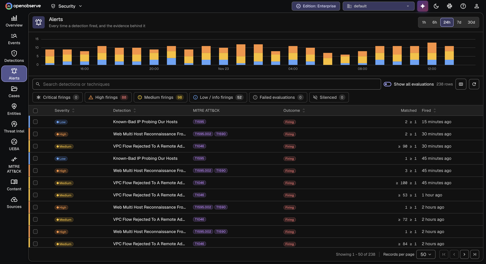

# Alerts

**Alerts** lists every time a detection fired, and the evidence behind it. Open **Security** > **Alerts**.

## Find firings

- Pick a window of **1h**, **6h**, **24h** (default), **7d**, or **30d**. The page refreshes every minute while the browser tab is visible.
- The chart stacks firings by severity.
- Search by detection name or ATT&CK technique.
- Click the tiles to filter: **Critical firings**, **High firings**, **Medium firings**, **Low / info firings** (which also counts unknown severity), **Failed evaluations**, and **Silenced**.
- Turn on **Show all evaluations** to also see runs that found nothing or were skipped. By default only firings, failed notifications, and errors are listed.

| Column | Shows |
| --- | --- |
| **Severity** | The detection's level. |
| **Detection** | The detection that fired. |
| **MITRE ATT&CK** | Its techniques. |
| **Outcome** | **Firing**, **Firing · notify failed**, **Evaluation failed**, **Normal**, or **Skipped**. |
| **Matched** | The matched count against the threshold, for example `8 ≥ 1`. |
| **Window** | The length of the evaluated window. Hidden by default. |
| **Fired** | When it fired. Reads **Evaluated** when all evaluations are shown. |

The table loads at most the newest 5,000 runs in the window. Pick a shorter window if it says it was cut off.

## Open a firing

Click a row to open it.

| Tab | Shows |
| --- | --- |
| **Overview** | What the rule detects, why it fired (the evaluated window, the group, and whether it was silenced), its ATT&CK techniques, and known false positives. With the Update permission, add a note to the firing's case here. |
| **Evidence** | Events in the evaluated window that match the detection's current query. Exceptions, suppressions, and de-duplication are not applied, and an edited detection shows its new query. Shown with key fields (**Actor**, **Source**, **Destination**, **Action**, **Object**, **Host**) and every raw field on expand. The detection query is shown below them. Events that aged out of retention are no longer shown. |
| **Detection** | The detection's state, stream, severity, how often it runs, log source, Sigma rule ID, and YAML. |
| **Raw** | The firing record as JSON. |

**Investigate in Events** opens [Events](events.md) in SQL mode with the evidence query over the firing's window, so you can widen the hunt from there. **Open detection** opens the detection.

## Triage from Alerts

With the Update permission on Security, you can triage firing, notify-failed, and error rows:

- **Open case** opens the case the detection is currently feeding. Cases are looked up per detection, so this is the open case for that detection, not necessarily the one this exact firing first opened.
- **Acknowledge** moves that case from **New** to **Investigating**.
- **Create case** appears when the detection has no open case and opens one for the firing. Select up to 100 firings and click **Create case** to put them all in one new case.
- **Add to case** adds the firing to another open case, picked from the open cases of detections in the current table.

See [Cases](cases.md) for what happens next.

## Where firings are stored

Firings and evaluations are recorded in the `triggers` stream, alongside other alert history. They follow that stream's retention. Users without read access to Security do not see Security detections in alert lists or alert history.
