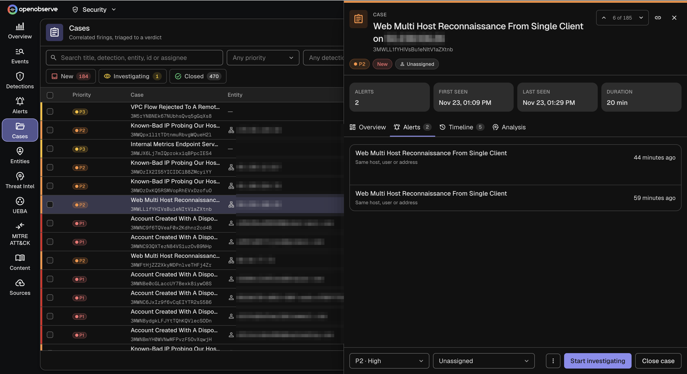

# Cases

A case groups related detection firings about the same host, user, or IP address so you triage them once, to a verdict. Cases open automatically when detections fire. Open **Security** > **Cases**.

Cases are Security [incidents](../analytics/incidents/index.md), so they need the Incidents license feature and incident correlation enabled (`O2_INCIDENTS_ENABLED`, on by default).

## How firings become cases

When a detection fires, OpenObserve picks the entity to key the case on from the rule's log source and ATT&CK tactics, so the case is about the attacker side:

- **Endpoint** rules key on the host first, then the user, then the IP address.
- **Identity** rules key on the user first.
- **Network** rules key on the IP address, then the user.
- **Credential access** rules outside cloud and endpoint sources key on the source IP address first.
- **Exfiltration and collection** rules key on the user, then the IP address.
- **Correlation** rules key on their group-by column first.

When the preferred field is empty, the next one is used. One firing can name several entities, so it can feed several cases: one per entity, up to 50.

Placeholder values such as `unknown`, `-`, `system`, and `localhost` are ignored.

A firing joins the most recent open case with the same detection and entity whose latest activity, by event time, is within the **group window** (120 minutes by default). Otherwise it opens a new case. The same Sigma rule running on several streams shares one case per entity; rolled-up cases are per detection. When its own detection has no open case for the entity, a P1 or P2 firing can join another detection's open case on the same entity, and any firing can join another detection's open P1 or P2 case on that entity, so a high-severity chain lands in one place.

By default, P3 and P4 firings (after any priority raise below) roll up into one case per detection rather than one per detection and entity, which keeps low-severity noise in a few cases. P1 and P2 firings always get a case per detection and entity.

### Priority

A case's priority starts from the detection's Sigma level, unless the alert has its own priority set: critical → **P1 · Critical**, high → **P2 · High**, medium → **P3 · Medium**, low and informational → **P4 · Low**. OpenObserve then raises it one step for each of these factors, by at most two steps:

- **Privileged**: the entity is an admin account, a member of a **Privileged account** or **Critical host** allowlist, or looks like a domain controller; or an admin grant came from an external IP address that is not on a **Known egress** allowlist. These count as one step together.
- **Multi-stage**: three or more detections, or three or more ATT&CK tactics, across the entity's open cases.
- **Threat intel**: the detection's query reads a threat-intel list, so every firing of that rule gets this step.

The privileged and multi-stage steps need an entity, so they never apply when the group window is 0.

## The case list

By default the list shows **New** and **Investigating** cases. Text search scans the latest 5,000 matching cases. Filter by text (title, detection, entity, ID, or assignee), **Priority**, **Detection**, assignee (including **Unassigned**), and entity, or turn on **Show closed**.

| Column | Shows |
| --- | --- |
| **Priority** | P1 to P4. |
| **Case** | The title and ID. **Updated** means another detection joined an assigned or **Investigating** case since you last opened it; updated cases sort first. **Historical (backfill)** means every firing in the case came from a backfill. |
| **Entity** | The hosts, users, and IP addresses the case names. |
| **Status** | **New**, **Investigating**, or **Closed**. |
| **Alerts** | The number of firings. |
| **Assignee** | The analyst, or **Unassigned**. |
| **First seen** / **Last seen** | First and latest activity. **First seen** is hidden by default. |

**Updated** tracking is kept in your browser, so it is per user and per browser.

## Work a case

Click a case to open it.

| Tab | Shows |
| --- | --- |
| **Overview** | **Detections in this case**, with how many times each fired, and **Affected entities**. |
| **Alerts** | Every firing, newest first, with why it was correlated into this case (**Same detection**, **Same host, user or address**, and so on). Expand a firing to see its evidence rows, filtered to this case's entities by default. |
| **Timeline** | Everything that happened: opened, fired, priority changes, status changes, assignments, notes, verdicts, merges. Post a note for the team here. |
| **Analysis** | An AI summary of what connects the firings. Click **Analyze** to run it (needs the Update permission). Needs AI analysis to be set up; see [Prerequisites](index.md#prerequisites). |

With the Update permission on Security, the footer lets you set the priority, assign the case, and move it through its lifecycle:

| Status | Actions |
| --- | --- |
| **New** | **Start investigating**, **Close case** |
| **Investigating** | **Close case**, **Reopen** |
| **Closed** | **Reopen** |

**More actions** has **Close as benign and suppress** (which preselects 24 hours), **Suppress similar**, and **View firings**, which opens Alerts filtered to the case's top detection over the case's time range.

## Close a case

Click **Close case** and choose:

- **Verdict** (required): **True positive**, **False positive**, **Benign**, **Duplicate**, or **Stale / historical**.
- **Reason** (required): what you found and why the case can close, up to 2,000 characters.
- For a **Benign** verdict, optionally **Suppress similar alerts** for 1 hour, 4 hours, 24 hours, 3 days, or 7 days.

Cases do not close on their own when a detection stops firing. They close automatically only if you set **Close quiet cases after (days)** in [case settings](#case-settings).

## Suppress similar alerts

When a case is about a known-good entity, suppress it instead of tuning the rule. **More actions** > **Suppress similar** drops new firings of the case's detections (up to 20) on the case's host, user, or IP address, or on each entity a rolled-up case absorbed (up to 20), for **1 hour**, **24 hours** (default), **7 days**, or **30 days**. Add a reason, and optionally tick **Also close this case as benign**.

Suppressing for up to 7 days needs the Update permission on Security; 30 days needs Create. Ending a suppression needs Delete. A case that names no host, user, or IP address cannot be suppressed; close it and add an [exception](detections.md#exceptions) to the detection instead.

Active suppressions are listed under **Suppressions** on the Cases page (needs the Update permission) and under **Detections** > **Tuning** > **Suppressions**.

## Bulk actions and merging

Select cases to **Close**, **Close and suppress**, **Assign**, set **Priority**, or **Merge**. When you select a full page, you can select every matching case, up to 1,000. P1 and P2 cases are left out of a select-all, and stay open in a bulk close, unless you explicitly include them.

**Merge** moves the firings of 2 to 101 selected cases into the one you choose to keep, which must be open. The others close as **Duplicate**, and the kept case takes the most urgent priority.

## Case settings

Users with the Delete permission on Security can open **Case settings** (the gear icon):

| Setting | Default | Range | Effect |
| --- | --- | --- | --- |
| **Close quiet cases after (days)** | 0 | 0 to 365 | A case with no new firing for this many days closes on its own. 0 keeps cases open. |
| **Group firings within (minutes)** | 120 | 0 to 43,200 | Activity on the same host, user, or address within this many minutes of a case's latest activity joins that case. 0 opens one case per detection and turns off entity keying, roll-up, cross-detection joins, and the privileged and multi-stage priority raises. |
| **Roll up P3/P4 firings into one case per detection** | On | | P1 and P2 firings still open a case per detection and entity. |
