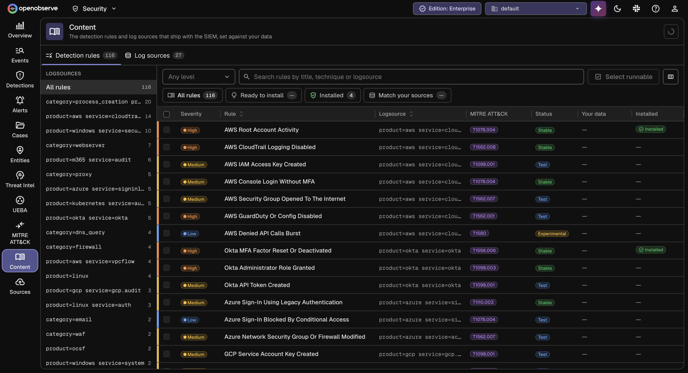

# Content

**Content** lists the detection rules and log sources that ship with OpenObserve, set against your own data. Open **Security** > **Content**.

## Detection rules

OpenObserve ships 116 Sigma rules: 95 single-event rules and 21 correlation rules. They cover AWS CloudTrail, Windows process creation and Security logs, web servers and proxies, Kubernetes audit, Microsoft 365, Okta, Entra ID, Google Cloud audit, DNS, Linux, firewalls, email, GitHub, and more.

Pick a logsource on the left to filter by it. Filter by level, search by title, technique, or logsource, or click the tiles:

| Tile | Shows |
| --- | --- |
| **Ready to install** | Rules that run on at least one stream of the source they were written for, and are not installed yet. |
| **Installed** | Rules installed as at least one detection. |
| **Match your sources** | Rules for a log source you have, installed or not. |
| **All rules** | The whole catalog. |

Each rule shows its severity, logsource, ATT&CK techniques, Sigma **Status** (**Stable**, **Test**, **Experimental**, **Deprecated**, or **Unsupported**), which of your streams it matches, and whether it is installed. A rule marked **Other sources only** compiles on your streams only through shared field names and is not counted as ready. **Not runnable yet** shows why it cannot compile yet.

Click a rule to see its description, techniques, known false positives, references, and YAML. The **Your data** tab lists each of your streams it applies to, with **Open in Events** and **Install on this stream**.

## Install rules in bulk

With the Create permission on Security:

1. Select rules, or click **Select runnable** to select every rule shown that runs on your data and is not installed.
2. Click **Install selected**.
3. Choose the settings for all of them: the streams (every stream each rule runs on, or one stream), the **Alert folder** (default **Security Detections**), **Notify (optional)**, **Look back** and **Run every** (15 minutes each), **Stay quiet for** (30 minutes), and whether to **Also check past data on the first run**.
4. Leave **Learn from current data first** on (the default) to record what already matches on each detection's first run as a baseline instead of opening cases. Later matches open cases as usual. This keeps a fresh install from flooding Cases with old activity. Turning on **Also check past data on the first run** turns this off, so the first run opens cases for what it finds in history.
5. Review the plan. Rules written for a different source than the stream was identified as start unticked.
6. Click **Install {n} detections**.

Installs run four at a time. Keep the tab open until they finish; if you close it, Content offers to **Resume** them for 24 hours. A rule whose detection name already exists is skipped, and one that fails to compile on its stream is marked **Failed** with the reason.

When the install finishes, set up [allowlists](detections.md#allowlists) for your ETL hosts, VPN egress, jump hosts, and scanners before the new detections start firing on them.

When new rules become runnable on a stream, for example after you ingest a new source, Content tells you with **{n} new rules can now run on {stream}** and a **Review** link.

## Log sources

The **Log sources** tab lists the 27 source types OpenObserve can identify, with vendor, OCSF class, Sigma logsource, number of rules, and which of your streams match. Click **Found in your data** to see only sources you have.

Click a source to see:

- **Your streams**: each matching stream, with **Open in Events**. If none match, it lists the fields a stream needs to be identified as this source.
- **Detection rules**: the rules written for it.
- **Field mapping**: how the source's fields map onto the normalized columns every Security page reads. The first field present on a row wins.

See [Data sources and OCSF](data-sources.md) for how streams are identified.
