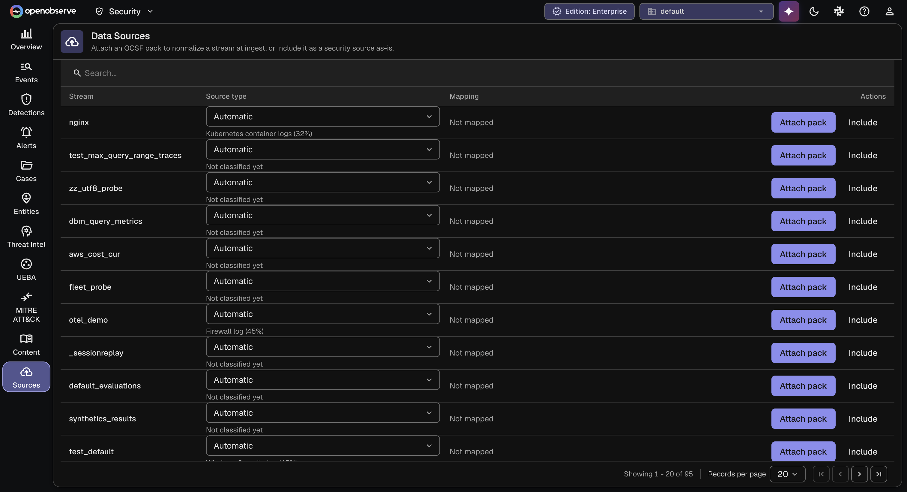

# Data sources and OCSF

Security reads the logs streams you already have. A stream becomes a **security source** when OpenObserve recognizes it as security data or when you include it by hand. Security sources are what the Overview, Events, Entities, UEBA, Threat Intel, and detection pages work over.

Open **Security** > **Sources**. The **Data Sources** page lists the logs streams you can read, with their source type, its mapping, and the actions you can take on it.

## How streams are classified

OpenObserve compares each logs stream's fields and values against 27 built-in source types:

- **Cloud and SaaS**: AWS CloudTrail, AWS VPC Flow Logs, Microsoft Entra sign-ins, Azure Activity, Microsoft 365 audit, Google Cloud Audit, GitHub audit, Okta System Log, Kubernetes audit.
- **Endpoint**: Windows Security log, Sysmon, Sysmon process creation, EDR telemetry, Linux auditd, Linux authentication (sshd, sudo).
- **Network and web**: Firewall log, Zeek connection log, IDS/IPS alert, DNS query log, Web server access log, Proxy access log, Web application firewall, Email security gateway.
- **Other**: OCSF (native), and the telemetry-only types Kubernetes container logs, Syslog, and Application logs. Telemetry-only types are recognized but are not treated as security data on their own.

Each type is defined by required fields, signal fields, fields that must be absent, characteristic values, and line formats. The result is a confidence score, shown under the stream as the source type and a percentage, for example **Windows Security log (45%)**.

| Confidence | Verdict |
| --- | --- |
| 70% or more, with the required fields filled and values seen | Selected automatically. The stream becomes a security source. |
| 50% or more otherwise | Suggested. It appears under **Suggested** in the Events sidebar for you to add or dismiss. |
| Below 50% | Ignored. |

Classification runs when a user with the Create permission on Security opens the Overview, Events, or Sources page, once per browser session. It samples up to 30 recent rows from up to 40 streams that user can read and that still need classifying, busiest first, and skips internal streams. A stored verdict is replaced only by a new one that is more than 5 points more confident, so classifications do not flicker. Users without the Create permission see the results but do not trigger classification.

A stream is a security source when it has not been excluded and any of these is true:

- It was selected automatically.
- You included it.
- You set its source type by hand (to a type that is not telemetry-only).
- An OCSF pack is attached to it.

## Columns

| Column | Shows |
| --- | --- |
| **Stream** | The logs stream. |
| **Source type** | **Automatic** (the classifier decides) or a source type you picked. Underneath: the detected type and its confidence, **(set by hand)**, **(from the attached pack)**, or **Not classified yet**. |
| **Mapping** | **Mapped {pack}**, **Included (not mapped)** (a security source without a pack, whether included by hand or selected automatically), **Excluded**, **Suggested: {type}**, or **Not mapped**. Hover to see who made the last change and when. |
| **Actions** | **Attach pack**, **Include**, **Exclude**, or **Detach**, depending on the stream's state and your permissions. |

## Set the source type by hand

If the classifier picks the wrong type, or none, choose the correct one from the **Source type** list (needs the Create permission on Security and read access to the stream). The classifier will no longer change it. Picking a telemetry-only type for a current security source removes it as a source, so that needs the Delete permission. Choose **Automatic** to hand the stream back to the classifier.

The source type decides which Sigma rules apply to a stream and how its fields are read across Security, so getting it right matters more than the pack.

## Include or exclude a stream

- **Include** adds the stream as a security source as-is, without mapping it. Needs the Create permission on Security and read access to the stream.
- Including a stream, attaching a pack, or setting a source type by hand turns on **index all values** for the stream, which increases its index storage.
- **Exclude** removes an unmapped security source from Security, whether it was included by hand or selected automatically, and keeps the classifier from adding it back. Needs the Delete permission on Security.

You can also add a stream from the **Events** sidebar with **Add a stream as a source**, or accept a suggestion with **Add as a source**.

:::note[Note]
A user with read access to Security can read the streams that were explicitly chosen as security sources (included, pack attached, or source type set by hand) without a separate stream permission. A stream that was only selected by the classifier still needs a stream grant.
:::

## Attach an OCSF pack

An OCSF pack normalizes a stream to [OCSF 1.6.0](https://schema.ocsf.io) at ingest by adding OCSF columns to every record. Detections, Events, and the entity pages work without a pack, but a pack gives every source the same column names and lets OCSF-native Sigma rules run on the stream.

OpenObserve ships packs for AWS CloudTrail, AWS VPC Flow, Cloudflare WAF, CrowdStrike FDR, Entra ID sign-ins, GitHub audit, Kubernetes audit, Linux auth, Microsoft 365 audit, Nginx access, Okta System Log, Palo Alto firewall, Proofpoint email, syslog, Windows Security, Sysmon, and Zscaler web, plus a generic **entity** pack. A stream is offered the full pack that matches its source type, or the entity pack when there is none.

Attaching a pack needs the Create permission on Security, read access to the stream, permission to create functions and to create and edit pipelines, and edit access to the stream's existing pipeline, if any. Attaching also includes the stream as a security source.

1. On the stream's row, click **Attach pack**.
2. Review the preview. Nothing is written until you confirm. It shows:
    - **Pack**: the pack name and version.
    - **OCSF class it writes**: the OCSF classes the pack produces.
    - **Function**: the VRL function it creates (`ocsf_<pack>_v<version>`, or `ocsf_entity_v<version>_<stream>` for the entity pack), or an identical one it reuses.
    - **Pipeline**: a new realtime pipeline named `ocsf-<stream>` that reads the stream, runs the function, and writes back to the same stream. If the stream already has a pipeline, the function is added to it right after the source instead.
3. Click **Attach**. The row updates when the function and pipeline are in place.

Every pack fills `class_uid`, `class_name`, `category_uid`, `category_name`, `activity_id`, `activity_name`, `type_uid`, `severity_id`, `severity`, `status_id`, and `o2_ocsf_pack` when a record does not already have them. Only new data is normalized; records ingested before you attached the pack are not rewritten.

OpenObserve refuses to attach a pack when:

- The stream's existing pipeline is disabled, or routes rows only to other streams.
- The stream's flatten level differs from the global one, or the global flatten level is 1 or 2 and would not keep the OCSF columns flat.
- The stream has a user-defined schema that lacks the OCSF columns.
- The stream's pipeline already runs a different pack or another version of the same pack, or a function with the pack's name exists but was edited.
- You cannot edit the stream's existing pipeline.

When a newer version of an attached pack ships, the **Mapping** column says so. Detach and attach again to move to it.

### Detach a pack

Click **Detach** (needs the Delete permission on Security and permission to edit or delete the pipeline). If Security created the `ocsf-<stream>` pipeline and it is unchanged, OpenObserve deletes the pipeline; if the pack was added to an existing pipeline, it removes just that step. The pack's function is deleted when nothing else uses it and you may delete functions. If someone changed the pipeline since, so it no longer exists, reads another stream, or runs a different pack, OpenObserve leaves it alone and tells you why.

Because attaching included the stream, it stays a security source after a detach until you exclude it. A source type set by a full pack stays as **(set by hand)**.

If you can read pipelines, the page also warns when a pack was removed outside Security, when a pack is attached without a record, when a pipeline no longer writes to its stream, or when a pipeline is disabled and nothing is being mapped.

## Source health

Each security source reports a health state, shown on the Overview and in the Events sidebar:

| State | Meaning |
| --- | --- |
| **Reporting** | The newest event is less than 24 hours old. |
| **Silent for over 24 hours** | The newest event is more than 24 hours old. Counted in the Overview's **Silent sources** tile. |
| **No data yet** | The stream has no documents. |
