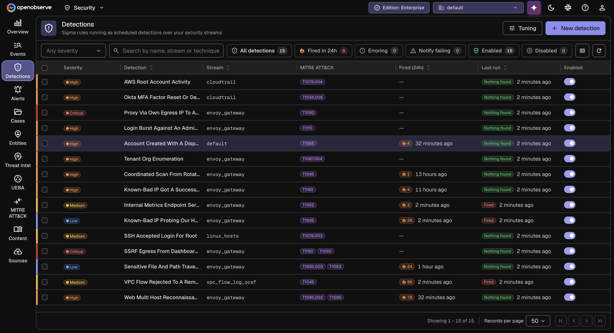
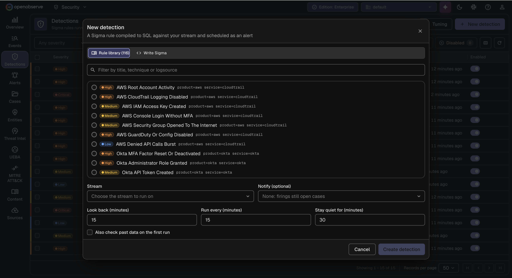

# Detections

A detection is a [Sigma](https://sigmahq.io/docs/basics/rules.html) rule compiled to SQL for one stream and run as a scheduled alert. Each time it finds matching rows, the firing is recorded in [Alerts](alerts.md) and opens or joins a [Case](cases.md). Notifying a destination is optional.

Open **Security** > **Detections**. The page lists only Security detections; regular alerts stay under **Alerts** in Observability.

## How a detection runs

- A detection is an ordinary scheduled alert marked as a Security detection. It is saved in the alert folder **Security Detections**, which is created on first use. If you cannot create folders, it is saved in **default**.
- Each run searches the look-back window plus 20 minutes before it by default, so late-arriving events are still evaluated (`O2_SIEM_DETECTION_LOOKBACK_SECS`). Rows that already fired are de-duplicated by fingerprint, so the overlap does not fire twice. Each detection remembers up to 5,000 fingerprints (`O2_SIEM_DETECTION_DEDUP_MAX_ROWS`).
- After downtime, or when a detection is turned back on, it fills the missed gap, up to 24 hours (`O2_SIEM_DETECTION_BACKFILL_HOURS`).
- A detection's evaluation never pauses, whatever its quiet period, so every match is evaluated and reaches Alerts and Cases.
- A rule's Sigma `level` sets the firing's severity and the case's starting priority: critical → P1, high → P2, medium → P3, low and informational → P4. A rule with no level is treated as medium. See [Cases](cases.md#priority) for what can raise it.

## The detections list

The toolbar has a severity filter, a search box (name, stream, or ATT&CK technique), and tiles that filter the list: **Fired in 24h**, **Erroring**, **Notify failing**, **Enabled**, **Disabled**, and **All detections**.

| Column | Shows |
| --- | --- |
| Severity | The rule's level. |
| **Detection** | The detection name. |
| **Stream** | The stream it runs on. |
| **MITRE ATT&CK** | The first two techniques, then a count of the rest. |
| **Schedule** | "Every N m over N m". Hidden by default. |
| **Fired (24h)** | Firings in the last 24 hours. |
| **Last run** | The last outcome and when, or **Not run yet**. |
| **Enabled** | A switch to turn the detection on or off. The **Enabled** tile counts detections that are on and healthy. |

A row tinted red is **Erroring**: its last run failed. A row tinted amber is **Notify failing**: it fired but the notification could not be delivered.

With the Create permission, select rows to **Enable** or **Disable** them in bulk; with the Delete permission you can also **Delete** them. Deleting a detection stops it immediately. Its cases and alert history stay.

### Detection details

Click a detection to open it.

| Tab | Shows |
| --- | --- |
| **Overview** | The description, MITRE tactics and techniques, logsource, source type, Sigma rule ID, notification destinations, quiet period, owner, and the last error. |
| **History** | Every evaluation in the last 7 days, up to 200, with its outcome: **Fired**, **Error**, **Nothing found**, **Fired · notification failed**, or **Skipped**. |
| **Sigma rule** | The rule's YAML. |
| **Query** | The compiled SQL. |
| **Exceptions** | Exceptions on this detection. See [Exceptions](#exceptions). |

The footer has **View matches in Events** (opens Events in SQL mode with the rule's predicate over its look-back), **Edit**, **Enable** or **Disable**, and **Delete**.

## Create a detection

You can start a detection from **Detections** > **New detection**, from a rule in [Content](content.md), from a technique in [MITRE ATT&CK](mitre-attack.md), or from **Create detection** in [Events](events.md#what-openobserve-detected).

1. Choose the rule:
    - **Rule library** (default) lists the Sigma rules that ship with OpenObserve. Filter by title, technique, or logsource. A rule that applies to the stream but cannot compile on it yet is marked **Not runnable yet**, with the reason.
    - **Write Sigma** opens an editor with an example rule. Paste or write your own.
2. Pick the **Stream** to run on. Only logs streams are listed.
3. Optionally choose destinations under **Notify (optional)**. With none, firings still land in Alerts and open cases.
4. Set the schedule:

    | Field | Default | Rule |
    | --- | --- | --- |
    | **Look back (minutes)** | 15 | At least 1, at least **Run every**, and for correlation rules at least the correlation window. |
    | **Run every (minutes)** | 15 | At least 1. |
    | **Stay quiet for (minutes)** | 30 | 0 or more. The quiet period after a firing. |
    | **Also check past data on the first run** | Off | Searches the **Last hour**, **Last 6 hours**, or **Last 24 hours** (default) on the first run. Capped by `O2_SIEM_DETECTION_BACKFILL_HOURS`; setting that to `0` removes the option. |

5. Check the compile result. OpenObserve compiles the rule against the stream as you type and shows either **Compiles against {stream}** with the compiled `WHERE` clause, or **Will not run on {stream}** with the reason, such as unsupported features or fields the stream does not have. It also warns when the rule is written for a different source than the stream was identified as.
6. Optionally click **Preview on history**. The preview runs the rule over the **Last hour**, **Last 24 hours** (default), or **Last 7 days** the way the scheduler would, and shows how many events matched with a sample. For correlation rules it shows the windows that would have fired; the scheduler evaluates at most 288 windows per run, so a long correlation preview may start later than the range you picked. The preview is unavailable while the rule reads fields the stream has not seen yet.
7. Click **Create detection**.

The detection name is the rule title followed by the stream, with whitespace and the characters `: # ? ' " % & / \` replaced by `_` and capped at 100 characters, for example `AWS_Root_Account_Activity__cloudtrail`. The dialog refuses a name that any alert in the org already uses.

Before saving, OpenObserve checks that the compiled query runs. If the rule reads fields the stream has not seen yet, OpenObserve says so and adds those columns to the stream's schema when you create the detection, so the rule is ready when the data arrives.

### Edit a detection

Click **Edit** in the detection drawer. The rule, stream, and schedule are recompiled and saved together. The detection keeps its name, history, and cases, even if you change the stream. A detection that has no Sigma YAML stored cannot be edited here.

Through the regular alerts API, you can change only a detection's notification settings, such as destinations, owner, and enabled state, and that needs the Create permission on Security. Every other change goes through Security.

## Supported Sigma

OpenObserve compiles Sigma rules to SQL itself. String matches are case-insensitive, except `re` (case-sensitive unless combined with `i`) and `base64offset`.

| Area | Supported |
| --- | --- |
| Modifiers | `contains`, `startswith`, `endswith`, `all`, `re`, `i`, `cidr`, `lt`, `lte`, `gt`, `gte`, `exists`, `windash`, `fieldref`, `base64offset` |
| Conditions | `and`, `or`, `not`, `1 of`, `any of`, `all of`, `N of`, `them`, and wildcard selection names such as `selection_*`. A list of conditions is combined with OR. |
| Keyword searches | Bare strings search the source's full-text columns, or `message`, `log`, `msg`, `body`, `raw`, and `_raw`. |
| Correlation rules | `event_count`, `value_count`, `value_sum`, `temporal`, `temporal_ordered`, and an OpenObserve extension, `time_coverage`. Timespans round up to whole minutes. |

A rule does not run when it uses:

- An unsupported modifier, or `fieldref` combined with another modifier, or `base64offset` without `contains`.
- The legacy `| aggregation` condition syntax, or `near`.
- Regular expressions with lookaround or backreferences.
- IPv6 or invalid CIDR ranges, or `gt`/`lt` on a non-numeric value.
- A keyword search on a stream with no full-text field, or `not` over a field the stream does not have.
- A condition that would match every row, or a rule that reads none of the stream's fields.
- A stream of unparsed raw lines. Attach an OCSF pack to it first.

Rules are mapped to each source type's field names. On OCSF-native streams, rules for process creation, file events, network connections, firewalls, DNS, web and proxy traffic, and AWS CloudTrail compile through the OCSF field map. Rules with `product: ocsf` run only on OCSF-native or pack-attached streams.

## Tune detections

There are three ways to stop known-good activity from firing:

| Tool | Scope | Where |
| --- | --- | --- |
| [Exceptions](#exceptions) | One detection, matched on a field. The rule itself is unchanged. | Detection drawer > **Exceptions** |
| [Allowlists](#allowlists) | Org-wide named lists of known-good values, used by exceptions and by case priority. | **Tuning** > **Allowlists** |
| [Suppressions](#suppressions) | One host, user, or IP address, for a limited time. | Created from a case |

### Exceptions

Rows that match an exception are dropped before the detection fires. Open a detection, go to **Exceptions**, and click **Add exception** (needs the Create permission on Security; removing one needs Delete).

| Field | Values |
| --- | --- |
| **Field** | Any field in the stream. |
| **Match** | **equals** (default), **contains**, **starts with**, **ends with**, **is in range (CIDR)**, or **is in allowlist**. All are case-insensitive. |
| **Values** | 1 to 50 values, one per line or comma-separated, each up to 512 characters. For **is in allowlist**, pick one or more allowlists instead. |
| **Why this is safe** | Required, up to 1,000 characters. |
| **Expires** | **Never**, or in 1, 7, **30** (default), or 90 days. |

A row that does not have the field never matches an exception. Each detection holds up to 100 exceptions, and an org up to 2,000; expired exceptions still count until you remove them. All tuning data together is limited to 1 MB per org.

An exception is added to the detection's SQL as a `NOT` clause on its `SELECT ... FROM <stream>`. OpenObserve refuses an exception when the detection's SQL has no simple select from its stream to attach it to, as with some correlation queries. If the detection changes later so it can no longer carry an existing exception, the exception is marked **Not enforced on N detections**; matching rows are still dropped from its results after the query runs.

### Allowlists

Allowlists are named lists of known-good addresses, accounts, and hosts. Exceptions match against them with **is in allowlist**, and case priority reads the **Privileged account**, **Critical host**, and **Known egress** lists. Open **Detections** > **Tuning** > **Allowlists** and click **Add allowlist** (needs the Create permission on Security; deleting needs Delete).

| Field | Values |
| --- | --- |
| **Name** | Required, up to 128 characters. |
| **ID** | 1 to 64 lowercase letters, digits, `_`, or `-`. Cannot be changed later. |
| **Purpose** | **Known egress** (default), **Scanner**, **Service account**, **Privileged account**, **Critical host**, or **Other**. |
| **Values** | Up to 1,000, one per line, each up to 512 characters. Known egress and Scanner values must be IP addresses or CIDR ranges. |
| **Description** | Up to 1,000 characters. |

An org can have up to 50 allowlists. You cannot delete an allowlist that an exception still uses.

After installing rules in bulk, set up allowlists for your ETL hosts, VPN egress, jump hosts, and scanners first; they are the most common source of noise.

### Suppressions

A suppression drops new firings of a case's detection on one host, user, or IP address until it ends. Suppressions are created from a case, with **Suppress similar** or **Close as benign and suppress**. See [Cases](cases.md#suppress-similar-alerts).

**Detections** > **Tuning** > **Suppressions** lists the active suppressions, soonest to end first, with the entity, the detection (or **All detections**), the reason, and who created it. Click **End** to lift one early (needs the Delete permission on Security). An org can have up to 1,000 suppressions. With the Update permission a suppression lasts at most 7 days and covers one detection; with Create it can last up to 30 days or cover all detections.
