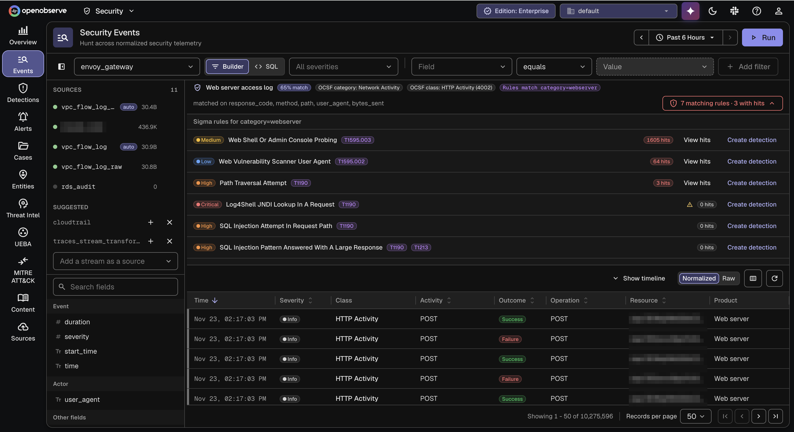
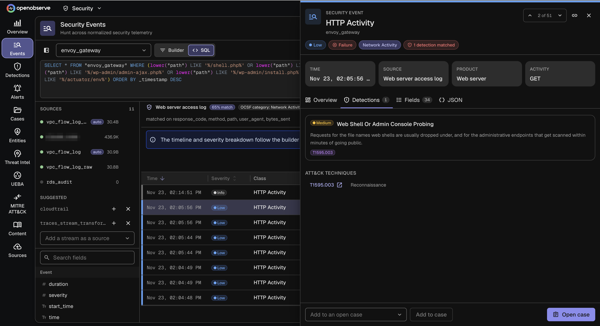

# Events

**Security Events** is where you hunt. It searches one security stream, or every security source at once, shows each record mapped onto OCSF columns, and tells you which Sigma rules apply to the source and which of them match.

Open **Security** > **Events**.

## Pick a stream and a time range

- The stream picker groups streams into **Security streams** and **Other streams**. The first entry, **All security sources**, starts a [cross-source hunt](#search-every-source-at-once).
- Opening Events without a link restores your last view in this browser: stream, time range, mode, query, and filters. On a first visit it picks the security source with the newest data and the last 15 minutes. Searches run automatically when the view changes; **Run** runs again. The button becomes **Cancel** while a search runs, and cancelling also stops the query on the server.

The whole view, including stream, time, mode, query, and filters, is kept in the URL, so you can share a hunt by copying the link.

## Builder and SQL

Switch between **Builder** and **SQL** in the query bar.

**Builder**

- Pick a **Field**, an operator (**equals**, **not equals**, **contains**, **not contains**), and a **Value**. The value list loads the top 50 values for the field, and you can type your own. Click **Add filter**.
- Filters appear as chips. Click a chip's toggle to switch it between include and exclude, or remove it. **Clear all** removes every filter.
- When the stream carries a severity, a severity filter appears: **Fatal**, **Critical**, **High**, **Medium**, **Low**, **Info**, **Unknown**, and **Other**.

**SQL**

- Switching to **SQL** fills the editor with the builder's query, unless you already edited the SQL, so you can start from what you built.
- The timeline and severity breakdown follow the builder filters only; switch back to **Builder** to see them.
- If your SQL reads a different stream, the stream picker follows it.
- Sorting from column headers is off in SQL mode, because a hand-written query sets its own `ORDER BY`.

## Fields sidebar

The sidebar lists the stream's fields, grouped as **Event**, **Actor**, **Source endpoint**, **Destination endpoint**, **Connection**, **HTTP**, **Process and file**, **Cloud and API**, **Finding**, **Device**, **Metadata**, and **Other fields**. Click a field to see its top 10 values in the window, with buttons to include or exclude each value. In SQL mode these are counted over the whole stream, not your query. **Show as column** adds a field to the table and switches it to **Raw**.

Above the fields, the sidebar also manages sources:

- **Sources**: the security sources, each with its health and document count. An **auto** tag means the stream was selected by its source type rather than included by hand. With the Delete permission on Security, **Remove from sources** takes a stream out. On a stream with a pack attached, this excludes it but leaves the pack's pipeline running; detach the pack on the Sources page as well.
- **Suggested**: streams that look like security data, five at a time with **Show N more**. Click **Add as a source** (needs the Create permission) or **Dismiss**. Dismissals are remembered in this browser only.
- **Add a stream as a source**: include any logs stream. See [Data sources and OCSF](data-sources.md).

## What OpenObserve detected

Above the results, a bar describes the selected source: its type and match percentage (hover to see expected fields that are missing), product, OCSF category and class (from `class_uid` over the last hour), and the OCSF objects that have columns. **Rules match {logsource}** names the Sigma logsource that detections are matched against.

The detections button shows how many catalog rules apply to the source. Expand it to load hit counts for the current window and see each rule, its severity, and techniques, with:

- **View hits** (when there are hits): switches to SQL with the rule's predicate, so you can see what it would match.
- **Create detection** (needs the Create permission): opens **New detection** with the rule, stream, and source filled in. See [Detections](detections.md#create-a-detection).

## Timeline and results

In **Builder** mode on a single stream with a readable severity, the timeline shows severity tiles (**Critical**, **High**, **Medium**, **Low**, **Info**, and **Unknown** when present) and a stacked chart of event volume. Click tiles to filter by severity. Streams without a severity get a plain volume chart. Drag across the chart to zoom into that time range.

The results table has two views:

- **Normalized**: every source mapped onto OCSF columns: **Time**, **Severity**, **Class**, **Activity**, **Outcome**, **Actor**, **Source IP**, **Destination IP**, **Host**, **Process**, **Operation**, **Resource**, **Product**, and **Message**. Columns with no data are hidden.
- **Raw**: the stream's own fields. Your column choice is remembered per stream.

Hover over a cell and use **Filter for value** or **Filter out value** to add it to the search. Results are paged 50, 100, or 250 at a time.

If a stream has no data in the selected range, Events tells you when it last reported and offers to search a wider period.

## Open an event

Click a row to open the event drawer.

| Tab | Shows |
| --- | --- |
| **Overview** | Entity cards for the actor, source, destination, host, process, operation, and resource, each with filter and copy actions, and how the source was classified. |
| **Detections** | Every runnable catalog rule for the source, checked against this one event. Matching rules are listed with their ATT&CK techniques. |
| **Fields** | Every field and value, searchable, with filter actions. |
| **JSON** | The raw record. |

### Open a case from an event

With the Update permission on Security, the drawer footer lets you turn an event into a case:

- **Open case** opens a dialog pre-filled from the event. **Title** defaults to the event type and entity. **Priority** defaults to the most severe matching rule (critical → P1, high → P2, medium → P3, low or informational → P4), or P3. Pick up to 10 **Entities** and add a **Note**.
- If open cases already name the event's entities, the newest one is preselected and the button reads **Add to case**. Choose **Open a new case** for a separate case. When adding to an existing case, only the **Note** is used.
- **Add to case** adds the event to a case you pick from **Add to an open case**.

## Search every source at once

Pick **All security sources** to hunt across every source in one search. Choose what you are looking for (**Any field**, **User**, **IP address**, or **Host**), type the value, and click **Search**. **Any field** matches the value exactly on each source's user, IP, and host columns, or as text inside the message; it does not search every column. Each source is searched with its own columns, so you do not need to know what each one calls a user or an IP address.

User searches match the account however the source writes it, so `dave` also finds `ACME\dave` and `dave@acme.local`. When you start a hunt from Entities or UEBA, the hunt also carries the other spellings that identity was seen with; a chip shows how many, and **Match only the name typed** drops them.

Results show **Time**, **Source**, **User**, **Source IP**, **Host**, **Action**, **Outcome**, and **Message**, with a count per source. Click a row to open that event in its own source.
