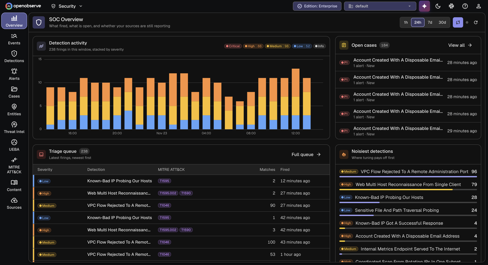

# Security

Security is OpenObserve's built-in SIEM. It finds the security logs you already ingest, normalizes them to [OCSF](https://ocsf.io), runs [Sigma](https://sigmahq.io) rules against them as scheduled detections, and groups the firings into cases that your team triages to a verdict. It runs on the same streams, alerts, and incidents as the rest of OpenObserve, so there is no second data store to feed.

:::info[Availability]
Security is available in OpenObserve Enterprise and Cloud. It is not part of the open-source build. On Enterprise, your license must include the **Security (SIEM)** feature; if it does not, the **Security** entry in the solution switcher shows a lock, and opening it shows the upgrade page. On Cloud, Security is marked **Alpha**.
:::

## Open Security

If you have read access to Security, use the **Solution** switcher in the header to move between **Observability** (logs, metrics, traces, dashboards) and **Security** (SIEM · OCSF · Sigma rules). Any page under `/security` opens in Security mode, and shared pages such as **Settings**, **IAM**, and alert destinations keep the mode you were in.

The Security rail has these pages:

| Page | What it is for |
| --- | --- |
| **Overview** | The SOC landing page: firings, open cases, triage queue, ATT&CK coverage, source health, and the change log. See [Overview](#overview). |
| **Events** | Hunt across security streams in a builder or in SQL. See [Events](events.md). |
| **Detections** | Sigma rules running as scheduled detections, and the tuning that quiets them. See [Detections](detections.md). |
| **Alerts** | Every firing and the evidence behind it. See [Alerts](alerts.md). |
| **Cases** | Firings correlated by entity, triaged to a verdict. See [Cases](cases.md). |
| **Entities** | Every user, IP address, and host your sources mention, with a risk graph. See [Entities and UEBA](entities-and-ueba.md). |
| **Threat Intel** | Known-bad indicators, and where they showed up. See [Threat Intel](threat-intel.md). |
| **UEBA** | Each user compared with their own recent past. See [Entities and UEBA](entities-and-ueba.md#ueba). |
| **MITRE ATT&CK** | Which techniques your detections cover, and which fired. See [MITRE ATT&CK](mitre-attack.md). |
| **Content** | The Sigma rules and log sources that ship with OpenObserve, set against your data. See [Content](content.md). |
| **Sources** | Which streams count as security sources, and their OCSF mapping. See [Data sources and OCSF](data-sources.md). |

## How it fits together

1. **Ingest** security logs into ordinary logs streams, the same way you ingest anything else: CloudTrail, Okta, Entra ID sign-ins, VPC Flow, Windows, Sysmon, firewalls, web servers, syslog, and so on.
2. **Classify.** When a user with the Create permission on Security opens the Overview, Events, or Sources page, OpenObserve samples recent rows from the streams that user can read and identifies each one's source type. Streams it is confident about become security sources automatically, and the rest are suggested. You can include, exclude, or override any stream on the [Sources](data-sources.md) page.
3. **Normalize (optional).** Attach an OCSF pack to a stream to add OCSF columns at ingest through a VRL function and a realtime pipeline.
4. **Detect.** Install Sigma rules from the catalog, or write your own. Each one is compiled to SQL for its stream and saved as a scheduled alert.
5. **Triage.** Every firing lands in **Alerts** and opens or joins a **Case** keyed on the host, user, or IP address involved.
6. **Investigate.** Pivot from a case or alert into **Events**, **Entities**, **UEBA**, and **Threat Intel**.

## Prerequisites

- **Cases** are built on [Incident Management](../analytics/incidents/index.md). They need the Incidents license feature and incident correlation, which is controlled by `O2_INCIDENTS_ENABLED` and defaults to `true`. If it is off, the Overview shows **Case management is not available on this deployment** and detections still fire into **Alerts**.
- The **Analysis** tab on a case uses incident AI analysis, which needs `O2_INCIDENTS_RCA_ENABLED=true` (the default), AI enabled with an agent configured, and the AI Assistant license feature.
- The **Change log** on the Overview reads the audit trail, so it needs `O2_AUDIT_ENABLED=true` (the default).
- Notifications are optional. A detection with no destination still records its firings and opens cases.

## Access and roles

Security has its own permission object, **Security (SIEM)**, in [role-based access control](../account-administration/identity-and-access-management/role-based-access-control.md). The HTTP method you grant on it decides what a user can do:

| Grant on Security | Lets a user |
| --- | --- |
| **Get / List** (read) | Open Security and see every page, detection, alert, and case. **Threat Intel** also needs read access to enrichment tables. Also read the logs streams someone explicitly chose as security sources (included, pack attached, or source type set by hand), without a separate stream grant. Streams the classifier selected on its own still need a stream grant. |
| **Update** (triage) | Acknowledge, assign, prioritize, note, close, merge, and bulk-update cases; open cases from alerts and events; run case analysis; suppress one detection on one entity for up to 7 days. |
| **Create** (author) | Create and edit detections, install content, add exceptions and allowlists, add threat-intel indicators, include streams as sources, attach OCSF packs, set a stream's source type, and create suppressions of up to 30 days or across all detections. |
| **Delete** (admin) | Delete detections, remove exceptions, allowlists, and threat-intel indicators, end suppressions, detach packs, exclude sources, and change case settings. |

Detections are also alerts and cases are also incidents, so the matching alert-folder and incident grants still apply. OpenObserve ships four role presets that bundle the right grants. An org admin can start a role from any of them under **IAM** > **Roles**:

| Preset | Grants |
| --- | --- |
| **Security Viewer** | See Security, its cases, detections, and explicitly chosen source streams without changing them. |
| **SOC Analyst** | Triage alerts and cases, with read access to detections, explicitly chosen source streams, and threat-intel lists. |
| **Detection Engineer** | Create, tune, enable, and run detections, install content, attach sources with their functions and pipelines, and maintain enrichment tables such as threat-intel lists. Reads cases but cannot triage them, and cannot delete detections, remove indicators, exceptions, or allowlists, or detach packs. Includes read access to all streams. |
| **Security Admin** | Manage all of Security, including deleting detections and cases and excluding sources, with incidents, functions, pipelines, enrichment tables, and cipher keys. Includes read access to all streams. |

A user without read access who opens a Security page sees a lock that names the preset they need. An org admin sees **Start a role from {preset}**, which opens a new role pre-filled from that preset. Controls a user cannot use are hidden, or disabled with a tooltip such as **Needs the Create permission on Security**.

Some guards apply outside the Security pages too. Detections also appear as alerts, but users without read access to Security do not see them in the regular alert list or history. Through the regular alerts API, a detection's notification settings (destinations, owner, enabled state) can be changed with the Create permission on Security, and it can be deleted with the Delete permission; any other change is refused and must go through Security. Deleting a stream that is a security source, deleting its data, shortening its retention (including through org retention defaults), or removing it as a source needs the Delete grant on Security. Writing to an enrichment table named `ioc_*` or `threat_intel*` needs the Create permission on Security, and deleting one needs Delete.

## Overview

The **SOC Overview** shows what fired, what is open, and whether your sources are still reporting. Pick a window of **1h**, **24h** (default), **7d**, or **30d**. The page refreshes every minute while the browser tab is visible; turn that off with the auto-refresh toggle.

**Stat tiles.** Each tile opens the page behind it.

| Tile | Counts |
| --- | --- |
| **Critical firings** / **High firings** | Firings in the window of detections at that Sigma level. Opens **Alerts** filtered to that level. |
| **Open cases** | Cases that are **New** or **Investigating**. |
| **Detections firing** | Distinct detections that fired at least once in the window. |
| **Silent sources** | Security sources whose newest event is more than 24 hours old. Opens **Events** on the first one. |
| **Active detections** | Enabled detections out of all detections. |

**Panels**, top to bottom:

- **Detection activity**: firings over the window, stacked by severity.
- **Open cases**: up to 50 New and 50 Investigating cases, highest priority first.
- **Triage queue**: the 50 latest firings, newest first. Click one to open it in **Alerts**, or click **Full queue**.
- **Noisiest detections**: the eight detections that fired most, which is where tuning pays off first.
- **MITRE ATT&CK coverage**: each of the 14 tactics with the number of enabled detections tagged with it and the number of firings in the window.
- **Log source health**: every security source with its document count and last event. A source is **Reporting**, **Silent for over 24 hours**, or **No data yet**. Click a source to open it in **Events**.
- **Change log**: who changed detections, sources, cases, and Security role grants. Each row shows when, who, the area (**Detection**, **Case**, **Source**, **Access**, or **Security**), the action, and **What changed**. **What changed** is the request path and body, cut to 2,000 characters. Refused attempts are listed too. Turn on **Include reads** to also see read-only actions such as searches, sweeps, and previews.

If you have no detections yet, the Overview says so and offers **Browse detections**.

## Keyboard shortcuts

In any Security detail drawer, press `j` for the next record and `k` for the previous one. Every drawer except the MITRE technique drawer also has **Copy link to this record**, so you can share the exact record you are looking at.

## Configuration reference

These environment variables tune Security on self-hosted Enterprise. All are read at startup.

| Variable | Default | Effect |
| --- | --- | --- |
| `O2_SIEM_DETECTION_LOOKBACK_SECS` | `1200` | How far before its window each detection run re-checks, so late-arriving events are still evaluated. Rows already alerted on are de-duplicated. |
| `O2_SIEM_DETECTION_BACKFILL_HOURS` | `24` | The longest gap a detection fills after downtime or being re-enabled, and the most history an opt-in backfill evaluates. `0` disables both. |
| `O2_SIEM_DETECTION_DEDUP_MAX_ROWS` | `5000` | How many row fingerprints each detection remembers, so the same row does not fire twice. |
| `O2_INCIDENTS_ENABLED` | `true` | Incident correlation. Cases need it. |
| `O2_INCIDENTS_RCA_ENABLED` | `true` | AI analysis of incidents and cases. |
| `O2_AUDIT_ENABLED` | `true` | The audit trail behind the Overview's change log. |

## Related

- [Building a SIEM platform with OpenObserve](../advanced/siem.md): the manual approach with pipelines, enrichment tables, and SQL alerts, for deployments without the Security solution.
- [Incident Management](../analytics/incidents/index.md)
- [Alerts](../analytics/alerts/index.md)
- [Enrichment tables](../data-processing/enrichment-tables/enrichment.md)
