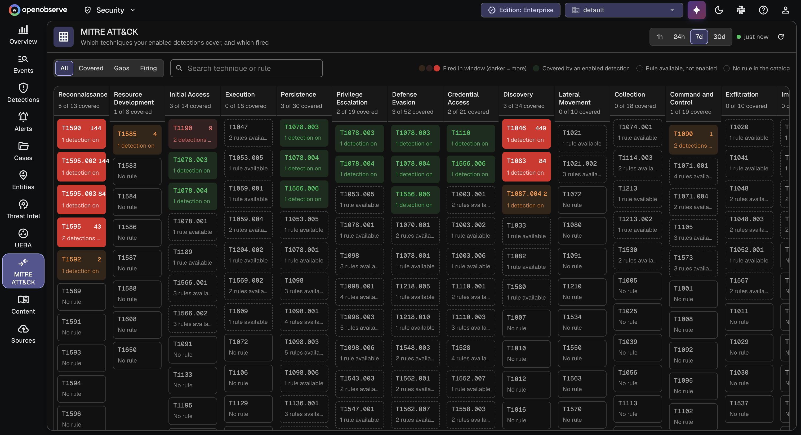

# MITRE ATT&CK

**MITRE ATT&CK** maps your detections onto the [MITRE ATT&CK Enterprise](https://attack.mitre.org) matrix, so you can see which techniques you cover, which fired, and where the gaps are. Open **Security** > **MITRE ATT&CK** and pick a window of **1h**, **24h**, **7d** (default), or **30d**.

Coverage is measured against the 216 parent techniques of ATT&CK Enterprise v18.1, across 14 tactics. A sub-technique counts toward its parent.

## Read the matrix

Each column is a tactic, with how many of its techniques are covered. Each cell is a technique, in one of four states:

| State | Meaning |
| --- | --- |
| **Fired in window** | A detection for this technique fired in the window. Darker means more firings: 1 to 4, 5 to 19, or 20 or more. |
| **Covered by an enabled detection** | You have an enabled detection for it. |
| **Rule available, not enabled** | A catalog rule or a disabled detection covers it. |
| **No rule in the catalog** | Nothing covers it. |

The tiles at the top count **Techniques firing**, **Coverage gaps** (techniques with no enabled detection), **Techniques covered**, and **Tactics covered**. Click one of the first three tiles, or use **All**, **Covered**, **Gaps**, and **Firing**, to filter the matrix. Search by technique ID or rule name. Technique IDs your detections carry that have no known tactic are listed under **Techniques without a known tactic**.

## Close a gap

Click a technique to open it:

- **Detections**: your detections for it, and catalog rules that are **Available in the catalog** but not installed. With the Create permission, click **Enable** on a catalog rule to open **New detection** with the rule selected. See [Create a detection](detections.md#create-a-detection).
- **Firings**: up to 50 detections that fired for it, newest first.
- **Reference**: a link to the technique on attack.mitre.org.
