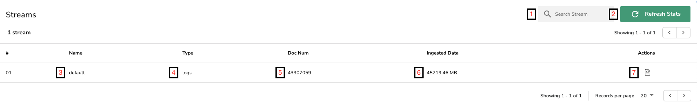
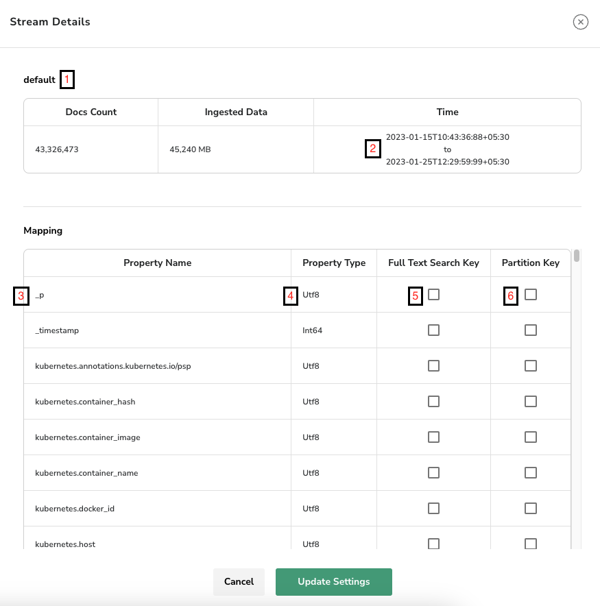

# Streams

:::note
For the current guides, see [Streams in OpenObserve](data-processing/streams/streams-in-openobserve.md), [Stream Details](data-processing/streams/stream-details.md), and [Schema Settings](data-processing/streams/schema-settings.md).
:::

A stream in OpenObserve is a sequence of events (logs, metrics, traces, and more), sharing the same source, for example logs from a specific application or from an enterprise.

To navigate to streams in OpenObserve , select preferred organization using organization selection control, then go to **Data** > **Streams** , which will take one to stream list screen. The screen lists all streams for selected organization.  

<kbd>

</kbd>

Streams screen details :

1. Search in listed streams
1. Refresh stats for listed streams , stats associated with streams include number of documents , ingested data size etc.
1. Name of the stream
1. Type of stream: logs, metrics, traces, profiles, or metadata
1. Number of documents/row belonging to the stream
1. Ingested data size for the stream in MB
1. Stream details control to open stream details page

To view details or to update stream settings click on stream details control on streams page

<kbd> 

</kbd>

Streams details screen:

1. Name of the stream
1. Start & end time for steam, these are based timestamps on log records in stream
1. Name of property/field belonging to the stream
1. Inferred type of the property, openobserve infers schema for data being ingested
1. Index type of the property, set on the **Schema Settings** tab: **Full text search** (used to search a term when using `match_all`), **Secondary index**, **Bloom filter**, or a partition (**KeyValue partition**, **Prefix partition**, **Hash partition**). Data ingested after updating the setting uses the new index types
